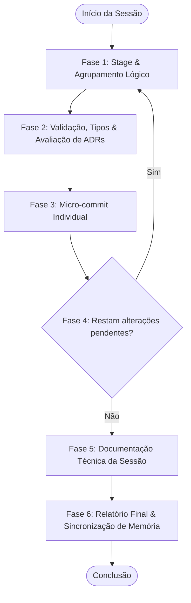
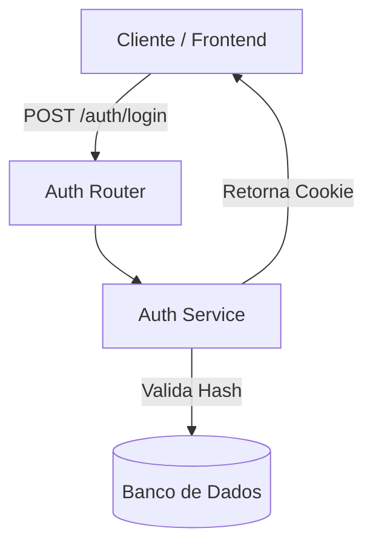

<!--
================================================================================
LOG DE MANUTENÇÃO E ALTERAÇÕES DO DOCUMENTO
--------------------------------------------------------------------------------
Data       | Autor          | Descrição da Alteração
--------------------------------------------------------------------------------
2026-08-06 | Matheus Diniz  | Criação do guia inicial cobrindo o fluxo de 6 fases
           |                | do /commit-e-documentar e Graphify.
2026-08-18 | Matheus Diniz  | Atualização e governança multi-repo e multi-agente.
           | (OpenClaude)   |
2026-08-31 | Matheus Diniz  | Integração da governança compulsória de ADRs (Architecture
           | (Antigravity)  | Decision Records) na Fase 2 conforme guia-padrao-criacao-adrs.md.
2026-08-31 | Matheus Diniz  | Generalização e desacoplamento arquitetural universal.
2026-09-09 | Eduardo Batista| v1.3.0 — Suprassumo autossuficiente dos fundamentais:
           |                | remoção de pastas voláteis e de convenções legadas; unificação
           |                | para arquitetura canônica Dual-Harness (.claude/, .gemini/,
           |                | .agents/); inclusão inline dos 6 Gatilhos de ADRs e
           |                | scripts de sincronização de memória prontos para uso.
2026-09-18 | Eduardo Batista| v1.4.0 — Seção de Heurísticas Executáveis (slug
           |                | harness-commit-memoria) consumida pelo /setup; prosa movida
           |                | para Fundamentos; scripts com fonte canônica em templates/.
2026-09-24 | Eduardo Batista| v1.5.0 — HARNESS-05/06 exigem CLAUDE.md/GEMINI.md no padrão
           |                | completo do template (todas as seções ##); convenção docs/ai/
           |                | (specs, plans, reports, sessions, chats) no template, no guia
           |                | e no /setup; HARNESS-11 cria docs/ai/reports/;
           |                | aprovação explícita obrigatória de specs e planos.
2026-09-25 | Eduardo Batista| v1.5.1 — HARNESS-05/06 preservam o conteúdo customizado do
           |                | projeto: templates/harness/merge_agent_md.py só acrescenta as
           |                | seções ## faltantes e o verify falha se alguma linha versionada
           |                | do CLAUDE.md/GEMINI.md sumir; o agente remove do texto inserido
           |                | o que duplica ou contradiz as instruções do projeto em
           |                | CLAUDE.md, .claude/CLAUDE.md, GEMINI.md e .gemini/GEMINI.md
           |                | (o projeto prevalece).
2026-09-27 | Eduardo Batista| v1.5.2 — HARNESS-04 migra skills locais (arquivo plano ou
           |                | pasta) para .agents/skills/<nome>/SKILL.md via
           |                | templates/harness/migrate_skills.sh, registra no git, para em
           |                | conflito sem apagar nada e o verify falha se o git registrar
           |                | deleção de skill sem cópia em .agents/skills; também promove
           |                | as skills planas .agents/skills/<nome>.md da v2.5.2, ignora .gitkeep,
           |                | adota a pasta canônica que o projeto já tinha (.claude/skills ->
           |                | ../skills), reaponta symlinks e não conta deleções anteriores ao setup.
2026-09-27 | Eduardo Batista| v1.5.3 — HARNESS-16 atualiza a cópia do verify_hooks.py quando ela
           |                | difere do template (cmp), para projetos da v2.6.0 passarem a acusar
           |                | executável por caminho inexistente e hook fora do schema.
2026-09-27 | Eduardo Batista| v1.5.4 — merge_agent_md.py tira do texto inserido os `make X` sem alvo no
           |                | Makefile e o --check acusa os que sobraram; linha que veio do template não
           |                | conta como conteúdo perdido; templates sem a linha do guia opcional do 1Password.
2026-09-28 | Eduardo Batista| v1.5.5 — HARNESS-16: a saída do do manda pular (--skip HARNESS-16) hook do
           |                | Graphify, que o GRAPH-04/05 troca, e perguntar ao usuário sobre os demais;
           |                | nunca editar hook à mão. merge_agent_md.py mantém os comandos de memória
           |                | que o HN3-09 cria depois.
2026-09-28 | Eduardo Batista| v1.5.6 — sync-claude-memory.sh e sync-memory.sh copiam os .md
           |                | sem rsync, que o Git Bash (Windows) não tem.
2026-10-14 | Eduardo Batista| v1.6.0 — AGENTS.md como instrução única: HARNESS-05 cria/semeia
           |                | AGENTS.md, HARNESS-06 enxuga CLAUDE.md para @AGENTS.md e absorve
           |                | GEMINI.md, HARNESS-08 aponta o Gemini via context.fileName.
           |                | Bloco na versão 5.
2026-10-14 | Eduardo Batista| v1.6.1 — HARNESS-05 manda comparar as linhas do GEMINI.md sob
           |                | headings que também existem no CLAUDE.md, acrescentar ao AGENTS.md
           |                | as que faltam e listá-las na saída final. Bloco na versão 6.
2026-10-14 | Eduardo Batista| v1.6.2 — HARNESS-08 silencia o stderr do `when` (settings ausente
           |                | é o estado "a instalar"); --migrate exige o GEMINI.md inteiro quando
           |                | ele não está versionado e idêntico a HEAD. Bloco na versão 7.
================================================================================
-->

# 📖 Guia Completo do Fluxo de Desenvolvimento, Commit, Documentação e Sincronização de Memórias

Este documento consolida o **suprassumo autossuficiente** da metodologia de engenharia de software e governança para desenvolvimento agêntico. Ele é desenhado para ser 100% independente e aplicável imediatamente por desenvolvedores e agentes de IA (Claude Code, OpenClaude e Gemini CLI / Antigravity), sem a necessidade de consultar múltiplos arquivos externos para operar o dia a dia.

## ⚙️ Heurísticas Executáveis

Bloco lido pelo `/setup` e por `skills/setup/scripts/verify_setup.py`. `when`/`verify` são shell (cwd = raiz do projeto, `AI_GUIDES_RUNTIME` aponta para `.agents/ai-guides`). `do` é shell ou começa com `agent:`.

```yaml heuristics
guide: harness-commit-memoria
version: 7
requires: []
heuristics:
  - id: HARNESS-01
    title: Camada compartilhada .agents/ (rules, skills, memory, workflows)
    when: "! test -d .agents/skills || ! test -d .agents/rules || ! test -d .agents/memory || ! test -d .agents/workflows"
    do: "mkdir -p .agents/rules .agents/skills .agents/memory .agents/workflows"
    verify: "test -d .agents/rules && test -d .agents/skills && test -d .agents/memory && test -d .agents/workflows"

  - id: HARNESS-02
    title: Harnesses .claude/ e .gemini/ com memory/team e agents
    when: "! test -d .claude/memory/team || ! test -d .gemini/memory/team || ! test -d .claude/agents || ! test -d .gemini/agents"
    do: "mkdir -p .claude/memory/team .claude/agents .gemini/memory/team .gemini/agents"
    verify: "test -d .claude/memory/team && test -d .gemini/memory/team && test -d .claude/agents && test -d .gemini/agents"
    depends_on: [HARNESS-01]

  - id: HARNESS-03
    title: Memória privada fora do git, memória de equipe versionada
    when: "! grep -qxF '.claude/memory/*' .gitignore 2>/dev/null"
    do: "printf '\\n# ai-guides: memória privada local, team/ versionada\\n.claude/memory/*\\n!.claude/memory/team/\\n.gemini/memory/*\\n!.gemini/memory/team/\\n' >> .gitignore"
    verify: "grep -qxF '.claude/memory/*' .gitignore && grep -qxF '!.claude/memory/team/' .gitignore"
    depends_on: [HARNESS-02]

  - id: HARNESS-04
    title: "Skills dos harnesses são symlinks para .agents/skills no padrão canônico <nome>/SKILL.md, sem perder skills locais"
    when: '! bash "$AI_GUIDES_RUNTIME/templates/harness/migrate_skills.sh" --check 2>/dev/null'
    do: |
      bash "$AI_GUIDES_RUNTIME/templates/harness/migrate_skills.sh"
    verify: 'bash "$AI_GUIDES_RUNTIME/templates/harness/migrate_skills.sh" --check && test -d .claude/skills/ && test -d .gemini/skills/'
    depends_on: [HARNESS-01, HARNESS-02]

  - id: HARNESS-05
    title: "AGENTS.md no padrão do template (todas as seções ## de templates/AGENTS.md.template, incluindo docs/ai/) sem perder o conteúdo do projeto"
    when: '! python3 "$AI_GUIDES_RUNTIME/templates/harness/merge_agent_md.py" --check "$AI_GUIDES_RUNTIME/templates/AGENTS.md.template" AGENTS.md || python3 "$AI_GUIDES_RUNTIME/templates/harness/merge_agent_md.py" --migrate --check "$AI_GUIDES_RUNTIME/templates/CLAUDE.md.template" AGENTS.md 2>&1 | grep -q ''falta no AGENTS.md'''
    do: |
      agent: Rode python3 "$AI_GUIDES_RUNTIME/templates/harness/merge_agent_md.py" "$AI_GUIDES_RUNTIME/templates/AGENTS.md.template" AGENTS.md.
      Ele cria o AGENTS.md — semeado com o CLAUDE.md (ou, sem ele, o GEMINI.md) verbatim, as seções novas do outro
      arquivo e as do template que faltam (imprime `migrado de …`) ou, sem nenhum dos dois, a partir do template — ou,
      se já existir, só acrescenta ao final as seções "## " que faltam.
      NUNCA sobrescreva, reescreva, reordene ou "padronize" à mão o conteúdo que já existia: regras, comandos e seções
      próprias do projeto ficam intactos, e o verify falha se qualquer linha versionada em HEAD sumir.
      Depois, só no texto que o script acabou de inserir (o arquivo inteiro, se ele imprimiu "criado"; com
      `migrado de …`, tudo o que veio depois do conteúdo do primário): remova o
      comentário "INSTRUÇÕES DE USO DESTE TEMPLATE" e, na seção de comandos (o script já tirou os `make X` sem alvo
      no Makefile), acrescente os comandos reais de package.json/pyproject que o projeto usa, com a descrição fiel ao
      que cada um faz (não invente comandos).
      Compare então esse texto com as instruções que o projeto já tinha: a versão em HEAD (`git show HEAD:<arquivo>`, ou o
      arquivo atual se não versionado) de CLAUDE.md, .claude/CLAUDE.md, GEMINI.md e .gemini/GEMINI.md que existirem.
      - duplicado (a mesma regra, comando ou orientação já existe no AGENTS.md, em .claude/CLAUDE.md ou em .gemini/GEMINI.md,
        mesmo com outras palavras ou sob outro heading): remova a duplicata do texto inserido; se a seção inteira ficar
        redundante, mantenha só o heading do template seguido da linha `Ver seção "<heading existente>".`;
      - contraditório (o template diz algo incompatível com uma regra do projeto em qualquer um dos quatro arquivos):
        a regra do projeto prevalece; remova ou ajuste, no texto inserido, o trecho conflitante e liste cada conflito
        (template × projeto, com o arquivo de origem) na saída final para o usuário decidir.
      Exceção: NUNCA remova do texto inserido linhas que citem um guia (`.agents/ai-guides/guides/…`) ou contenham
      "Graphify Antes de Grep": são marcadores que outras heurísticas (GRAPH-02/03 e as referências de guias) procuram
      com grep, e sem eles o /setup reinsere o mesmo texto. Se uma delas conflitar com o projeto, mantenha a linha e
      liste o conflito.
      Duplicatas e contradições se resolvem só no texto inserido, nunca editando o conteúdo que já existia.
      Liste na saída final cada linha vinda do GEMINI.md que você removeu como duplicata, com a linha equivalente do AGENTS.md.
      A semeadura só traz do GEMINI.md os headings novos: compare as linhas do GEMINI.md sob headings que o CLAUDE.md também
      tem, acrescente ao AGENTS.md as que faltam e não são duplicatas, e inclua-as na lista final que você reporta.
      Por fim rode python3 "$AI_GUIDES_RUNTIME/templates/harness/merge_agent_md.py" --migrate --check "$AI_GUIDES_RUNTIME/templates/CLAUDE.md.template" AGENTS.md.
      Para cada `falta no AGENTS.md: <linha ou heading>`, acrescente esse conteúdo ao AGENTS.md (na seção correspondente,
      ou como nova seção ao final), com as mesmas regras de duplicata e contradição acima; ignore
      `CLAUDE.md sem a linha @AGENTS.md` e `GEMINI.md ainda existe na raiz` — são o trabalho do HARNESS-06.
      Se o --check listar linhas removidas, restaure-as de `git show HEAD:AGENTS.md`.
      Se listar "comando do template sem alvo no Makefile", apague essa linha: ela veio do template, não do projeto.
    verify: 'python3 "$AI_GUIDES_RUNTIME/templates/harness/merge_agent_md.py" --check "$AI_GUIDES_RUNTIME/templates/AGENTS.md.template" AGENTS.md && ! python3 "$AI_GUIDES_RUNTIME/templates/harness/merge_agent_md.py" --migrate --check "$AI_GUIDES_RUNTIME/templates/CLAUDE.md.template" AGENTS.md 2>&1 | grep -q ''falta no AGENTS.md'''

  - id: HARNESS-06
    title: "CLAUDE.md reduzido a @AGENTS.md e GEMINI.md da raiz absorvido, sem perder conteúdo"
    when: '! python3 "$AI_GUIDES_RUNTIME/templates/harness/merge_agent_md.py" --migrate --check "$AI_GUIDES_RUNTIME/templates/CLAUDE.md.template" AGENTS.md 2>/dev/null'
    do: 'python3 "$AI_GUIDES_RUNTIME/templates/harness/merge_agent_md.py" --migrate "$AI_GUIDES_RUNTIME/templates/CLAUDE.md.template" AGENTS.md'
    verify: 'python3 "$AI_GUIDES_RUNTIME/templates/harness/merge_agent_md.py" --migrate --check "$AI_GUIDES_RUNTIME/templates/CLAUDE.md.template" AGENTS.md'
    depends_on: [HARNESS-05]

  - id: HARNESS-07
    title: Hooks mínimos do Claude Code (.claude/settings.json com guardrail do Graphify)
    when: "! test -f .claude/settings.json"
    do: 'cp "$AI_GUIDES_RUNTIME/templates/settings.claude.json" .claude/settings.json'
    verify: 'python3 -c "import json,sys; d=json.load(open(''.claude/settings.json'')); sys.exit(0 if ''hooks'' in d else 1)"'
    depends_on: [HARNESS-02]

  - id: HARNESS-08
    title: Gemini CLI com hooks mínimos e lendo AGENTS.md (.gemini/settings.json context.fileName)
    when: '! python3 "$AI_GUIDES_RUNTIME/templates/harness/gemini_context.py" --check .gemini/settings.json "$AI_GUIDES_RUNTIME/templates/settings.gemini.json" 2>/dev/null'
    do: 'python3 "$AI_GUIDES_RUNTIME/templates/harness/gemini_context.py" .gemini/settings.json "$AI_GUIDES_RUNTIME/templates/settings.gemini.json"'
    verify: 'python3 "$AI_GUIDES_RUNTIME/templates/harness/gemini_context.py" --check .gemini/settings.json "$AI_GUIDES_RUNTIME/templates/settings.gemini.json"'
    depends_on: [HARNESS-02]

  - id: HARNESS-09
    title: Scripts de sincronização de memória executáveis
    when: "! test -x .claude/sync-claude-memory.sh || ! test -x .gemini/sync-memory.sh"
    do: |
      cp "$AI_GUIDES_RUNTIME/templates/sync-claude-memory.sh" .claude/sync-claude-memory.sh
      cp "$AI_GUIDES_RUNTIME/templates/sync-memory.sh" .gemini/sync-memory.sh
      chmod +x .claude/sync-claude-memory.sh .gemini/sync-memory.sh
    verify: "test -x .claude/sync-claude-memory.sh && test -x .gemini/sync-memory.sh && grep -q GLOBAL_MEM_PATH .claude/sync-claude-memory.sh"
    depends_on: [HARNESS-02]

  - id: HARNESS-10
    title: Pre-commit hook faz auto-staging das memórias
    when: 'git rev-parse --git-path hooks >/dev/null 2>&1 && ! grep -q sync-claude-memory "$(git rev-parse --git-path hooks)/pre-commit" 2>/dev/null'
    do: |
      H="$(git rev-parse --git-path hooks)"; mkdir -p "$H"
      if test -f "$H/pre-commit"; then tail -n +2 "$AI_GUIDES_RUNTIME/templates/pre-commit-memory.sh" >> "$H/pre-commit"
      else cp "$AI_GUIDES_RUNTIME/templates/pre-commit-memory.sh" "$H/pre-commit"; fi
      chmod +x "$H/pre-commit"
    verify: 'test -x "$(git rev-parse --git-path hooks)/pre-commit" && grep -q sync-claude-memory "$(git rev-parse --git-path hooks)/pre-commit"'
    depends_on: [HARNESS-09]

  - id: HARNESS-11
    title: Estrutura docs/ (adrs — ou adr existente —, ai/{chats,plans,reports,sessions,specs}, commits)
    when: "! test -d docs/adr && ! test -d docs/adrs || ! test -d docs/ai/plans || ! test -d docs/ai/reports || ! test -d docs/ai/sessions || ! test -d docs/ai/specs || ! test -d docs/ai/chats || ! test -d docs/commits"
    do: 'A=docs/adr; test -d $A || A=docs/adrs; mkdir -p $A docs/ai/chats docs/ai/plans docs/ai/reports docs/ai/sessions docs/ai/specs docs/commits && for d in $A docs/ai/chats docs/ai/plans docs/ai/reports docs/ai/sessions docs/ai/specs docs/commits; do touch "$d/.gitkeep"; done'
    verify: "(test -d docs/adr || test -d docs/adrs) && test -d docs/ai/plans && test -d docs/ai/reports && test -d docs/ai/sessions && test -d docs/ai/specs && test -d docs/ai/chats && test -d docs/commits"

  - id: HARNESS-12
    title: uv instalado (gerenciador canônico de ferramentas Python — macOS, Linux e Windows)
    when: '! command -v uv >/dev/null 2>&1 && ! test -x "$HOME/.local/bin/uv"'
    do: |
      if [ "${OS:-}" = "Windows_NT" ]; then
        powershell -ExecutionPolicy ByPass -c "irm https://astral.sh/uv/install.ps1 | iex"
      else
        curl -LsSf https://astral.sh/uv/install.sh | sh || sh "$AI_GUIDES_RUNTIME/templates/install_dep.sh" uv
      fi
    verify: 'command -v uv >/dev/null 2>&1 || test -x "$HOME/.local/bin/uv"'

  - id: HARNESS-13
    title: Graphify (CLI graphifyy) instalado — o harness inteiro depende dele
    when: '! command -v graphify >/dev/null 2>&1 && ! test -x "$HOME/.local/bin/graphify"'
    do: |
      PATH="$HOME/.local/bin:$PATH" uv tool install graphifyy \
        || PATH="$HOME/.local/bin:$PATH" pipx install graphifyy \
        || python3 -m pip install --user graphifyy
    verify: 'PATH="$HOME/.local/bin:$PATH" graphify --version >/dev/null 2>&1'
    depends_on: [HARNESS-12]

  - id: HARNESS-15
    title: jq instalado (os hooks de ciclo de vida fazem parsing de JSON com ele)
    when: "! command -v jq >/dev/null 2>&1"
    do: 'sh "$AI_GUIDES_RUNTIME/templates/install_dep.sh" jq winget:jqlang.jq choco:jq scoop:jq'
    verify: "command -v jq >/dev/null 2>&1"

  - id: HARNESS-16
    title: Verificador de hooks instalado e TODOS os hooks configurados rodam sem erro
    when: '! cmp -s "$AI_GUIDES_RUNTIME/templates/harness/verify_hooks.py" .agents/scripts/harness/verify_hooks.py || ! python3 .agents/scripts/harness/verify_hooks.py >/dev/null 2>&1'
    do: |
      mkdir -p .agents/scripts/harness
      cp "$AI_GUIDES_RUNTIME/templates/harness/verify_hooks.py" .agents/scripts/harness/verify_hooks.py
      chmod +x .agents/scripts/harness/verify_hooks.py
      python3 .agents/scripts/harness/verify_hooks.py || echo "hooks quebrados acima: NÃO os edite à mão. Hook do Graphify (hook-guard, graphify update): o GRAPH-04/05 o troca pelo formato canônico; rode apply harness-commit-memoria --skip HARNESS-16 e siga. Outro hook: pergunte ao usuário (AskUserQuestion: corrigir o caminho · remover · manter e deixar ❌) antes de tocar."
    verify: 'cmp -s "$AI_GUIDES_RUNTIME/templates/harness/verify_hooks.py" .agents/scripts/harness/verify_hooks.py && python3 .agents/scripts/harness/verify_hooks.py'
    depends_on: [HARNESS-07, HARNESS-08, HARNESS-13, HARNESS-15]

  - id: HARNESS-14
    title: graphify-out/ ignorado pelo git
    when: "! grep -qxF 'graphify-out/' .gitignore 2>/dev/null"
    do: "printf 'graphify-out/\\n' >> .gitignore"
    verify: "grep -qxF 'graphify-out/' .gitignore"
```

---

---

## 📚 Fundamentos

### 📐 1. Estrutura Arquitetural do Projeto (Três Eixos Canônicos)

Todo repositório operado por agentes adota a arquitetura em três eixos, separando configurações específicas de cada assistente e compartilhando regras e artefatos globais:

```text
projeto-raiz/                            # Repositório Raiz (Governança, Código, Grafo e Memórias)
├── .claude/                             # Configurações do Claude Code / OpenClaude
│   ├── settings.json                    # Hooks de ciclo de vida (PreToolUse / PostToolUse)
│   ├── memory/                          # Memórias locais do Claude (team/ versionado, private local)
│   ├── skills/                          # Symlinks apontando para .agents/skills/
│   ├── agents/                          # Subagentes especializados (ex: migration-verifier)
│   └── sync-claude-memory.sh            # Script de sincronização de memória local <-> global
├── .gemini/                             # Configurações do Gemini CLI / Antigravity
│   ├── settings.json                    # Hooks (BeforeTool / AfterTool) e servidores MCP
│   ├── memory/                          # Memórias locais do Gemini (team/ versionado)
│   ├── skills/                          # Symlinks apontando para .agents/skills/
│   ├── agents/                          # Subagentes de auditoria do Gemini
│   └── sync-memory.sh                   # Script de sincronização de memória local <-> global
├── .agents/                             # Camada Compartilhada (Fonte Canônica de Skills e Rules)
│   ├── rules/                           # Regras globais always-on (core-skills.md)
│   ├── skills/                          # Single Source of Truth: TODAS as skills são criadas aqui
│   └── workflows/                       # Workflows operacionais (/plan, /test, /audit)
├── AGENTS.md                            # Instruções únicas para todos os agentes
├── CLAUDE.md                            # @AGENTS.md (import para o Claude Code)
├── backend/                             # API REST (FastAPI / Laravel / Node.js / Go)
│   ├── app/
│   │   ├── api/v1/endpoints/            # Rotas e controladores (auth, billing, logs)
│   │   ├── core/                        # Conexões de banco, segurança JWT, configurações
│   │   ├── crud/                        # Repositórios e persistência de dados
│   │   ├── models/                      # Entidades e modelos de banco
│   │   └── services/                    # Regras de negócio e orquestração
│   └── main.py                          # Ponto de entrada da API e middlewares
├── frontend/                            # Aplicação Web (Angular / React / Vue / Next.js)
│   └── src/app/
│       ├── components/                  # Componentes reutilizáveis (buttons, tables, modals)
│       ├── guard/                       # Guards de rota e autenticação
│       ├── interceptors/                # Interceptores HTTP (auth, logging, erros)
│       ├── models/                      # Interfaces e tipagens TypeScript
│       ├── pages/                       # Telas e fluxos de navegação
│       └── services/                    # Serviços HTTP e estado reativo
├── docs/                                # Documentação viva do ecossistema
│   ├── adr/                             # Architecture Decision Records (0001-slug.md)
│   ├── ai/                              # Artefatos gerados por IA (padrão único: docs/ai/)
│   │   ├── chats/                       # Registros e transcrições de sessões
│   │   ├── plans/                       # Planos de implementação cirúrgicos
│   │   ├── reports/                     # Relatórios de auditoria, review, análise e investigação
│   │   ├── sessions/                    # Checkpoints e memória de contexto de IA
│   │   ├── specs/                       # Especificações técnicas e critérios de aceite
│   │   └── setup-manifest.yaml          # Manifesto gravado pelo /setup (verify --manifest)
│   ├── commits/                         # Relatórios consolidados por sessão de trabalho
│   └── guides/                          # Guias de engenharia e padrões
├── graphify-out/                        # Grafo de Conhecimento AST (graph.json, graph.html)
└── sync-repos.sh                        # Script de sincronização multi-repo via git subtree (opcional)
```

> 📂 **Regra de Ouro para Artefatos de IA (`docs/ai/`)**:  
> Todo artefato gerado por agente vai em `docs/ai/`, com nome `YYYY-MM-DD-<topico>.md`: specs de design em `docs/ai/specs/` (`-design.md`), planos em `docs/ai/plans/`, relatórios (auditorias, reviews, análises, investigações) em `docs/ai/reports/`, checkpoints de sessão em `docs/ai/sessions/` e transcrições em `docs/ai/chats/`. **Nunca** crie `docs/superpowers/`, `docs/plans/`, `plans/`, `reports/` ou arquivos soltos na raiz — quando uma skill sugerir outro caminho (ex.: `brainstorming`, `writing-plans`), sobrescreva-o. Ficam fora de `docs/ai/` apenas os ADRs (`docs/adrs/`) e os relatórios do `/commit-e-documentar` (`docs/commits/`). A regra é instalada na seção ``## 📂 Artefatos de IA em `docs/ai/` `` do `AGENTS.md` (HARNESS-05) e as pastas por HARNESS-11.
>
> ✋ **Regra de Ouro para Specs e Planos (aprovação obrigatória & `/plan-criticize` compulsório)**:
> Após propor ou escrever uma spec (`docs/ai/specs/`) ou um plano (`docs/ai/plans/`), execute **obrigatoriamente por padrão** o teste de estresse da skill `/plan-criticize` (`plan_critic.py`, meta Risk Score <= 15) para eliminar pontos cegos, modos de falha e lacunas de rollback. Em seguida, o agente **PARA** e pede aprovação explícita do usuário apresentando o caminho do arquivo e o veredito do `/plan-criticize`. Sem um "sim" explícito não há implementação, próximo artefato nem commit; silêncio ou autonomia concedida para outra tarefa não contam. Se o artefato mudar, rode `/plan-criticize` novamente e peça nova aprovação. A regra é instalada na seção `## ✋ Aprovação Obrigatória de Specs e Planos` do `AGENTS.md` (HARNESS-05).
>
> 💡 **Regra de Ouro para Skills (Single Source of Truth)**:  
> Todas as skills são **compulsoriamente criadas em `.agents/skills/<nome-da-skill>/`** e consumidas pelos harnesses específicos (`.claude/skills/` e `.gemini/skills/`) através de links simbólicos (`ln -s ../../.agents/skills/<nome-da-skill> .claude/skills/<nome-da-skill>`). Nunca duplique arquivos de skills entre pastas.

---

### 🔄 2. O Ciclo Determinístico em 6 Fases (`/commit-e-documentar`)

O fluxo de commit e documentação é executado em um loop contínuo e determinístico. Nenhuma alteração de código deve ser consolidada sem agrupamento lógico, validação, checagem de ADRs e documentação.



---

#### 🔹 Fase 1: Stage e Agrupamento Lógico por Afinidade

1. **Inspeção de Estado**: Obtenha o status completo e higienizado:

   ```bash
   git status --porcelain
   ```

2. **Agrupamento por Contexto Lógico**: Separe as alterações por componente funcional. Nunca misture escopos distintos no mesmo commit.
   - _Exemplo_: Arquivos de template HTML, componente TypeScript e seu model formam um único grupo de UI.
   - _Exemplo_: Migração de banco DDL, endpoint FastAPI e schemas Pydantic formam outro grupo no backend.
3. **Adição Seletiva**: Adicione ao staging area estritamente o grupo selecionado:

   ```bash
   git add caminho/do/arquivo1.ts caminho/do/arquivo2.html
   ```

---

#### 🔹 Fase 2: Validação, Documentação & Avaliação de ADRs (Autossuficiente)

Antes de gerar o commit, execute o checklist triplo:

##### 1. Documentação Reversa Inline & Externa Estrita CPB (`reversa-sync`)

- **Inline**: Funções, componentes, modelos de dados e serviços novos ou alterados devem possuir comentários explicativos em **pt-BR** (Docstrings/JSDoc/divisores `MARK:`) detalhando parâmetros, retornos, invariantes de negócio (`RN-XXX`/`RF-XXX`) e escala de confiança (`🟢 CONFIRMADO`, `🟡 INFERIDO`, `🔴 LACUNA`).
- **Externa Estrita nos Diretórios CPB (`docs/domains/`, `docs/database/`, `docs/ai/specs/`, `docs/adrs/`)**: Recursos estruturais e alterações de regras ou schema devem atualizar os artefatos correspondentes (`docs/domains/<dominio>/{overview,business-rules,tech-design}.md` via `/code-documentar`, `docs/database/database-schema.md` via `/db-documentar`, `docs/ai/specs/` para especificações de IA).

##### 1.1 Radar de Topologia de Branches, Provisionamento e Watchdog de CI/CD (`git_branch_ci_radar.py`)

- Utilize `python3 skills/software-engineering/commit-e-documentar/scripts/git_branch_ci_radar.py --markdown` para inspecionar divergências (`ahead`/`behind`) de todas as branches locais/worktrees em relação ao upstream e à branch base (`origin/main`).
- Se o projeto não possuir esteira de CI/CD (`has_ci: false`), ofereça ou execute `--scaffold-ci` para provisionar `.github/workflows/ci.yml` adaptado às stacks detectadas.
- Após confirmação do push remoto, monitore ativamente a execução da esteira (`gh run watch --exit-status` / `gh pr checks --watch`) e reporte o status consolidado ao usuário.

##### 2. Avaliação Compulsória dos 6 Gatilhos de ADR (Architecture Decision Records)

Avalie se o grupo de alterações ativa qualquer um dos **6 Gatilhos Arquiteturais Canônicos**:

|   #   | Gatilho Arquitetural                       | Critérios Práticos de Disparo                                                                                                                   |
| :---: | :----------------------------------------- | :---------------------------------------------------------------------------------------------------------------------------------------------- |
| **1** | **Comunicação / Protocolos**               | Criação ou alteração em Gateways, WebSockets, gRPC, APIs REST públicas, BFF, mensageria (Kafka/RabbitMQ) ou webhooks.                           |
| **2** | **Modelagem de Dados & Persistência**      | Novas tabelas SQL, alterações de DDL, índices críticos, tabelas Append-Only, estratégias de particionamento ou migrações complexas.             |
| **3** | **Segurança & Identidade**                 | Mecanismos de autenticação, RBAC/ABAC, cookies `httpOnly`, criptografia em repouso/trânsito, proteção anti-IDOR ou políticas CORS/CSP.          |
| **4** | **Conformidade Regulatória & Privacidade** | Tratamento de dados sensíveis (LGPD/GDPR), conformidade fiscal, prazos de retenção/guarda de logs ou assinaturas eletrônicas.                   |
| **5** | **Resiliência & Engenharia Distribuída**   | Implementação de Circuit Breakers, chaves de Idempotência, retentativas com Jitter exponencial, Dead Letter Queues (DLQs) ou cache distribuído. |
| **6** | **Adoção/Descontinuação de Tecnologias**   | Adição ou remoção de frameworks, ORMs, drivers de banco, bibliotecas estruturais de estado ou infraestrutura base.                              |

**Se algum gatilho for disparado:**
Crie imediatamente a ADR em `docs/adrs/[NUMERO_4_DIGITOS]-[slug-kebab-case].md` (ex: `docs/adrs/0005-autenticacao-jwt-httponly.md`; em projeto que já usa `docs/adr/`, grave nele) contendo a estrutura essencial em 8 seções:

1. **Cabeçalho/Metadados**: Título, Data, Autor, Status (`Aceito`/`Proposto`), Versão.
2. **Contexto & Problema**: Descreva a motivação técnica e os riscos mapeados.
3. **Fundamentação & Normas**: Requisitos de negócio ou conformidades aplicáveis.
4. **Decisão de Arquitetura & Trade-offs**: O que foi decidido, alternativas descartadas e por quê.
5. **Matriz de Implementação Técnica (IN-CODE)**: Módulos, classes ou tabelas afetadas.
6. **Matriz de Governança Institucional (OFF-CODE)**: Ações operacionais, acessos ou infra.
7. **Prazos de Retenção & Políticas**: Tempo de guarda de dados e expiração (se aplicável).
8. **Consequências & Resultados**: Benefícios obtidos e compromissos assumidos.

Adicione a nova ADR ao stage:

```bash
git add docs/adrs/0005-slug-da-decisao.md
```

##### 3. Checagem Estática de Tipos, Lint e Testes

- **Frontend**:

  ```bash
  cd frontend && npx tsc --noEmit
  ```

- **Backend**:

  ```bash
  cd backend && pytest -v
  ```

  _Se houver qualquer falha ou quebra de tipos, interrompa o fluxo e corrija antes de commitar._

---

#### 🔹 Fase 3: Micro-commits Isolados (Conventional Commits)

Cada grupo validado deve ser commitado individualmente usando o padrão **Conventional Commits**:

- **Formato**: `<tipo>(<escopo>): <descrição curta em pt-BR>`
- **Tipos Permitidos**:
  - `feat`: Nova funcionalidade para o sistema ou usuário.
  - `fix`: Correção de bug.
  - `docs`: Modificações em documentação ou novas ADRs.
  - `style`: Formatação e ajustes visuais sem alteração lógica.
  - `refactor`: Refatoração interna que não altera comportamento externo.
  - `test`: Criação ou ajuste de testes automatizados.
  - `chore`: Tarefas de build, dependências ou manutenção de grafo/harness.

- **Comando Seguro com HEREDOC**:

  ```bash
  git commit -m "$(cat <<'EOF'
  feat(auth): implementar rotas de login com tokens jwt em cookies httponly

  Adiciona validacao de credenciais no endpoint /api/v1/auth/login, geracao de access token
  com expiracao configuravel e gravacao segura via cookie httpOnly com SameSite Strict.
  EOF
  )"
  ```

---

#### 🔹 Fase 4: Repetição e Limpeza Completa

Repita as **Fases 1, 2 e 3** até que o comando abaixo retorne 100% limpo em todas as pastas do projeto:

```bash
git status --porcelain
```

---

#### 🔹 Fase 5: Documentação Técnica da Sessão

Com os micro-commits concluídos, gere o relatório consolidado da sessão em `docs/commits/YYYY-MM-DD_<escopo-principal>.md`.

##### Modelo Completo de Relatório de Sessão

````markdown
# Relatório de Sessão de Desenvolvimento: YYYY-MM-DD (<Escopo>)

## 1. Metadados da Sessão

- **Data**: YYYY-MM-DD
- **Escopo Principal**: `<escopo>`
- **Total de Commits**: X commit(s)
- **ADRs Vinculadas**: `docs/adrs/0005-autenticacao-jwt-httponly.md` (ou "Nenhuma ADR exigida")

## 2. Visão Geral Executiva

Resumo em 2 a 4 frases das entregas e refatorações realizadas nesta sessão de trabalho.

## 3. Diagrama Arquitetural & Fluxo (Mermaid)



## 4. Mapa de Arquivos Modificados

| Arquivo                                | Tipo    | Descrição da Alteração                    |
| :------------------------------------- | :------ | :---------------------------------------- |
| `backend/app/api/v1/endpoints/auth.py` | Rota    | Criação do endpoint de login e refresh    |
| `backend/app/services/auth_service.py` | Serviço | Validação de credenciais e geração de JWT |

## 5. Detalhamento por Commit

- **`feat(auth): ...`**: Descrição detalhada do comportamento e testes.
- **`docs(adr): ...`**: Registro da decisão arquitetural tomada.

## 6. Status do Projeto

- **✅ O Que Está Funcionando**: Funcionalidades testadas e operacionais.
- **❌ O Que Está Pendente**: Débitos ou itens deixados para a próxima sessão.
- **⚠️ Dívida Técnica Identificada**: Oportunidades de refatoração futuras.
````

Após gerar o relatório, comite-o imediatamente:

```bash
git add docs/commits/YYYY-MM-DD_<escopo>.md
git commit -m "docs(commits): registra sessao de desenvolvimento de YYYY-MM-DD"
```

---

#### 🔹 Fase 6: Relatório Final no Terminal

Exiba o resumo consolidado no terminal para ciência imediata do desenvolvedor:

```text
================================================================================
🚀 FLUXO DETERMINÍSTICO CONCLUÍDO COM SUCESSO
================================================================================
📦 Commits gerados:
- feat(auth): implementar rotas de login com tokens jwt em cookies httponly
- docs(adr): adiciona ADR 0005 sobre autenticacao jwt em cookies httponly
- docs(commits): registra sessao de desenvolvimento de YYYY-MM-DD

🏛️ Decisões Arquiteturais (ADRs):
- docs/adrs/0005-autenticacao-jwt-httponly.md

📄 Documentação da Sessão:
- docs/commits/YYYY-MM-DD_auth.md

🔍 Dívidas técnicas encontradas: 0 item(ns)
📋 Próximos passos registrados: X item(ns)
================================================================================
```

---

### 🧭 3. Navegação por Grafo de Conhecimento (`graphify`)

Para garantir máxima economia de tokens e precisão cirúrgica de contexto, o ecossistema utiliza o **Graphify** em vez de varreduras manuais e lentas por texto (a pasta `graphify-out/` gerada localmente é completamente ignorada no `.gitignore`).

> 💡 **Instalação Canônica**: O Graphify deve ser configurado via `uv tool install graphifyy` (caso o `uv` não esteja instalado na máquina, configure-o primeiro via `curl -LsSf https://astral.sh/uv/install.sh | sh`, a menos que o usuário declare que não deseja utilizar o `uv`). Consulte o [Guia de Graph Engineering](./guia-graph-engineering.md) para detalhes completos.

#### A Diretriz Mandatória: "Graphify Antes de Grep/Glob"

Antes de disparar buscas cegas de texto bruto (`Grep`) ou listas de arquivos (`Glob`), consulte o grafo relacional:

| Comando                         | Propósito                                             | Exemplo                                                        |
| :------------------------------ | :---------------------------------------------------- | :------------------------------------------------------------- |
| `graphify query "<pergunta>"`   | Retorna o subgrafo relevante focado na pergunta.      | `graphify query "como funciona o fluxo de login e tokens?"`    |
| `graphify path "<A>" "<B>"`     | Mapeia a cadeia de chamadas entre dois módulos/nós.   | `graphify path "endpoints/auth.py" "services/auth_service.py"` |
| `graphify explain "<conceito>"` | Explica entidades e interações de uma funcionalidade. | `graphify explain "autenticacao jwt"`                          |

#### Atualização do Grafo

Após criar ou modificar arquivos de código de produção (`.py`, `.ts`, `.js`, etc. — note que documentação `.md` é estritamente excluída pelo `.graphifyignore`), atualize incrementalmente o grafo:

```bash
graphify update .
```

---

### 🧠 4. Sincronização e Governança de Memórias (Autossuficiente)

A memória persistente garante que convenções de projeto, lições aprendidas em incidentes e regras estritas nunca sejam esquecidas entre turnos ou sessões distintas.

---

#### 4.1 Escopo Duplo de Memória: Privada vs. Equipe

1. **Memória Privada (`private`)**:
   - Preferências individuais, atalhos de terminal, comandos pessoais do desenvolvedor.
   - Localizada em `.claude/memory/` (não versionada, arquivos sem prefixo de equipe).
2. **Memória de Equipe (`team`)**:
   - Padrões arquiteturais, convenções de testes, regras de migrações e aprendizados críticos.
   - Localizada em `.claude/memory/team/` e `.gemini/memory/team/`.
   - **Compulsoriamente versionada no Git** para que todos os agentes e desenvolvedores compartilhem o conhecimento.

#### 4.2 Formato Canônico de Arquivo de Memória

Todo arquivo de memória deve conter Frontmatter YAML e as 3 seções estruturadas:

```markdown
---
name: policy_convencao_exemplo
description: Descricao clara da regra para indexacao rapida
type: team
---

### Regra / Fato

Definição objetiva e inegociável da diretriz técnica.

### Motivo (Why)

Razão técnica, incidente histórico ou dependência que motivou a criação desta regra.

### Como Aplicar (How to apply)

Exemplo prático de código ou comando de validação.
```

---

#### 4.3 Scripts Prontos de Sincronização de Memória

Para manter as memórias sincronizadas entre as pastas do repositório local e os diretórios globais dos assistentes (`~/.claude` ou `~/.openclaude` e `~/.gemini`), utilize os scripts abaixo:

##### 1. `.claude/sync-claude-memory.sh` (Claude Code / OpenClaude)

```bash
#!/bin/bash
# Fonte canônica: templates/sync-claude-memory.sh (instalado por HARNESS-09)
PROJECT_ROOT=$(git rev-parse --show-toplevel)
SANITIZED_PATH=$(echo "$PROJECT_ROOT" | sed 's/[^a-zA-Z0-9]/-/g')

CONFIG_HOME="$HOME/.openclaude"
if [ ! -d "$CONFIG_HOME" ] && [ -d "$HOME/.claude" ]; then
  CONFIG_HOME="$HOME/.claude"
fi

GLOBAL_MEM_PATH="$CONFIG_HOME/projects/$SANITIZED_PATH/memory/"
LOCAL_MEM_PATH="$PROJECT_ROOT/.claude/memory/"

# copia os .md de $1 para $2 mantendo as subpastas; sem rsync, que o Git Bash (Windows) não tem
copia_md() {
  [ -d "$1" ] || return 0
  (cd "$1" && find . -type f -name '*.md') | while IFS= read -r f; do
    mkdir -p "$2/$(dirname "$f")" && cp "$1/$f" "$2/$f"
  done
}

if [ "$1" == "pull" ]; then
  mkdir -p "$LOCAL_MEM_PATH"
  if [ -d "$GLOBAL_MEM_PATH" ]; then
    copia_md "$GLOBAL_MEM_PATH" "$LOCAL_MEM_PATH"
    git add "$LOCAL_MEM_PATH"
  fi
elif [ "$1" == "push" ]; then
  mkdir -p "$GLOBAL_MEM_PATH"
  copia_md "$LOCAL_MEM_PATH" "$GLOBAL_MEM_PATH"
else
  echo "Uso: ./.claude/sync-claude-memory.sh [pull|push]"
  exit 1
fi
```

##### 2. `.gemini/sync-memory.sh` (Gemini CLI / Antigravity)

```bash
#!/bin/bash
# Fonte canônica: templates/sync-memory.sh (instalado por HARNESS-09)
PROJECT_ROOT=$(git rev-parse --show-toplevel)
PROJECT_BASENAME=$(basename "$PROJECT_ROOT")

CONFIG_HOME="$HOME/.gemini"
GLOBAL_MEM_PATH="$CONFIG_HOME/tmp/$PROJECT_BASENAME/memory/"
LOCAL_MEM_PATH="$PROJECT_ROOT/.gemini/memory/"

# copia os .md de $1 para $2 mantendo as subpastas; sem rsync, que o Git Bash (Windows) não tem
copia_md() {
  [ -d "$1" ] || return 0
  (cd "$1" && find . -type f -name '*.md') | while IFS= read -r f; do
    mkdir -p "$2/$(dirname "$f")" && cp "$1/$f" "$2/$f"
  done
}

if [ "$1" == "pull" ]; then
  mkdir -p "$LOCAL_MEM_PATH"
  if [ -d "$GLOBAL_MEM_PATH" ]; then
    copia_md "$GLOBAL_MEM_PATH" "$LOCAL_MEM_PATH"
    git add "$LOCAL_MEM_PATH"
  fi
elif [ "$1" == "push" ]; then
  mkdir -p "$GLOBAL_MEM_PATH"
  copia_md "$LOCAL_MEM_PATH" "$GLOBAL_MEM_PATH"
else
  echo "Uso: ./.gemini/sync-memory.sh [pull|push]"
  exit 1
fi
```

---

#### 4.4 Automação via Git Pre-Commit Hook (Auto-Staging de Memórias)

Para que nenhuma memória criada durante a sessão do agente seja esquecida sem versionamento, configure o pre-commit hook em `.git/hooks/pre-commit`:

```bash
#!/bin/bash
# .git/hooks/pre-commit
# Fonte canônica: templates/pre-commit-memory.sh (instalado por HARNESS-10)
# 1. Puxa as memórias mais recentes e faz git add automático
if [ -f "./.claude/sync-claude-memory.sh" ]; then
  ./.claude/sync-claude-memory.sh pull >/dev/null 2>&1 || true
fi

if [ -f "./.gemini/sync-memory.sh" ]; then
  ./.gemini/sync-memory.sh pull >/dev/null 2>&1 || true
fi

exit 0
```

Torne o script executável:

```bash
chmod +x .git/hooks/pre-commit
```

---

### 📋 5. Checklist Diário de Qualidade

Antes de concluir a sessão ou abrir um Pull Request, execute a validação final:

- [ ] Arquivos em `git status` 100% commitados via micro-commits organizados.
- [ ] Todos os micro-commits seguem o padrão `tipo(escopo): descrição`.
- [ ] Se houve impacto de protocolo, dados, segurança ou tecnologia, a ADR foi criada em `docs/adrs/`.
- [ ] Checagens estáticas e testes automatizados executados com sucesso.
- [ ] Relatório consolidado gravado em `docs/commits/YYYY-MM-DD_<escopo>.md`.
- [ ] Grafo de Conhecimento atualizado via `graphify update .`.
- [ ] Memórias de equipe sincronizadas e estagiadas no commit.
