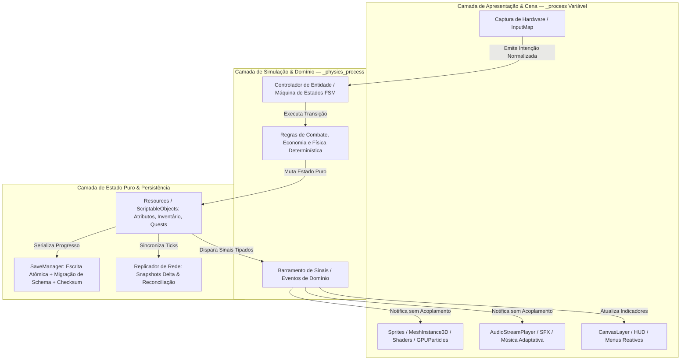
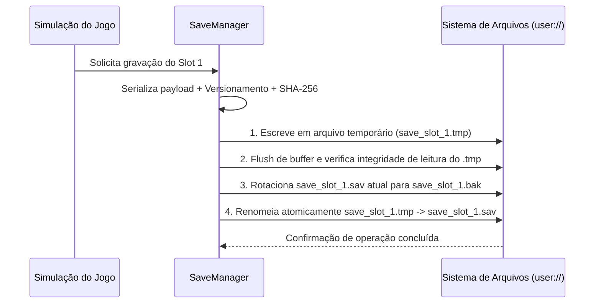

<!-- markdownlint-disable MD022 MD025 MD031 MD032 MD040 MD026 -->

<!--
LOG DE MANUTENÇÃO E ALTERAÇÕES DO DOCUMENTO

| Data          | Autor                                                      | Descrição da Alteração                                                                       |
| ------------- | ---------------------------------------------------------- | -------------------------------------------------------------------------------------------- |
| 2026-10-19    | Comitê Corporativo de Arquitetura & Engenharia de Software | v1.0.0 — Criação do guia especializado de arquitetura de jogos, persistência e netcode (ADR 0007). |

=================================================================================
-->

# 🏛️ Guia de Arquitetura de Jogos, Estado Desacoplado, Persistência Resiliente e Netcode

> **Princípio Fundamental:** *Em jogos digitais, a árvore de cena visual é efêmera, volátil e escrava da taxa de quadros da GPU, enquanto o estado da simulação é a fonte matemática da verdade. Uma arquitetura de jogos profissional isola dados e regras de negócio em recursos puros independentes de renderização, protege o progresso do jogador com escrita atômica versionada em disco e trata a rede como um canal não confiável governado por um servidor estritamente autoritativo.*

---

## 1. Topologia da Clean Architecture Aplicada a Jogos

O maior antipadrão no desenvolvimento de jogos é acoplar atributos econômicos, inventário, regras de dano e estado de missões diretamente em scripts de nós visuais (`Node2D`, `CharacterBody3D`, `MonoBehaviour`). Quando a cena é descarregada ou instanciada novamente, o estado se perde ou exige gambiarras globais frágeis.



### Regras de Dependência em Engines (Godot 4, Unity, Unreal):
1. **O Estado não conhece a Árvore de Cena:** Um `Resource` (Godot) ou `ScriptableObject`/POCO (Unity) jamais deve importar ou referenciar `Node2D`, `Sprite2D`, `Camera3D` ou `CanvasItem`. Ele contém apenas dados tipados, invariantes matemáticas e sinais de mutação.
2. **Call Down, Signal Up:** Nós pais configuram e invocam métodos diretos nos filhos na inicialização (*call down*); nós filhos e recursos de dados comunicam eventos para cima ou para o HUD exclusivamente via sinais (`signal`) desacoplados (*signal up*).
3. **Proibição de Navegação Frágil na Árvore:** É estritamente proibido acoplar regras de negócio a caminhos relativos quebradiços como `get_parent().get_parent().get_node("UI/HealthBar")`. Se o designer mover um nó no editor para ajustar o layout, o código não pode quebrar.

---

## 2. Desacoplamento Estado Puro vs. Apresentação Visual

### 2.1 Implementação Canônica em Godot 4 (GDScript 2.0 Estático)

```gdscript
# res://domain/stats/character_stats.gd
# Camada de Estado Puro: Zero dependência de Node2D/Node3D; 100% testável sem SceneTree.
class_name CharacterStats
extends Resource

signal health_changed(current_health: int, max_health: int)
signal stamina_changed(current_stamina: float, max_stamina: float)
signal depleted()

@export var max_health: int = 100:
	set(value):
		max_health = maxi(1, value)
		current_health = clampi(current_health, 0, max_health)
		health_changed.emit(current_health, max_health)

@export var max_stamina: float = 100.0

var current_health: int = 100
var current_stamina: float = 100.0

func initialize() -> void:
	current_health = max_health
	current_stamina = max_stamina
	health_changed.emit(current_health, max_health)

func apply_damage(raw_amount: int, armor_mitigation: int = 0) -> int:
	if raw_amount <= 0 or current_health <= 0:
		return 0
	var effective_damage: int = maxi(1, raw_amount - maxi(0, armor_mitigation))
	current_health = clampi(current_health - effective_damage, 0, max_health)
	health_changed.emit(current_health, max_health)
	if current_health == 0:
		depleted.emit()
	return effective_damage

func consume_stamina(cost: float) -> bool:
	if cost < 0.0 or current_stamina < cost:
		return false
	current_stamina = maxf(0.0, current_stamina - cost)
	stamina_changed.emit(current_stamina, max_stamina)
	return true
```

```gdscript
# res://presentation/actors/player_actor.gd
# Camada de Apresentação: Consome o Resource e reage aos seus sinais.
class_name PlayerActor
extends CharacterBody2D

@export var stats: CharacterStats
@export var move_speed: float = 220.0

@onready var sprite: Sprite2D = $Sprite2D
@onready var animation_player: AnimationPlayer = $AnimationPlayer

func _ready() -> void:
	assert(stats != null, "CharacterStats Resource obrigatório no PlayerActor")
	stats.initialize()
	stats.health_changed.connect(_on_health_changed)
	stats.depleted.connect(_on_stats_depleted)

func _physics_process(_delta: float) -> void:
	var direction: Vector2 = Input.get_vector("move_left", "move_right", "move_up", "move_down")
	velocity = direction.normalized() * move_speed
	move_and_slide()

func _on_health_changed(_current: int, _max_val: int) -> void:
	animation_player.play("hit_flash")

func _on_stats_depleted() -> void:
	set_physics_process(false)
	animation_player.play("death")
```

---

## 3. Resiliência Defensiva em Persistência Local (Save/Load Anti-Corrupção)

Diferente de aplicações web onde o estado reside em um banco PostgreSQL gerenciado na nuvem, em jogos singleplayer e híbridos o arquivo de save reside no disco local do jogador — sujeito a quedas bruscas de energia, fechamento forçado (`Alt+F4`), falta de espaço em disco ou falhas de sincronização da Steam Cloud / consoles.

### 3.1 O Protocolo de Escrita Atômica (Write-Replace-Backup)
**Nunca** abra o arquivo de save principal (`save_slot_1.sav`) em modo de escrita direta (`WRITE`). Se o jogo travar ou a bateria acabar no meio da serialização, o arquivo ficará truncado (0 bytes ou JSON/binário incompleto) e o jogador perderá dezenas de horas de progresso.



### 3.2 Implementação de Save Atômico com Fallback Automático e Migração de Schema

```gdscript
# res://infrastructure/persistence/save_manager.gd
class_name SaveManager
extends RefCounted

const CURRENT_SCHEMA_VERSION: int = 2
const SAVE_DIR: String = "user://saves/"

static func save_game(slot_id: int, state_payload: Dictionary) -> Error:
	DirAccess.make_dir_recursive_absolute(SAVE_DIR)
	var base_path: String = SAVE_DIR + "slot_%d" % slot_id
	var tmp_path: String = base_path + ".tmp"
	var sav_path: String = base_path + ".sav"
	var bak_path: String = base_path + ".bak"

	var envelope: Dictionary = {
		"schema_version": CURRENT_SCHEMA_VERSION,
		"timestamp_unix": Time.get_unix_time_from_system(),
		"payload": state_payload,
	}
	var json_payload: String = JSON.stringify(envelope)
	var checksum: String = json_payload.sha256_text()

	var file: FileAccess = FileAccess.open(tmp_path, FileAccess.WRITE)
	if file == null:
		return FileAccess.get_open_error()

	file.store_line(checksum)
	file.store_string(json_payload)
	file.flush()
	file.close()

	# Verifica se o temporário foi gravado integralmente antes de substituir o oficial
	if not _verify_file_integrity(tmp_path):
		DirAccess.remove_absolute(tmp_path)
		return ERR_FILE_CORRUPT

	if FileAccess.file_exists(sav_path):
		DirAccess.copy_absolute(sav_path, bak_path)

	return DirAccess.rename_absolute(tmp_path, sav_path)

static func load_game(slot_id: int) -> Dictionary:
	var base_path: String = SAVE_DIR + "slot_%d" % slot_id
	var sav_path: String = base_path + ".sav"
	var bak_path: String = base_path + ".bak"

	var data: Dictionary = _try_read_verified(sav_path)
	if data.is_empty() and FileAccess.file_exists(bak_path):
		push_warning("Save principal corrompido no slot %d. Restaurando backup (.bak)." % slot_id)
		data = _try_read_verified(bak_path)

	if data.is_empty():
		return {}

	return _migrate_schema(data)

static func _try_read_verified(path: String) -> Dictionary:
	if not FileAccess.file_exists(path):
		return {}
	var file: FileAccess = FileAccess.open(path, FileAccess.READ)
	if file == null:
		return {}
	var stored_checksum: String = file.get_line().strip_edges()
	var json_body: String = file.get_as_text()
	file.close()

	if json_body.sha256_text() != stored_checksum:
		return {}
	var parsed: Variant = JSON.parse_string(json_body)
	return parsed if parsed is Dictionary else {}

static func _verify_file_integrity(path: String) -> bool:
	return not _try_read_verified(path).is_empty()

static func _migrate_schema(envelope: Dictionary) -> Dictionary:
	var version: int = int(envelope.get("schema_version", 1))
	var payload: Dictionary = envelope.get("payload", {})
	if version < 2:
		# Migração v1 -> v2: converte moeda antiga "gold" para dicionário "wallet"
		var legacy_gold: int = int(payload.get("gold", 0))
		payload["wallet"] = {"coins": legacy_gold, "gems": 0}
		payload.erase("gold")
	return payload
```

---

## 4. Arquitetura de Rede e Netcode Autoritativo em Tempo Real

Em jogos multiplayer competitivos ou cooperativos, a latência da luz na fibra óptica ($30\text{ ms}$ a $150\text{ ms}$) e a perda de pacotes (*packet loss*) tornam impossível aguardar a resposta do servidor antes de mover o personagem na tela do jogador.

### 4.1 A Tríade do Netcode Moderno (UDP / ENet / WebRTC)

| Técnica | Onde Opera | Problema Resolvido | Como Funciona |
| :--- | :--- | :--- | :--- |
| **Client-Side Prediction** | Cliente Local | Elimina a sensação de atraso (*input lag*) ao caminhar ou atirar | O cliente aplica o comando de movimento localmente no instante $t_0$ sem aguardar o servidor, gravando o input associado ao número do `tick` em um buffer circular. |
| **Server Reconciliation** | Cliente Local + Servidor | Corrige divergências quando a predição local discorda da autoridade do servidor | Quando chega o estado oficial do servidor para o `tick` $N$, o cliente descarta estados antigos, adota a posição autoritativa de $N$ e re-simula instantaneamente todos os inputs de $N+1$ até o tick atual. |
| **Entity Interpolation** | Clientes Remotos | Evita que outros jogadores teleportem em saltos visuais na tela (ex.: snapshots de 20Hz em monitor de 144Hz) | O cliente renderiza entidades remotas com um pequeno atraso intencional (ex.: $100\text{ ms}$ no passado), interpolando suavemente (`lerp`/`slerp`) entre os dois últimos snapshots confirmados pelo servidor. |
| **Lag Compensation** | Servidor Dedicado | Permite que disparos (*hitscan*) acertem o alvo onde o atirador o via na tela no momento do clique | O servidor mantém um histórico curto de posições das *hitboxes* (ex.: últimos $500\text{ ms}$). Ao receber um tiro do cliente com latência $\Delta t$, o servidor rebobina as hitboxes para $t - \Delta t$, testa o Raycast e restaura o mundo. |

### 4.2 Reconciliação Determinística de Movimento

```gdscript
# Estrutura de comando de entrada numerado por Tick para Reconciliação
class_name InputCommand
extends RefCounted

var tick: int
var move_axis: Vector2
var jump_pressed: bool
var delta: float

static func simulate_step(start_pos: Vector2, start_vel: Vector2, cmd: InputCommand, speed: float) -> Dictionary:
	var next_vel: Vector2 = cmd.move_axis.normalized() * speed
	var next_pos: Vector2 = start_pos + (next_vel * cmd.delta)
	return {"position": next_pos, "velocity": next_vel}
```

---

## 5. Checklist de Auditoria Arquitetural de Jogos

- [ ] **Zero Estado em Nós Visuais:** Atributos de combate, progresso de campanha, árvores de habilidades e economia residem em classes `Resource` / modelos puros fora de `Node2D`/`Node3D`?
- [ ] **Determinismo de Passo Fixo:** Toda simulação física, movimentação cinemática e contadores de gameplay rodam em `_physics_process(delta)` com taxa fixa de ticks?
- [ ] **Save Atômico com `.tmp` e `.bak`:** O sistema de salvamento escreve em arquivo temporário, valida o hash SHA-256 e mantém rotação do último save válido antes de sobrescrever?
- [ ] **Versionamento de Schema de Save:** Todo arquivo persistido carrega `schema_version` explícito com funções de migração para garantir que atualizações do jogo não quebrem saves antigos dos jogadores?
- [ ] **Pool de Objetos Efêmeros:** Projéteis, partículas de impacto, textos flutuantes de dano e inimigos frequentes são reciclados via *Object Pool* em vez de `instantiate()` + `queue_free()` em pleno combate?
