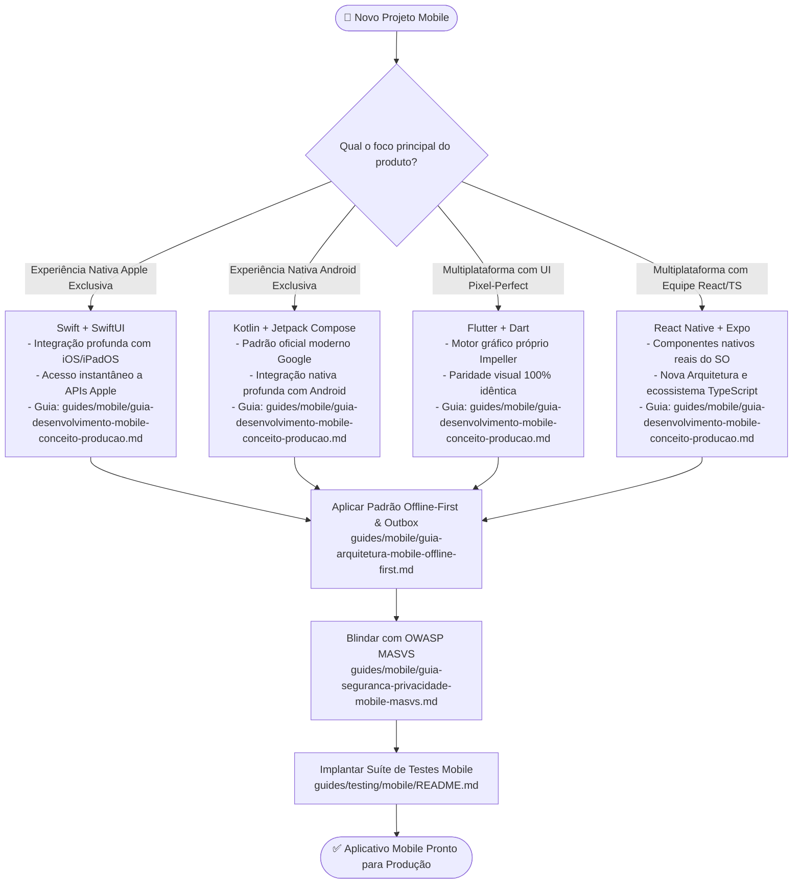

# 📱 Acervo Normativo de Desenvolvimento Mobile

<div align="center">

[](../../README.md)
[](../../README.md)
[](../../README.md)

<p align="center">
  <b>Biblioteca canônica de engenharia móvel, padrões arquiteturais reativos, resiliência offline-first, segurança defensiva e ergonomia para iOS e Android.</b>
</p>

</div>

---

## 📂 Guias Disponíveis nesta Categoria

```text
guides/mobile/
├── README.md                                         ──> Portal e visão geral do ecossistema mobile
├── guia-desenvolvimento-mobile-conceito-producao.md   ──> ⭐ Guia Mestre: UDF, arquitetura proporcional, 4 sintaxes e release
├── guia-arquitetura-mobile-offline-first.md          ──> Clean Architecture, Repositórios, Outbox Pattern e Background Sync
├── guia-seguranca-privacidade-mobile-masvs.md        ──> OWASP MASVS v2/MASTG, Keychain/Keystore, Biometria e SSL Pinning
└── guia-design-ergonomia-acessibilidade-mobile.md   ──> Thumb Zone, Touch Targets (48dp/44pt), Dynamic Type e Safe Areas
```

---

## 🗺️ Matriz de Decisão entre Stacks Tecnológicas



---

## 📋 Resumo dos Guias da Categoria

| Guia | Foco Temático | Tópicos Principais |
| :--- | :--- | :--- |
| [`guia-desenvolvimento-mobile-conceito-producao.md`](guia-desenvolvimento-mobile-conceito-producao.md) | **Guia Mestre (Conceito à Produção)** | Fluxo Unidirecional de Dados (UDF), progressão nó a nó nas 4 stacks (React Native, Kotlin/Hilt, Swift/SwiftData, Flutter/Impeller), profiling e checklist de lançamento. |
| [`guia-arquitetura-mobile-offline-first.md`](guia-arquitetura-mobile-offline-first.md) | **Arquitetura & Resiliência** | Clean Architecture Mobile, State Hoisting, Repositórios como Single Source of Truth, Local Outbox Pattern, resolução de conflitos e Background Sync (WorkManager/BGTaskScheduler). |
| [`guia-seguranca-privacidade-mobile-masvs.md`](guia-seguranca-privacidade-mobile-masvs.md) | **Segurança Defensiva (MASVS v2)** | As 7 categorias do OWASP MASVS v2 (Storage, Crypto, Auth, Network, Platform, Code, Resilience), Hardware Keystore/Keychain, biometria e defesa anti-tampering/Root. |
| [`guia-design-ergonomia-acessibilidade-mobile.md`](guia-design-ergonomia-acessibilidade-mobile.md) | **Design, Ergonomia & A11y** | Lei de Fitts e Thumb Zone, alvos de toque mínimos ($48\text{ dp}$ / $44\text{ pt}$), Safe Areas, Dynamic Type, Reduce Motion, contraste WCAG 2.2 AA e leitores de tela nas 4 stacks. |

---

## 🧪 Suíte de Testes Mobile Complementar

Para a estratégia e implementação prática da pirâmide de testes móveis (Testes Unitários, Testes de Componentes/Widgets e E2E em dispositivos reais), consulte a suíte complementar em:
👉 **[`guides/testing/mobile/README.md`](../testing/mobile/README.md)**
