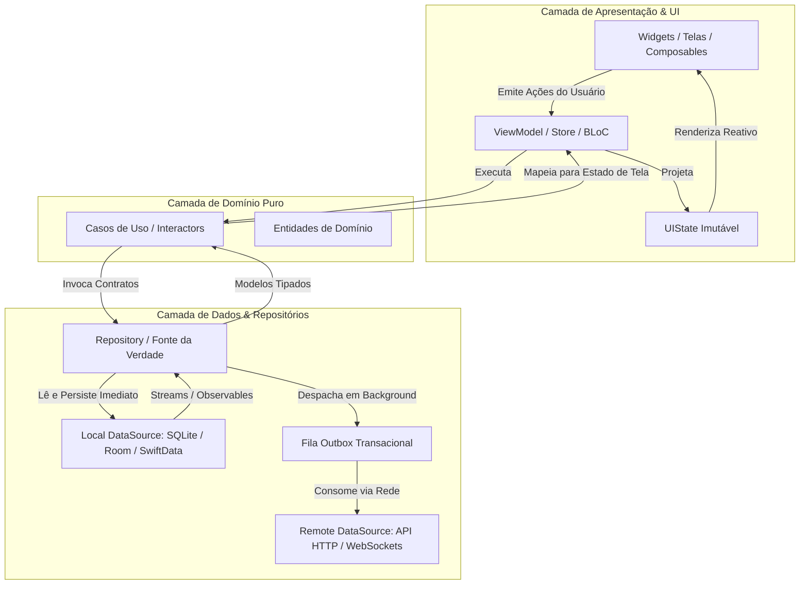

<!-- markdownlint-disable MD022 MD025 MD031 MD032 MD040 MD026 -->

<!--
LOG DE MANUTENÇÃO E ALTERAÇÕES DO DOCUMENTO

| Data          | Autor                                                      | Descrição da Alteração                                                                 |
| ------------- | ---------------------------------------------------------- | -------------------------------------------------------------------------------------- |
| 2026-10-18    | Comitê Corporativo de Arquitetura & Engenharia de Software | v1.0.0 — Criação do guia especializado de arquitetura móvel e offline-first (ADR 0006). |

=================================================================================
-->

# 🏛️ Guia de Arquitetura Mobile, State Hoisting e Resiliência Offline-First

> **Princípio Fundamental:** *A conectividade de rede em dispositivos móveis não é uma garantia contínua, mas uma conveniência transitória. Em sistemas móveis profissionais, o banco de dados local é a fonte primária da verdade da UI, a interface nunca bloqueia aguardando I/O de rede, e qualquer mutação realizada offline é registrada em uma fila transacional determinística para sincronização posterior.*

---

## 1. Topologia da Clean Architecture Mobile

A arquitetura recomendada para aplicações móveis robustas desacopla a volatilidade do sistema operacional das regras de negócio autoritativas:



### Regras de Dependência:
1. **A Camada de UI não conhece a Camada de Dados:** Telas e widgets recebem dados exclusivamente através de `UIState` imutável provido pelo ViewModel ou Store.
2. **Entidades de Domínio são Independentes:** Nenhuma entidade de negócio pode conter anotações de serialização JSON (`@Serializable`, `Codable`, `@JsonSerializable`) ou anotações de ORM de banco de dados (`@Entity`, `@Table`).
3. **Mappers nas Fronteiras:** Toda resposta da API (`DTO`) e todo registro de banco local (`Entity`) deve ser convertido para uma Entidade de Domínio antes de trafegar para cima.

---

## 2. State Hoisting e Gerenciamento de Estado Reativo

O **State Hoisting** é o padrão que move o estado de um componente para seu container pai, tornando o componente filho puramente declarativo, sem estado interno (*stateless*) e facilmente testável.

### Contrato de State Hoisting:
- **O estado desce:** O componente pai passa o valor atual do estado para os filhos como parâmetros/propriedades imutáveis.
- **Os eventos sobem:** Os componentes filhos notificam o componente pai sobre ações do usuário disparando callbacks ou lambdas (`onValueChange`, `onItemClicked`).

```kotlin
// Exemplo em Jetpack Compose: State Hoisting aplicado
@Composable
fun TaskItem(
    title: String,
    isCompleted: Boolean,
    onToggle: (Boolean) -> Unit, // O evento sobe
    onDelete: () -> Unit,        // O evento sobe
    modifier: Modifier = Modifier
) {
    Row(
        modifier = modifier.fillMaxWidth().padding(16.dp),
        verticalAlignment = Alignment.CenterVertically
    ) {
        Checkbox(checked = isCompleted, onCheckedChange = onToggle)
        Text(text = title, modifier = Modifier.weight(1f))
        IconButton(onClick = onDelete) {
            Icon(Icons.Default.Delete, contentDescription = "Excluir")
        }
    }
}
```

---

## 3. O Padrão Offline-First com Local Outbox

Quando o usuário realiza uma operação de escrita (ex.: criar uma anotação, aprovar um documento, enviar uma mensagem):
1. A ação é salva imediatamente no banco local com status `PENDING_SYNC`.
2. O registro é espelhado na tabela `sync_outbox` com payload JSON, timestamp e contador de tentativas.
3. A interface atualiza instantaneamente para o usuário (**latência percebida zero**).
4. Um worker de sincronização em segundo plano monitora a conectividade e despacha os itens pendentes com retry exponencial.
5. Ao receber a confirmação do backend (200/201 OK), o status no banco local muda para `SYNCED` e o item é removido da `sync_outbox`.

### Esquema Relacional do Local Outbox:

```sql
CREATE TABLE sync_outbox (
    id TEXT PRIMARY KEY,
    aggregate_type TEXT NOT NULL,
    aggregate_id TEXT NOT NULL,
    action TEXT NOT NULL,           -- 'CREATE', 'UPDATE', 'DELETE'
    payload TEXT NOT NULL,          -- JSON serializado
    idempotency_key TEXT NOT NULL,  -- UUID único por operação
    retry_count INTEGER DEFAULT 0,
    created_at INTEGER NOT NULL,
    last_attempt INTEGER,
    error_message TEXT
);
```

---

## 4. Estratégias de Resolução de Conflitos

Em sistemas móveis distribuídos, conflitos ocorrem quando um registro é modificado localmente enquanto estava desatualizado em relação ao servidor.

| Estratégia | Funcionamento | Trade-offs | Caso de Uso Ideal |
| :--- | :--- | :--- | :--- |
| **Server-Wins** | O servidor descarta a mutação do cliente caso a versão/timestamp seja anterior à versão em produção. | O usuário móvel pode perder alterações locais sem aviso se não houver alerta explícito. | Cadastros financeiros, inventário de estoque, reservas de passagens. |
| **Client-Wins (LWW)** | A última gravação do cliente sobrescreve o servidor incondicionalmente. | Pode sobrescrever alterações críticas feitas por outros usuários simultaneamente. | Rascunhos de notas pessoais, preferências locais de interface. |
| **Field-Level Merge** | Mescla apenas os atributos efetivamente alterados na sessão do usuário. | Requer rastreamento de campos modificados (*dirty tracking*) e versionamento por campo. | Formulários longos com múltiplos colaboradores (ex.: prontuários, vistorias). |
| **Intervenção Manual** | Quando há colisão, o aplicativo salva ambas as versões e exibe diálogo comparativo. | Aumenta a complexidade de UX para o usuário leigo. | Documentos textuais colaborativos e contratos de negócio. |

---

---

## 5. Background Tasks e Restrições de Sistema Operacional

Tanto o iOS quanto o Android impõem políticas agressivas de gerenciamento de energia e suspensão de processos em segundo plano. Nunca utilize loops infinitos em threads em memória. A sincronização deve ser delegada aos agendadores nativos do sistema:

### 5.1. Android: Sincronização Garantida com WorkManager (Kotlin)

O **WorkManager** é a solução oficial recomendada pelo Google para tarefas em segundo plano adiáveis que precisam de garantia de execução mesmo após o encerramento do app ou reinicialização do dispositivo:

```kotlin
// 1. Definição do Worker de Sincronização
class OutboxSyncWorker(
    appContext: Context,
    workerParams: WorkerParameters
) : CoroutineWorker(appContext, workerParams) {

    override suspend fun doWork(): Result = withContext(Dispatchers.IO) {
        val database = AppDatabase.getInstance(applicationContext)
        val apiService = RetrofitClient.apiService
        val pendingEvents = database.outboxDao().getPendingEvents()

        try {
            for (event in pendingEvents) {
                val response = apiService.syncEvent(
                    idempotencyKey = event.idempotencyKey,
                    payload = event.payload
                )
                if (response.isSuccessful) {
                    database.outboxDao().markAsSynced(event.id)
                } else if (response.code() in 400..499) {
                    // Erro de validação irrecuperável: não tentar novamente
                    database.outboxDao().markAsFailed(event.id, response.message())
                } else {
                    return@withContext Result.retry()
                }
            }
            Result.success()
        } catch (e: Exception) {
            Result.retry()
        }
    }
}

// 2. Agendamento com Restrições (Constraints)
fun schedulePeriodicOutboxSync(context: Context) {
    val constraints = Constraints.Builder()
        .setRequiredNetworkType(NetworkType.CONNECTED)
        .setRequiresBatteryNotLow(true)
        .build()

    val syncRequest = PeriodicWorkRequestBuilder<OutboxSyncWorker>(15, TimeUnit.MINUTES)
        .setConstraints(constraints)
        .setBackoffCriteria(BackoffPolicy.EXPONENTIAL, 30, TimeUnit.SECONDS)
        .build()

    WorkManager.getInstance(context).enqueueUniquePeriodicWork(
        "OutboxSyncWork",
        ExistingPeriodicWorkPolicy.KEEP,
        syncRequest
    )
}
```

---

### 5.2. Apple (iOS): Sincronização em Segundo Plano com BGTaskScheduler (Swift)

No ecossistema iOS, o sistema operacional concede fatias curtas de processamento em segundo plano via `BGTaskScheduler`:

```swift
import BackgroundTasks

final class BackgroundSyncManager {
    static let shared = BackgroundSyncManager()
    static let taskIdentifier = "com.cpb.enterprise.outboxSync"

    func registerBackgroundTasks() {
        BGTaskScheduler.shared.register(forTaskWithIdentifier: Self.taskIdentifier, using: nil) { task in
            guard let appRefreshTask = task as? BGAppRefreshTask else { return }
            self.handleAppRefresh(task: appRefreshTask)
        }
    }

    func scheduleNextSync() {
        let request = BGAppRefreshTaskRequest(identifier: Self.taskIdentifier)
        request.earliestBeginDate = Date(timeIntervalSinceNow: 15 * 60) // A cada 15 minutos (sugestão ao SO)
        do {
            try BGTaskScheduler.shared.submit(request)
        } catch {
            print("Falha ao agendar BGTask: \(error)")
        }
    }

    private func handleAppRefresh(task: BGAppRefreshTask) {
        scheduleNextSync() // Reagenda para a próxima janela

        let syncOperation = Task {
            let success = await OutboxRepository.shared.drainPendingQueue()
            task.setTaskCompleted(success: success)
        }

        // Se o sistema interromper o tempo de background antes de concluir
        task.expirationHandler = {
            syncOperation.cancel()
            task.setTaskCompleted(success: false)
        }
    }
}
```

---

### 5.3. React Native / Expo: Sincronização via TaskManager e BackgroundFetch

```typescript
import * as BackgroundFetch from 'expo-background-fetch';
import * as TaskManager from 'expo-task-manager';
import { drainOutboxQueue } from '../services/outboxService';

export const BACKGROUND_SYNC_TASK = 'BACKGROUND_OUTBOX_SYNC_TASK';

// 1. Definição da tarefa em nível global do arquivo
TaskManager.defineTask(BACKGROUND_SYNC_TASK, async () => {
  try {
    const hasMoreItems = await drainOutboxQueue();
    return hasMoreItems
      ? BackgroundFetch.BackgroundFetchResult.NewData
      : BackgroundFetch.BackgroundFetchResult.NoData;
  } catch (error) {
    return BackgroundFetch.BackgroundFetchResult.Failed;
  }
});

// 2. Registro da tarefa na inicialização do app
export async function registerBackgroundSyncAsync(): Promise<void> {
  const isRegistered = await TaskManager.isTaskRegisteredAsync(BACKGROUND_SYNC_TASK);
  if (!isRegistered) {
    await BackgroundFetch.registerTaskAsync(BACKGROUND_SYNC_TASK, {
      minimumInterval: 15 * 60, // 15 minutos
      stopOnTerminate: false,
      startOnBoot: true,
    });
  }
}
```

---

## 6. Checklist de Arquitetura Mobile para Code Review

- [ ] **[OFF-01] Fonte Única da Verdade:** A camada de apresentação é puramente reativa e consulta dados exclusivamente do banco local, permitindo que a tela carregue instantaneamente sem depender de rede?
- [ ] **[OFF-02] Outbox Transacional:** Toda operação de escrita realizada offline é gravada na tabela `sync_outbox` com payload serializado e chave de idempotência (UUID) antes de disparar rede?
- [ ] **[OFF-03] Chaves de Idempotência:** As requisições de rede de mutação transmitem o cabeçalho `Idempotency-Key` para impedir duplicação acidental em cenários de retry com timeout?
- [ ] **[OFF-04] Isolamento de Threads:** Todas as consultas ao banco local e deserializações JSON pesadas rodam em despachantes assíncronos (`Dispatchers.IO`, `Task`, *Isolates*), nunca na thread principal?
- [ ] **[OFF-05] Resolução de Conflitos Determinística:** A política de resolução de conflitos (Server-Wins, Client-Wins ou Field-Merge) está definida formalmente no domínio e não depende de lógica ad-hoc em telas?
- [ ] **[OFF-06] Background Sync Nativo:** A sincronização em segundo plano utiliza `WorkManager` (Android), `BGTaskScheduler` (iOS) ou `expo-background-fetch` (RN) respeitando restrições de conectividade e bateria?
