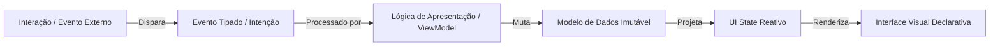
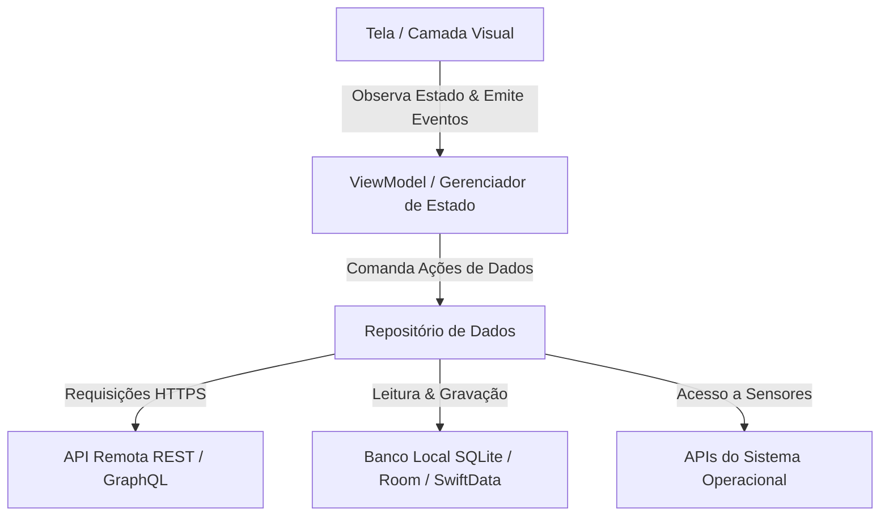
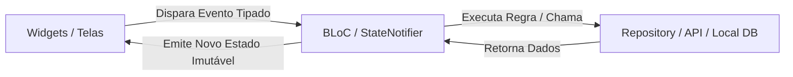
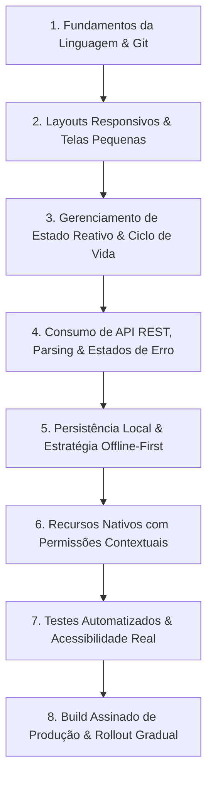

<!-- markdownlint-disable MD022 MD025 MD031 MD032 MD040 MD026 -->

<!--
LOG DE MANUTENÇÃO E ALTERAÇÕES DO DOCUMENTO

| Data          | Autor                                                      | Descrição da Alteração                                                                 |
| ------------- | ---------------------------------------------------------- | -------------------------------------------------------------------------------------- |
| 2026-10-18    | Comitê Corporativo de Arquitetura & Engenharia de Software | v1.0.0 — Instituição do Guia Definitivo de Desenvolvimento Mobile (ADR 0006). Síntese  |
|               |                                                            | agnóstica de engenharia móvel cobrindo UDF, arquitetura proporcional, 4 sintaxes de   |
|               |                                                            | estado (SwiftUI, Compose, Flutter, React Native/Expo), UI adaptável, offline-first,    |
|               |                                                            | recursos de hardware, OWASP MASVS e checklist de lançamento em produção.              |
| 2026-10-18    | Comitê Corporativo de Arquitetura & Engenharia de Software | v1.1.0 — Expansão abrangente baseada no curso Mobile Development (roadmap.sh) e nos     |
|               |                                                            | roadmaps React Native Developer, Kotlin e Swift & SwiftUI, com progressão nó a nó,    |
|               |                                                            | cenários empíricos, trade-offs e projeto integrador de referência.                     |

=================================================================================
-->

> **Manifesto de Engenharia Mobile:** *A interface do aplicativo móvel é uma projeção determinística do estado atual; ela nunca deve ser a dona dos dados nem das regras de negócio. Em dispositivos móveis, a rede hostil e intermitente é a norma, a bateria e a memória são recursos finitos, e o binário reside nas mãos do usuário em ambiente não confiável. O design de software excelente trata falhas, modo offline, cancelamento e permissões como estados legítimos de primeira classe, garantindo fluidez ininterrupta a 60/120 FPS e preservação incondicional dos dados do usuário.*

---

## ⚙️ Heurísticas Executáveis

Bloco lido pelo `/setup` e por `skills/setup/scripts/verify_setup.py`. `when`/`verify` são shell (cwd = raiz do projeto, `AI_GUIDES_RUNTIME` aponta para `.agents/ai-guides`). `do` é shell ou começa com `agent:`.

```yaml heuristics
guide: desenvolvimento-mobile
version: 1
requires: [padrao-criacao-adrs]
heuristics:
  - id: MOB-01
    title: Checklist de engenharia mobile em .agents/rules/desenvolvimento-mobile.md
    when: "sh \"$AI_GUIDES_RUNTIME/templates/detect_stack.sh\" mobile && ! test -f .agents/rules/desenvolvimento-mobile.md"
    do: |
      mkdir -p .agents/rules
      cp "$AI_GUIDES_RUNTIME/templates/rules/desenvolvimento-mobile.md" .agents/rules/desenvolvimento-mobile.md
    verify: "grep -q 'Checklist Canônico de Engenharia Mobile' .agents/rules/desenvolvimento-mobile.md"

  - id: MOB-02
    title: Proteção de segredos no cliente (zero chaves privadas ou tokens em código fonte)
    when: |
      sh "$AI_GUIDES_RUNTIME/templates/detect_stack.sh" mobile && git grep -q --untracked -iE -e '(api_key|secret_key|private_key|token)([[:space:]]*:[[:space:]]*[^=;\n]+)?[[:space:]]*=[[:space:]]*["\x27][a-zA-Z0-9_-]{16,}["\x27]' -- '*.swift' '*.kt' '*.dart' '*.tsx' '*.ts' ':(exclude,glob)**/test*/**' ':(exclude,glob)**/__tests__/**' ':(exclude,glob)**/*test*' ':(exclude,glob)**/*Test*' ':!.agents' ':!docs'
    do: "agent: Remova credenciais e chaves privadas estáticas dos fontes mobile, migrando para variáveis de ambiente ou backend seguro."
    verify: |
      ! sh "$AI_GUIDES_RUNTIME/templates/detect_stack.sh" mobile || ! git grep -q --untracked -iE -e '(api_key|secret_key|private_key|token)([[:space:]]*:[[:space:]]*[^=;\n]+)?[[:space:]]*=[[:space:]]*["\x27][a-zA-Z0-9_-]{16,}["\x27]' -- '*.swift' '*.kt' '*.dart' '*.tsx' '*.ts' ':(exclude,glob)**/test*/**' ':(exclude,glob)**/__tests__/**' ':(exclude,glob)**/*test*' ':(exclude,glob)**/*Test*' ':!.agents' ':!docs'

  - id: MOB-03
    title: Referência canônica do guia de desenvolvimento mobile no AGENTS.md
    when: "sh \"$AI_GUIDES_RUNTIME/templates/detect_stack.sh\" mobile && ! grep -q 'desenvolvimento-mobile' AGENTS.md"
    do: "agent: Adicione a referência ao guia-desenvolvimento-mobile-conceito-producao.md na seção de governança do AGENTS.md."
    verify: "grep -q 'desenvolvimento-mobile' AGENTS.md"
```

---

## 📚 Sumário Executivo e Estrutura do Guia

Este guia consolida a formação técnica completa em desenvolvimento móvel multiplataforma e nativo. Ele foi desenhado para servir tanto como manual de consulta arquitetural sênior quanto como trilha de aprendizagem estruturada por progressão de nós conceituais:

1. **Desenvolvimento Mobile: Princípios e Arquitetura**
2. **O Curso Mobile Development: Leitura Fiel e Conexão com os Roadmaps**
3. **Trilha React Native e Expo, Nó a Nó**
4. **Trilha Kotlin e Android, Nó a Nó**
5. **Trilha Swift e SwiftUI, Nó a Nó**
6. **Trilha Flutter e Dart, Nó a Nó**
7. **Fundamentos Comuns: Exemplos Comparados nas Quatro Stacks**
8. **Qualidade, Segurança e Produção**
9. **Como Escolher a Stack Tecnológica e Roteiro de Estudos**
10. **Projeto Integrador: App de Catálogo e Tarefas**
11. **Referências Canônicas e Documentação Oficial**

---

## 1. Desenvolvimento Mobile: Princípios e Arquitetura

### 1.1. O que Torna Mobile Fundamentalmente Diferente

Um aplicativo móvel vive em um ambiente sobre o qual **não possui controle total**:
- O sistema operacional (iOS/Android) pode suspender, congelar ou encerrar o processo a qualquer instante para recuperar memória para o aplicativo em primeiro plano ou economizar bateria.
- A usuária alterna rapidamente entre múltiplos apps, atende chamadas telefônicas e bloqueia a tela.
- A conectividade é inerentemente intermitente: o dispositivo transita entre Wi-Fi veloz, redes 4G/5G congestionadas, modo avião e túneis sem sinal.
- Permissões de hardware (câmera, microfone, localização, notificações) podem ser negadas na primeira solicitação ou revogadas a qualquer momento nas configurações do sistema.
- Bateria, ciclos de CPU e armazenamento são restrições físicas severas.
- O aplicativo recebe entradas externas a qualquer momento: deep links, notificações push, intents de compartilhamento e arquivos anexados.

#### Axiomas de Projeto para Software Móvel:
1. **Nunca presuma conectividade ininterrupta:** Falhas de rede, timeouts, pacotes corrompidos e reconexões não são exceções anômalas; são o fluxo normal de execução.
2. **Não guarde estado importante apenas na memória volátil da tela:** Mudanças de configuração (rotação de tela, redimensionamento em dobráveis, ativação de modo escuro) e recriação de processos pelo SO apagam o estado efêmero.
3. **Não solicite acesso a hardware sem justificativa contextual:** Peça permissão no momento exato em que a usuária compreende o benefício prático e forneça sempre um caminho alternativo gracioso caso ela recuse.
4. **Não confie em tamanhos ou resoluções fixas de tela:** Projete interfaces fluidas compatíveis com telas pequenas (ex.: iPhone SE), tablets, dobráveis, fontes ampliadas por acessibilidade (Dynamic Type / Font Scaling) e teclados virtuais dinâmicos.
5. **Nunca meça performance apenas em simuladores/emuladores de desktop:** Faça medições de profiling de CPU, memória e FPS em compilações de release e em aparelhos físicos de entrada.
6. **Código do cliente não é cofre de segredos:** O pacote compilado (APK, AAB, IPA) reside no dispositivo e pode ser descompilado via engenharia reversa. Chaves privadas, tokens mestres e autorização autoritativa pertencem exclusivamente ao servidor.

---

### 1.2. Modelo Mental: Estado, Evento e Renderização

A interface do usuário (UI) deve ser uma **descrição pura e determinística do que o aplicativo sabe no momento atual**.



#### O Fluxo Unidirecional de Dados (UDF):
Um evento — toque em botão, texto digitado, resposta da rede, mudança de conectividade — é processado por lógica explícita. O estado resultante é emitido para a UI, que o renderiza. Esse fluxo unidirecional permite compreender exatamente a causa de cada transição de tela e testar a lógica sem depender de emuladores.

#### Modelagem de Estados Mutuamente Exclusivos:
Um erro comum de engenharia é manter múltiplos booleanos independentes (`isLoading`, `hasError`, `isEmpty`, `hasData`). Essa abordagem gera estados contraditórios e impossíveis (ex.: `isLoading == true` e `hasError == true` simultaneamente).

Em vez disso, modele os estados da tela como uma estrutura selada ou união discriminada:
```
Loading
Content(items, refreshState)
Empty
Failure(message, retryAvailable)
```

- No **Kotlin:** `sealed interface` ou `sealed class`.
- No **Swift:** `enum` com valores associados (*associated values*).
- No **TypeScript:** uniões discriminadas com chave comum (`type: 'loading' | 'content' | ...`).
- No **Dart / Flutter:** classes seladas (`sealed class`) ou enums com payload.

#### Taxonomia de Estados por Tempo de Vida:
| Escopo | Exemplos | Onde Reside | Sobrevive a Morte do Processo? |
| :--- | :--- | :--- | :--- |
| **Efêmero de Componente** | Posição de scroll, menu aberto, animação em andamento, foco do campo | Memória local da View (`remember`, `@State`, `useState`) | Não |
| **Estado de Tela** | Filtro selecionado, aba ativa, carregamento e erro da tela | ViewModel / Presenter / Store | Não (a menos que salvo via `SavedStateHandle` ou restauração de cena) |
| **Estado de Sessão** | Usuário autenticado, token volátil, contexto da conta atual | Injeção de dependência / Singleton de sessão | Não (recuperado do cofre seguro ao reiniciar) |
| **Dados Duráveis** | Registros cadastrais, carrinho de compras, rascunhos | Banco local (Room, SQLite, SwiftData, Drift) | **Sim** |
| **Dados Remotos** | Catálogo online, feed de notícias sincronizado | Cache do repositório / Servidor | Conforme política de retenção |

*Aviso arquitetural:* Persistir tudo indiscriminadamente degrada a performance de disco e introduz riscos de privacidade. Persistência requer finalidade clara, política de expiração e classificação de sensibilidade.

---

### 1.3. Arquitetura Proporcional

Adote uma arquitetura em camadas proporcional à complexidade real do produto:



1. **Camada de UI:** Renderiza o estado atual, recebe entradas do usuário e despacha eventos. Não contém regras de negócio nem código de rede ou SQL.
2. **Detentor de Estado (ViewModel / Store / Bloc):** Coordena a lógica de apresentação, converte modelos de domínio para formatos adequados à exibição e gerencia o ciclo de vida da tela.
3. **Repositório (Repository):** Define o contrato de acesso a dados, arbitra entre cache em memória, banco local e rede remota, mantendo uma fonte única de verdade.
4. **Fontes de Dados (Data Sources):** Encapsulam clientes HTTP, bancos de dados, arquivos locais e sensores do dispositivo.
5. **Casos de Uso / Domínio (Opcional):** Introduzidos quando regras de negócio são reutilizadas entre múltiplas telas ou quando a lógica do repositório ultrapassa a complexidade aceitável.

*Princípio da Proporcionalidade:* Não crie três camadas de abstração vazias para uma simples operação de leitura em um app de três telas. O objetivo da arquitetura é facilitar testes e manutenção, não satisfazer dogmas visuais.

---

### 1.4. Fonte Única de Verdade (SSOT) e Imutabilidade

Para cada entidade de dados no aplicativo, defina com clareza **qual componente é o dono da alteração e qual fonte representa o valor vigente**:
- Em um aplicativo **Offline-First**, o banco de dados local estruturado é a fonte primária de leitura para a interface.
- O subsistema de sincronização conversa assincronamente com o servidor remoto e consolida as novidades no banco local.
- Quando o banco local é atualizado, ele emite automaticamente streams reativas para a UI.

Sem uma regra explícita de autoridade, a interface, a memória volátil, o cache local e o servidor competem entre si, gerando inconsistências visuais e perda de dados.

*Imutabilidade na Fronteira:* Modelos de dados expostos para a interface devem ser **imutáveis**. A imutabilidade impede que um componente filho altere acidentalmente propriedades de um objeto compartilhado, garantindo rastreabilidade determinística.

---

### 1.5. Adaptação, Acessibilidade e Localização

Acessibilidade em dispositivos móveis não é um recurso suplementar; é a garantia de que o software é utilizável por qualquer pessoa, em qualquer circunstância:
- **Semântica e Leitores de Tela:** Atribua rótulos claros (`accessibilityLabel`, `contentDescription`, `Semantics`) para VoiceOver e TalkBack. Declare o papel do controle (botão, link, cabeçalho) e o estado atual (marcado, desabilitado).
- **Contraste e Cor:** Mantenha contraste mínimo de texto de 4.5:1 (WCAG AA). Nunca transmita significado exclusivamente por cor; associe sempre um ícone ou rótulo textual.
- **Áreas Mínimas de Toque:** Garanta alvos táteis de no mínimo **$48 \times 48\text{ dp}$** no Android e **$44 \times 44\text{ pt}$** no iOS para prevenir erros de digitação (*fat-finger syndrome*).
- **Layout Adaptável:** Suporte fontes ampliadas (Dynamic Type e Font Scaling) sem truncamento de texto; implemente safe areas para evitar sobreposição em entalhes (*notches*), ilhas dinâmicas e barras de gestos; suporte orientação retrato e paisagem e modos dobráveis/janela múltipla.
- **Internacionalização (i18n):** Datas, moedas, números, pluralização e direção de escrita (LTR vs. RTL) pertencem à localidade do dispositivo, nunca a concatenações manuais de strings.

#### Fontes Desta Seção:
- Android Architecture Guide: [developer.android.com/topic/architecture](https://developer.android.com/topic/architecture)
- Android Architecture Recommendations: [developer.android.com/topic/architecture/recommendations](https://developer.android.com/topic/architecture/recommendations)
- Compose State: [developer.android.com/develop/ui/compose/state](https://developer.android.com/develop/ui/compose/state)
- Flutter App Architecture: [docs.flutter.dev/app-architecture/guide](https://docs.flutter.dev/app-architecture/guide)
- Apple Human Interface Guidelines - Accessibility: [developer.apple.com/design/human-interface-guidelines/accessibility](https://developer.apple.com/design/human-interface-guidelines/accessibility)
- React Native Accessibility: [reactnative.dev/docs/accessibility](https://reactnative.dev/docs/accessibility)
- Kotlin Null Safety: [kotlinlang.org/docs/null-safety.html](https://kotlinlang.org/docs/null-safety.html)

---

## 2. O Curso Mobile Development: Leitura Fiel da Página

### 2.1. O que a Página Declara
O curso de desenvolvimento mobile do roadmap.sh é estruturado com as seguintes características formais:
- **Nível:** Iniciante.
- **Duração Estimada:** Aproximadamente 2,5 horas.
- **Aulas:** 16 aulas distribuídas em 4 módulos.
- **Objetivos de Aprendizagem:**
  1. Construção de interfaces multiplataforma com widgets reativos.
  2. Padrões de gerenciamento reativo de estado.
  3. Consumo de serviços REST e estratégias de cache local.
  4. Integração segura com recursos nativos do dispositivo.
  5. Testes automatizados e publicação em produção.

#### Divisão Modular (4 Aulas por Módulo):
- **Módulo 1: Core User Interfaces** — Aula 1 visível: *"Build your first Flutter screen"*.
- **Módulo 2: State and User Input** — Aula 1 visível: *"Capture input with text form fields"*.
- **Módulo 3: Data and Device Features** — Aula 1 visível: *"Fetch remote data using HTTP requests"*.
- **Módulo 4: Production Readiness** — Aula 1 visível: *"Verify screen behavior with widget tests"*.

---

### 2.2. Como Cada Módulo se Conecta aos Roadmaps Especializados

| Módulo do Curso | Conceitos Base Normativos | Nós Correspondentes nas Trilhas Especializadas |
| :--- | :--- | :--- |
| **Core User Interfaces** | Componentes declarativos, hierarquia de layout, ergonomia de toque, acessibilidade, design responsivo | **React Native:** Core Components, Text, View, Image, Pressable, Styling, Flexbox.<br>**SwiftUI:** Views, HStack, VStack, ZStack, List, Form, UI Controls.<br>**Kotlin:** Jetpack Compose UI, Modifiers, Layouts.<br>**Flutter:** Widgets, Layout, Material 3, Cupertino. |
| **State and User Input** | Estado reativo, UDF, validação contextual de formulários, controle de teclado, ciclo de vida da tela | **React Native:** State, useState, TextInput, Props, Form validation.<br>**SwiftUI:** @State, @Binding, @Observable, FocusState, Forms.<br>**Kotlin:** Compose State, remember, rememberSaveable, ViewModel, Flow.<br>**Flutter:** StatefulWidget, ValueNotifier, TextEditingController. |
| **Data and Device Features** | Requisições HTTP robustas, cache local, resiliência offline, permissões de hardware, sensores nativos | **React Native:** Fetch, AbortController, AsyncStorage, Expo SecureStore, SQLite, Native Modules.<br>**SwiftUI:** URLSession, async/await, SwiftData, Keychain, CoreLocation.<br>**Kotlin:** Coroutines, Ktor/Retrofit, Room, Keystore, WorkManager.<br>**Flutter:** http/dio, Drift, flutter_secure_storage. |
| **Production Readiness** | Testes automatizados (Unit, Widget, E2E), profiling a 60/120 FPS, ofuscação, MASVS, assinatura e publicação | **React Native:** Jest, RNTL, Maestro, EAS Build, EAS Update.<br>**SwiftUI:** XCTest, Swift Testing, Xcode Instruments, App Store Connect.<br>**Kotlin:** JUnit5, Compose Test, R8/ProGuard, Google Play Console.<br>**Flutter:** unit/widget/integration tests, flutter build appbundle. |

#### Fontes Desta Seção:
- Curso Mobile Development: [roadmap.sh/ai/course/mobile-development-1792330586888](https://roadmap.sh/ai/course/mobile-development-1792330586888)
- Repositório Developer Roadmap: [github.com/kamranahmedse/developer-roadmap](https://github.com/kamranahmedse/developer-roadmap)
- React Native Roadmap: [roadmap.sh/react-native](https://roadmap.sh/react-native)
- Kotlin Roadmap: [roadmap.sh/kotlin](https://roadmap.sh/kotlin)
- Swift & SwiftUI Roadmap: [roadmap.sh/swift-ui](https://roadmap.sh/swift-ui)

---

## 3. Trilha React Native e Expo, Nó a Nó

### 3.1. Introdução e Escolha de Fluxo

#### O que é o React Native e Alternativas:
O React Native permite compor interfaces móveis nativas usando React e TypeScript/JavaScript. Ao contrário de uma WebView híbrida, o React Native renderiza componentes nativos reais da plataforma (ex.: `UIView` no iOS, `android.view.View` no Android).
- **Proposta de Valor:** Compartilhamento de lógica de negócio e parte da interface entre iOS e Android.
- **Trade-off Central:** "Compartilhar código" é uma alavanca de produtividade, não o fim em si mesmo. Bibliotecas nativas especializadas, permissões de baixo nível e certas diretrizes visuais permanecem específicas de cada plataforma.

#### Pré-requisitos de Linguagem e Framework:
- **JavaScript Moderno:** Closures, escopo léxico, desestruturação, Promises, `async`/`await`, tratamento explícito de exceções e manipulação de arrays funcionais.
- **CSS no React Native:** O React Native adota um modelo próprio de estilos inspirado em CSS, implementado pelo motor **Yoga** em C++. Não há DOM nem seletores complexos; o layout é baseado estritamente em **Flexbox**, onde o eixo padrão é vertical (`flexDirection: 'column'`).
- **React Components, Props e State:** Componentes declarativos recebem entradas imutáveis (`props`) e produzem interfaces reativas a partir de mudanças de estado (`state`).
- **Atualizador Funcional:** Ao atualizar um estado com base em seu valor anterior, use sempre a forma funcional:
  ```tsx
  setCount(current => current + 1);
  ```
  Evite mutações in-place em arrays ou objetos (`state.push(...)`), pois o reconciliador do React depende de **novas referências de memória** para disparar re-renderizações.

#### Configuração de Ambiente: Expo vs. React Native CLI
- **Expo Framework:** Conjunto completo de ferramentas, bibliotecas e serviços de nuvem para React Native.
- **Expo Go:** Aplicativo cliente pré-compilado para inicialização imediata sem compilar código nativo na máquina local. Adequado para prototipação e aprendizagem, porém limitado a módulos nativos pré-embutidos.
- **Expo Development Build (`expo-dev-client`):** Binário de desenvolvimento gerado para o próprio projeto, incluindo exatamente os módulos nativos e configurações exigidas pelo app. É o padrão da indústria para aplicações profissionais.
- **React Native Community CLI:** Inicializa o projeto gerenciando manualmente os diretórios `ios/` e `android/`. Oferece controle irrestrito de toolchain nativa, mas impõe maior custo de manutenção e upgrades.
- **Expo Prebuild / Config Plugins:** Permitem configurar código nativo declarativamente no `app.json`, eliminando a necessidade de editar arquivos `.pbxproj` ou `build.gradle` diretamente.

#### Workflow de Desenvolvimento, Ferramentas e Depuração:
- **Metro Bundler:** Compilador e empacotador JavaScript especializado para mobile. Resolve imports, compila assets e serve o bundle via WebSocket.
- **Fast Refresh:** Aplica alterações de código em segundos preservando o estado do componente. *Atenção:* Valide sempre o comportamento do aplicativo a partir de um *cold start* (inicialização a frio).
- **LogBox e DevTools:** Inspecione erros e alertas da aplicação. Elimine *warnings* de dependências e ciclos de renderização em vez de ocultá-los.
- **Sourcemaps:** Mapeie erros de produção minificados de volta aos arquivos TypeScript originais.

---

### 3.2. Componentes, Layout e Interação

#### Componentes Principais (Core Components):
- `View`: Contêiner flexível fundamental para agrupamento e layout.
- `Text`: Renderizador tipográfico obrigatório. No React Native, todo texto puro deve residir dentro de um componente `Text`.
- `Image`: Renderização de imagens locais e remotas. Exige definição explícita de dimensões e `accessibilityLabel` para leitores de tela.
- `Pressable`: Primitiva recomendada para interação tátil. Expõe estados de toque (`pressed`, `focused`, `hovered`) e substitui os antigos `TouchableOpacity` e `TouchableHighlight`.
- `ActivityIndicator`: Sinalizador visual de carregamento acessível.
- `Modal`: Superfície sobreposta para diálogos e confirmações. Deve garantir foco semântico e capacidade de fechamento pelo botão voltar do sistema.

#### Safe Area e Teclado Virtual:
- **`SafeAreaView` Deprecada:** A `SafeAreaView` interna do core do React Native está obsoleta. Utilize a biblioteca canônica **`react-native-safe-area-context`**, que oferece `useSafeAreaInsets()` com suporte contínuo a entalhes, Dynamic Island e barras do sistema.
- **`KeyboardAvoidingView`:** Ajusta dinamicamente a posição dos campos quando o teclado virtual surge na tela. Requer testes rigorosos em ambas as plataformas devido a diferenças de comportamento entre iOS (`behavior="padding"`) e Android (`windowSoftInputMode="adjustResize"`).

#### Listas Otimizadas com FlatList:
Para coleções de itens, o `ScrollView` renderiza todos os filhos simultaneamente na memória, tornando-se inviável para listas médias e longas. O **`FlatList`** implementa reciclagem de células e renderização em janela deslizante (*windowing*):
```tsx
<FlatList
  data={items}
  keyExtractor={(item) => item.id}
  renderItem={({ item }) => <ItemCard item={item} />}
  initialNumToRender={10}
  maxToRenderPerBatch={10}
  windowSize={5}
  removeClippedSubviews={true}
  ListEmptyComponent={<EmptyState />}
  refreshControl={
    <RefreshControl refreshing={isRefreshing} onRefresh={handleRefresh} />
  }
/>
```

##### 5 Regras Inegociáveis para FlatList:
1. **`keyExtractor` Estável:** Use identificadores únicos do domínio (`item.id`). **Nunca use o índice do array (`index`)** se os itens puderem ser ordenados, filtrados ou removidos.
2. **Estado Desacoplado da Célula:** Não guarde estado essencial dentro do componente da linha; a célula pode ser desmontada da memória ao sair da área visível da tela.
3. **Dados Imutáveis:** Atualizações de lista devem fornecer uma nova referência de array imutável para que o `FlatList` detecte a mutação.
4. **`getItemLayout` Opcional:** Só implemente `getItemLayout` se as linhas tiverem altura fixa e determinística calculável matematicamente.
5. **Modelagem de Todos os Estados:** Forneça componentes explícitos para carregamento inicial, lista vazia (`ListEmptyComponent`), erro de rede e indicador de fim de paginação.

#### Estilização e Flexbox:
- O React Native adota Flexbox padronizado pelo motor Yoga.
- Propriedades principais: `flex`, `flexDirection`, `justifyContent`, `alignItems`, `flexWrap`.
- Projete sistemas de tokens de design consistentes (espaçamentos, raio de borda, tipografia). Evite valores mágicos dispersos pelo código.

#### Gestos, Animações e Acessibilidade:
- Utilize a biblioteca **`react-native-gesture-handler`** para interações fluidas e suporte a gestos complexos (pinça, arrasto, rotação).
- Para animações de alto desempenho a 60/120 FPS, utilize a biblioteca **`react-native-reanimated`**, que executa as animações diretamente na thread de UI nativa sem sobrecarregar a bridge/JSI JavaScript.
- Respeite as preferências de sistema do usuário, especialmente a flag `isReduceMotionEnabled`.

---

### 3.3. Rede, Navegação, Dispositivos e Armazenamento

#### Comunicação de Rede Confiável:
- O `fetch` nativo não lança exceção em códigos de status HTTP `4xx` ou `5xx`. Verifique sempre a propriedade `response.ok`.
- Adicione suporte obrigatório a cancelamento via `AbortController` para interromper requisições quando a usuária navega para outra tela antes do término do download.
- Trate timeouts explícitos via `setTimeout` combinado com o sinal de cancelamento.

#### Navegação e Deep Links:
- Utilize **React Navigation** (baseada em componentes) ou **Expo Router** (baseada em sistema de arquivos, inspirada no Next.js).
- Deep links (`myapp://`) e Universal Links (`https://meudominio.com/rota`) representam **entradas não confiáveis de dados**. Valide esquema, parâmetros de rota e autorização de sessão antes de navegar para a tela de destino.

#### Armazenamento Local no Ecossistema Expo / React Native:
| Solução de Armazenamento | Tipo de Dado | Características & Garantias | Quando Usar |
| :--- | :--- | :--- | :--- |
| **`AsyncStorage`** | Chave/Valor não sensível | Assíncrono, persistência em texto plano sem criptografia. | Preferências de interface, idioma selecionado, rascunhos sem PII. |
| **`expo-secure-store`** | Chave/Valor sensível | Criptografado pelo hardware nativo (iOS Keychain / Android Keystore). | Tokens JWT, Refresh Tokens, identificadores confidenciais. |
| **`expo-sqlite` / SQLite** | Dados relacionais estruturados | Banco de dados SQL com suporte a índices e consultas ACID. | Cache durável de dados, tabelas relacionais, aplicações offline-first. |
| **`expo-file-system`** | Arquivos binários | Gerenciamento de diretórios de cache, documentos e mídia. | Imagens em cache, PDFs baixados, anexos de formulários. |

#### Nova Arquitetura do React Native (New Architecture):
- **Fabric:** Novo sistema de renderização concorrente em C++ que elimina a bridge assíncrona serializada em JSON.
- **TurboModules:** Carregamento sob demanda (*lazy-loading*) de módulos nativos através de **JSI** (JavaScript Interface), permitindo invocações síncronas de métodos C++/Kotlin/Swift a partir do JavaScript.
- A partir do Expo SDK 55, a Nova Arquitetura é habilitada obrigatoriamente. Certifique-se de que todas as bibliotecas de terceiros sejam compatíveis.

#### Fontes Desta Seção:
- React Native Getting Started: [reactnative.dev/docs/getting-started](https://reactnative.dev/docs/getting-started)
- React Native FlatList: [reactnative.dev/docs/flatlist](https://reactnative.dev/docs/flatlist)
- React Native Network Guide: [reactnative.dev/docs/network](https://reactnative.dev/docs/network)
- React Native Linking: [reactnative.dev/docs/linking](https://reactnative.dev/docs/linking)
- React Native Security: [reactnative.dev/docs/security](https://reactnative.dev/docs/security)
- Expo Development Builds: [docs.expo.dev/develop/development-builds/introduction/](https://docs.expo.dev/develop/development-builds/introduction/)
- Expo SecureStore: [docs.expo.dev/versions/latest/sdk/securestore/](https://docs.expo.dev/versions/latest/sdk/securestore/)
- Expo SQLite: [docs.expo.dev/versions/latest/sdk/sqlite/](https://docs.expo.dev/versions/latest/sdk/sqlite/)
- Expo EAS Update: [docs.expo.dev/eas-update/introduction/](https://docs.expo.dev/eas-update/introduction/)

---

## 4. Trilha Kotlin e Android, Nó a Nó

### 4.1. Fundamentos da Linguagem Kotlin

#### Características e Filosofia:
Kotlin é uma linguagem de tipagem estática moderna, concisa e 100% interoperável com Java, adotada pelo Google como linguagem oficial para desenvolvimento Android. O conhecimento sólido de suas estruturas de dados e tipagem é indispensável antes de programar em Jetpack Compose.

#### Variáveis, Imutabilidade e Inferência:
- `val`: Declara uma referência somente leitura (*read-only*). Prefira `val` como regra padrão em todo o código.
- `var`: Declara uma variável mutável, permitindo reatribuição. Use apenas quando estritamente necessário em loops ou acumuladores locais.
- *Imutabilidade de Referência vs. Imutabilidade do Objeto:* Uma referência declarada com `val` não impede a mutação interna de um objeto se este for uma coleção mutável (ex.: `val list = ArrayList<String>()` permite `list.add(...)`). Utilize sempre tipos imutáveis na fronteira de dados (`List<T>`, `Set<T>`, `Map<K, V>`).

#### Null Safety Rigorosa:
A tipagem do Kotlin diferencia explicitamente tipos que aceitam nulo daqueles que não aceitam:
```kotlin
var nonNullable: String = "Texto"
// nonNullable = null // Erro de compilação!

var nullable: String? = null // Permitido
val length: Int = nullable?.length ?: 0 // Safe call (?.) com Elvis operator (?:)
```

##### Tratamento Seguro de Nulabilidade:
- **Operador de Chamada Segura (`?.`):** Executa a chamada apenas se a referência for não nula.
- **Operador Elvis (`?:`):** Fornece um valor substituto padrão caso o operando seja nulo.
- **Smart Casts:** O compilador converte automaticamente tipos anuláveis para tipos não nulos após checagens explícitas de `if (x != null)`.
- **Cast Seguro (`as?`):** Tenta realizar o cast de tipo e retorna `null` caso falhe, evitando `ClassCastException`.
- **Operador de Asserção de Não-Nulo (`!!`):** Converte qualquer incerteza em `NullPointerException`. **É expressamente proibido o uso de `!!` em código de produção corporativo**, exceto em casos com prova formal e justificativa em comentário técnico.

#### Controle de Fluxo Idiomático:
- `when` com Exaustividade: O operador `when` substitui o `switch` tradicional e pode ser usado como expressão de retorno. Quando utilizado com `enum` ou `sealed interface`, o compilador força o tratamento exaustivo de todos os ramos possíveis:
  ```kotlin
  val message = when (state) {
      is ScreenState.Loading -> "Carregando..."
      is ScreenState.Content -> "Itens: ${state.items.size}"
      is ScreenState.Empty   -> "Nenhum registro encontrado"
      is ScreenState.Error   -> "Falha: ${state.message}"
  }
  ```

---

### 4.2. Funções, Coleções, Classes e Erros

#### Funções de Ordem Superior e Lambdas:
- Kotlin suporta funções como cidadãos de primeira classe.
- **Extension Functions:** Permitem adicionar novos métodos utilitários a classes existentes sem recorrer a herança ou modificar o código-fonte original:
  ```kotlin
  fun String.toIsoLocalDate(): LocalDate = LocalDate.parse(this, DateTimeFormatter.ISO_DATE)
  ```
- Funções padrão de escopo (`let`, `run`, `apply`, `also`, `takeIf`) devem ser usadas para concisão sem comprometer a legibilidade.

#### Coleções: Read-Only vs. Mutable:
- Separe rigidamente interfaces de leitura (`List`, `Set`, `Map`) de implementações mutáveis (`MutableList`, `MutableSet`, `MutableMap`).
- Operações de transformação funcional: `map`, `filter`, `groupBy`, `sortedBy`, `fold`.
- **Sequences (`asSequence()`):** Processam transformações sob demanda (*lazy evaluation*). Devem ser utilizadas em pipelines grandes para evitar a alocação de coleções intermediárias na memória.

#### Classes de Dados e Hierarquias Fechadas:
- **`data class`:** Gera automaticamente implementações de `equals()`, `hashCode()`, `toString()`, `componentN()` e `copy()`. Ideal para DTOs e modelos de domínio.
- **`sealed interface` / `sealed class`:** Modela hierarquias fechadas de tipos, garantindo segurança de tipos e checagem exaustiva em tempo de compilação.
- **`value class` (Inline Class):** Empacota um tipo primitivo sem custo de alocação de objeto na JVM, criando tipos de domínio fortemente tipados (ex.: `value class UserId(val value: String)`).

---

### 4.3. Corrotinas, Flow e Arquitetura Android Moderna

#### Concorrência Estruturada com Corrotinas:
As Corrotinas do Kotlin permitem programar operações assíncronas de forma sequencial sem bloquear threads do sistema:
- **`suspend fun`:** Marca uma função que pode ser suspensa e retomada posteriormente.
- **Concorrência Estruturada (*Structured Concurrency*):** Toda corrotina deve ser executada dentro de um `CoroutineScope` com ciclo de vida definido (`viewModelScope`, `lifecycleScope`). Nunca utilize `GlobalScope` em código de aplicação.
- **Dispatchers:**
  - `Dispatchers.Main`: Thread principal de UI para atualizações visuais.
  - `Dispatchers.IO`: Otimizado para I/O de rede, consultas a disco e banco de dados.
  - `Dispatchers.Default`: Otimizado para processamento intensivo de CPU (ordenação, parsing JSON pesado).

#### Kotlin Flow (Streams Assíncronas):
- `Flow<T>` representa uma emissão contínua e assíncrona de valores.
- **Cold Flow:** Começa a produzir dados apenas quando um coletor invoca `collect`.
- **StateFlow / SharedFlow:** Hot streams que compartilham o estado atual com múltiplos observadores. O `StateFlow` é a ferramenta padrão para expor o `UIState` do ViewModel para o Jetpack Compose.
- **Coleta Ciente do Ciclo de Vida:** Na camada de UI Compose, colete flows sempre através de `collectAsStateWithLifecycle()` para interromper automaticamente a coleta e economizar bateria quando o aplicativo for colocado em segundo plano.

#### Jetpack Compose e Gerenciamento de Estado:
- **Recomposição Inteligente:** O Compose atualiza apenas os nós da árvore de composição que dependem dos estados que mudaram.
- **`remember` vs. `rememberSaveable`:**
  - `remember`: Preserva o valor entre recomposições da tela; é perdido se a Activity for recriada (ex.: rotação de tela).
  - `rememberSaveable`: Preserva dados primitivos e serializáveis mesmo após recriação da Activity ou encerramento temporário de processo pelo SO.
- **Elevação de Estado (*State Hoisting*):** Mova o estado para um nível superior e passe valores e lambdas de callback para os componentes filhos, tornando os componentes desacoplados, sem estado interno (*stateless*) e facilmente testáveis.

---

### 4.4. Tooling, Build, Injeção de Dependências (Hilt) e R8

#### Gradle Kotlin DSL e Version Catalogs:
O ecossistema Android corporativo padroniza a gestão de builds através do **Gradle com Kotlin DSL (`build.gradle.kts`)** e Catálogos de Versões (**`gradle/libs.versions.toml`**):
- **Tipagem Segura em Builds:** O Kotlin DSL oferece auto-complete, verificação estática de tipos e refatoração assistida pela IDE nos scripts de compilação.
- **Centralização de Dependências:** O arquivo `libs.versions.toml` centraliza versões de bibliotecas, plugins e bundles em um único ponto da base de código:
  ```toml
  [versions]
  kotlin = "2.0.21"
  compose = "1.7.5"
  hilt = "2.52"

  [libraries]
  androidx-compose-ui = { group = "androidx.compose.ui", name = "ui", version.ref = "compose" }
  hilt-android = { group = "com.google.dagger", name = "hilt-android", version.ref = "hilt" }

  [plugins]
  android-application = { id = "com.android.application", version = "8.7.1" }
  kotlin-android = { id = "org.jetbrains.kotlin.android", version.ref = "kotlin" }
  hilt = { id = "com.google.dagger.hilt.android", version.ref = "hilt" }
  ```

#### Injeção de Dependências com Hilt:
O **Hilt** (construído sobre o Dagger) é a solução padrão prescrita pelo Google para injeção de dependência no Android:
- **`@HiltAndroidApp`:** Anotação obrigatória na classe `Application`, gerando o contêiner raiz de dependências em tempo de compilação.
- **`@AndroidEntryPoint`:** Anotado em Activities e Fragments para habilitar a injeção de dependências do ecossistema.
- **`@HiltViewModel`:** Injeta dependências diretamente no construtor de ViewModels com `@Inject constructor(...)`, integrando-se nativamente com a navegação do Compose via `hiltViewModel()`:
  ```kotlin
  @HiltViewModel
  class TaskListViewModel @Inject constructor(
      private val repository: TaskRepository,
      @IoDispatcher private val ioDispatcher: CoroutineDispatcher
  ) : ViewModel() {
      val uiState: StateFlow<TaskListUiState> = repository.observeTasks()
          .map { TaskListUiState.Success(it) }
          .stateIn(
              scope = viewModelScope,
              started = SharingStarted.WhileSubscribed(5_000),
              initialValue = TaskListUiState.Loading
          )
  }
  ```
- **Escopos (`@Singleton`, `@ActivityRetainedScoped`):** Amarram o ciclo de vida das instâncias aos ciclos do aplicativo ou da tela, prevenindo vazamentos de memória (*memory leaks*).

#### Minificação, Dead-Code Stripping e R8:
Em compilações de `release`, o compilador R8 executa minificação, encolhimento de recursos (*resource shrinking*) e ofuscação:
- **`isMinifyEnabled = true`:** Remove classes, métodos e campos não invocados e encurta nomes de identificadores.
- **`isShrinkResources = true`:** Remove recursos de layout, strings e drawables não referenciados no binário.
- **Regras ProGuard (`proguard-rules.pro`):** Proteja classes serializadas (DTOs consumidos por Retrofit/Moshi/Kotlinx Serialization) com anotações `@Keep` ou regras `-keepclassmembers` explícitas para prevenir quebras em tempo de execução causadas pela renomeação de propriedades JSON.

#### Kotlin Multiplatform (KMP):
Para projetos com compartilhamento de código entre Android e iOS, o KMP permite compartilhar 100% da lógica de negócio (Domínio, Repositórios, Regras de Validação, Networking com Ktor e Banco de Dados com Room/SQLDelight) enquanto preserva interfaces de usuário totalmente nativas (Compose no Android e SwiftUI no iOS).

#### Fontes Desta Seção:
- Kotlin Documentation: [kotlinlang.org/docs/home.html](https://kotlinlang.org/docs/home.html)
- Kotlin Coroutines Guide: [kotlinlang.org/docs/coroutines-overview.html](https://kotlinlang.org/docs/coroutines-overview.html)
- Kotlin Flow: [kotlinlang.org/docs/coroutines-flow.html](https://kotlinlang.org/docs/coroutines-flow.html)
- Android App Architecture: [developer.android.com/topic/architecture](https://developer.android.com/topic/architecture)
- Android Compose State: [developer.android.com/develop/ui/compose/state](https://developer.android.com/develop/ui/compose/state)
- Android Hilt Dependency Injection: [developer.android.com/training/dependency-injection/hilt-android](https://developer.android.com/training/dependency-injection/hilt-android)
- Android Shrink Your Code (R8): [developer.android.com/build/shrink-code](https://developer.android.com/build/shrink-code)
- Android Offline-First: [developer.android.com/topic/architecture/data-layer/offline-first](https://developer.android.com/topic/architecture/data-layer/offline-first)

---

## 5. Trilha Swift e SwiftUI, Nó a Nó

### 5.1. A Linguagem Swift

#### Filosofia e Segurança em Tempo de Compilação:
Swift é uma linguagem moderna, rápida e orientada a segurança de tipos e memória, desenvolvida pela Apple para os sistemas operacionais iOS, iPadOS, macOS, watchOS e visionOS.
- `let`: Define valores imutáveis (constantes). Regra padrão para toda atribuição.
- `var`: Define valores mutáveis.
- **Precisão Financeira:** Nunca utilize `Double` ou `Float` para representar valores monetários, pois o arredondamento binário introduz erros matemáticos. Utilize `Decimal`.

#### Optionals e Desempacotamento Seguro:
O tipo `Optional<T>` (`T?`) força o tratamento explícito de ausência de dados:
```swift
var username: String? = nil

// Desempacotamento seguro com guard let
guard let name = username else {
    print("Nome ausente")
    return
}
print("Olá, \(name)")

// Coalescência de nulo (Nil-Coalescing)
let displayName = username ?? "Convidado"
```
*Proibição Técnica:* O desempacotamento forçado com exclamação (`value!`) é terminantemente proibido em dados vindos de APIs, bancos de dados ou deep links.

#### Value Types (Structs/Enums) vs. Reference Types (Classes):
- **`struct` e `enum`:** São **Value Types** (passados por cópia de valor). Devem ser a escolha prioritária para modelos de dados, componentes visuais SwiftUI e definições de estado.
- **`class`:** São **Reference Types** (passados por referência e gerenciados pelo ARC - Automatic Reference Counting). Devem ser usados apenas quando identidade compartilhada única ou integração com APIs legadas do Objective-C for estritamente necessária.
- **Prevenção de Ciclos de Retenção (Retain Cycles):** Em closures capturando `self`, utilize explicitamente a lista de captura com `[weak self]` para permitir que o ARC libere a memória do objeto quando ele não tiver mais proprietários.

#### Concorrência Moderna com Swift 6 e Strict Concurrency:
- **`async` / `await`:** Sintaxe estruturada para operações assíncronas sem pirâmide de callbacks (*callback hell*).
- **`Task` e `TaskGroup`:** Gerenciam tarefas em segundo plano com suporte a cancelamento cooperativo (`Task.isCancelled`).
- **`actor`:** Isola estado mutável compartilhado e serializa acessos concorrentes em tempo de compilação, prevenindo *data races*.
- **`@MainActor`:** Anotação que força a execução de código exclusivamente na thread principal de interface gráfica.
- **Protocolo `Sendable`:** Garante que tipos possam ser transferidos com segurança entre domínios de concorrência concorrentes.

---

### 5.2. SwiftUI: Composição e Layout Declarativo

#### Paradigma Declarativo:
No SwiftUI, a interface é expressa como uma árvore de estruturas imutáveis em conformidade com o protocolo `View`. A camada visual reage automaticamente a mutações em modelos observáveis.

#### Contêineres de Layout e Modificadores:
- `VStack`: Organiza visualizações verticalmente.
- `HStack`: Organiza visualizações horizontalmente.
- `ZStack`: Sobrepõe visualizações em camadas de profundidade.
- `LazyVStack` / `LazyHStack` / `List`: Instanciam apenas as células visíveis na tela, economizando memória em listas extensas.
- **Sensibilidade à Ordem dos Modificadores:** No SwiftUI, a ordem de aplicação dos modificadores altera o resultado visual:
  ```swift
  Text("Exemplo")
      .padding()               // Aplica o espaçamento ao redor do texto
      .background(Color.blue)  // Pinta o fundo incluindo o espaçamento
  ```

#### Gerenciamento de Estado no SwiftUI:
- **`@State`:** Propriedade local privada owned pela própria View para armazenar estados efêmeros simples.
- **`@Binding`:** Cria uma conexão bidirecional de leitura e escrita para um estado cujo dono é uma view ancestral.
- **Macro `@Observable` (iOS 17+):** Padrão moderno de observabilidade. Substitui o antigo `ObservableObject` e `@Published`, permitindo que o SwiftUI rastreie acessos a propriedades individuais com granularidade fina.
- **`@Environment`:** Permite injetar dependências globais e valores de configuração de sistema (ex.: esquema de cores, tamanho de fonte) na hierarquia de visualizações.

#### Navegação Tipada com NavigationStack:
Evite `NavigationLink` direto com destino embutido na view. Utilize **`NavigationStack`** baseado em caminhos orientados a dados (`NavigationPath`):
```swift
NavigationStack(path: $navigationPath) {
    List(products) { product in
        NavigationLink(value: product) {
            ProductRow(product: product)
        }
    }
    .navigationDestination(for: Product.self) { product in
        ProductDetailView(product: product)
    }
}
```

---

### 5.3. Ciclo de Vida do App, Persistência e Ferramentas

#### Ciclo de Vida com SwiftUI App Protocol:
- A estrutura do app implementa o protocolo `App`, gerenciando uma ou mais `Scene`.
- Monitore transições de estado via `@Environment(\.scenePhase)` (`active`, `inactive`, `background`).
- Ao entrar em `background`, salve imediatamente rascunhos críticos e cancele tarefas desnecessárias de rede.

#### Networking Moderno com URLSession e Concorrência:
O consumo de APIs remotas em Swift moderno utiliza concorrência estruturada sem callbacks:

```swift
actor TaskApiClient {
    private let session: URLSession

    init(session: URLSession = .shared) {
        self.session = session
    }

    func fetchTasks(from url: URL) async throws -> [TaskDto] {
        let (data, response) = try await session.data(from: url)
        guard let httpResponse = response as? HTTPURLResponse,
              (200...299).contains(httpResponse.statusCode) else {
            throw URLError(.badServerResponse)
        }
        let decoder = JSONDecoder()
        decoder.dateDecodingStrategy = .iso8601
        return try decoder.decode([TaskDto].self, from: data)
    }
}
```

#### Persistência com SwiftData (iOS 17+):
O **SwiftData** integra-se diretamente ao sistema de tipos de Swift via macros:
- **`@Model`:** Transforma qualquer classe Swift em um esquema persistido no SQLite subjacente.
- **`@Query`:** Macro de propriedade no SwiftUI para carregar, filtrar e ordenar modelos de forma reativa:

```swift
import SwiftData
import SwiftUI

@Model
final class TaskEntity {
    @Attribute(.unique) var id: UUID
    var title: String
    var isCompleted: Bool
    var createdAt: Date

    init(id: UUID = UUID(), title: String, isCompleted: Bool = false, createdAt: Date = Date()) {
        self.id = id
        self.title = title
        self.isCompleted = isCompleted
        self.createdAt = createdAt
    }
}

@Observable
@MainActor
final class TaskListViewModel {
    var tasks: [TaskEntity] = []
    var isLoading = false
    var errorMessage: String?

    func loadTasks(using client: TaskApiClient, in context: ModelContext) async {
        isLoading = true
        errorMessage = nil
        do {
            let dtos = try await client.fetchTasks(from: URL(string: "https://api.cpb.com.br/tasks")!)
            for dto in dtos {
                context.insert(TaskEntity(title: dto.title, isCompleted: dto.done))
            }
            try context.save()
        } catch {
            errorMessage = error.localizedDescription
        }
        isLoading = false
    }
}
```

#### Persistência no Ecossistema Apple:
| Mecanismo de Persistência | Categoria | Características Técnicas |
| :--- | :--- | :--- |
| **`UserDefaults` / `@AppStorage`** | Chave/Valor simples | Armazena pequenas preferências e flags de configuração. **Nunca armazene senhas, tokens ou dados volumosos.** |
| **Keychain Services** | Cofre criptografado | Armazenamento seguro de chaves criptográficas, credenciais e tokens autenticados. |
| **SwiftData / Core Data** | Banco relacional com ORM | Persistência orientada a modelos de dados, com relacionamentos, índices, consultas otimizadas e migrações. |
| **FileManager** | Sistema de arquivos | Gestão direta de diretórios (`Application Support`, `Caches`, `Documents`) com políticas de backup do iCloud configuráveis. |

#### Fontes Desta Seção:
- Swift Language Guide: [docs.swift.org/swift-book/documentation/the-swift-programming-language/](https://docs.swift.org/swift-book/documentation/the-swift-programming-language/)
- Swift Concurrency: [docs.swift.org/swift-book/documentation/the-swift-programming-language/concurrency/](https://docs.swift.org/swift-book/documentation/the-swift-programming-language/concurrency/)
- Adopting Swift 6: [developer.apple.com/documentation/swift/adoptingswift6](https://developer.apple.com/documentation/swift/adoptingswift6)
- SwiftUI Managing Model Data: [developer.apple.com/documentation/swiftui/managing-model-data-in-your-app](https://developer.apple.com/documentation/swiftui/managing-model-data-in-your-app)
- SwiftData Documentation: [developer.apple.com/documentation/swiftdata](https://developer.apple.com/documentation/swiftdata)
- Apple Security Overview: [developer.apple.com/security/](https://developer.apple.com/security/)

---

## 6. Trilha Flutter e Dart, Nó a Nó

### 6.1. A Linguagem Dart

#### Filosofia e Sound Null Safety:
Dart é a linguagem orientada a objetos com compilação antecipada (*AOT - Ahead-of-Time*) para código de máquina nativo (ARM e x86) e compilação JIT (*Just-In-Time*) para Hot Reload instantâneo durante o desenvolvimento:
- **Sound Null Safety:** Sistema de tipos estritamente seguro contra nulos. Se uma variável é tipada como `String`, ela **nunca** conterá `null` em tempo de execução:
  ```dart
  String nonNullable = 'Texto';
  String? nullableText; // Pode ser null
  
  // Acesso seguro e operador de coalescência
  final length = nullableText?.length ?? 0;
  ```
- **`final` vs. `const`:**
  - `final`: Variável de atribuição única cujo valor é resolvido em tempo de execução.
  - `const`: Constante imutável conhecida em tempo de compilação. Construtores `const` em widgets evitam reconstruções desnecessárias na árvore de renderização.
- **Estruturas de Dados e Imutabilidade:** Coleções `List<T>`, `Set<T>`, `Map<K, V>`. Utilize coleções não modificáveis (`List.unmodifiable`) nas fronteiras de estado.

#### Concorrência e Programação Assíncrona:
- **Isolates e Event Loop:** O código Dart executa em uma única thread principal suportada por um *Event Loop* (Microtask Queue e Event Queue).
- **Operações Não Bloqueantes:** Requisições de rede e I/O de disco utilizam `Future<T>` e sintaxe `async` / `await` sem bloquear o processamento visual da interface.
- **Processamento Pesado em Isolates (`compute` / `Isolate.run`):** Parsing de payloads JSON gigantescos ou processamento de imagens devem ser delegados a um *Isolate* secundário com memória própria isolada, prevenindo travamentos de taxa de quadros (*jank*).
- **Streams (`Stream<T>`):** Emissão de fluxos contínuos de dados assíncronos (equivalente a Kotlin Flow e Combine), consumidos com `await for` ou `StreamBuilder`.

---

### 6.2. Arquitetura de Widgets e o Motor Gráfico Impeller

#### As Três Árvores do Flutter:
O Flutter não manipula widgets nativos do SO; ele renderiza pixels diretamente na GPU:
1. **Widget Tree:** Configuração declarativa, imutável, efêmera e barata de criar.
2. **Element Tree:** Gerencia o ciclo de vida e a posição dos widgets na hierarquia, decidindo se um elemento precisa ser reaproveitado ou descartado.
3. **RenderObject Tree:** Responsável pelo cálculo geométrico de dimensões, layout e pintura direta de pixels.

#### O Motor Gráfico Impeller:
- O **Impeller** substituiu a engine Skia no iOS e no Android, pré-compilando shaders em tempo de compilação (*AOT Shaders*). Isso elimina quase 100% dos *shader compilation janks* que historicamente ocorriam nas primeiras animações de aplicativos Flutter.

#### Stateless vs. Stateful vs. InheritedWidget:
- **`StatelessWidget`:** Componente imutável que recebe parâmetros e apenas descreve a UI.
- **`StatefulWidget`:** Mantém um objeto `State` persistente ao longo de reconstruções. O método `setState()` agenda a execução do método `build()`.
- **`InheritedWidget`:** Provedor fundamental de injeção de dados da árvore de widgets, permitindo que nós filhos acessem dados ancestrais com eficiência $O(1)$ sem passagem manual de propriedades em cascata (*prop drilling*).

---

### 6.3. Gerenciamento de Estado Reativo e Arquitetura

#### Fluxo Unidirecional de Dados (UDF):
A interface nunca deve conter lógica de negócio ou persistência. O padrão prescrito para Flutter corporativo é o **BLoC (Business Logic Component)** ou **Riverpod**:



#### Exemplo em BLoC / Cubit:
```dart
// Estado Imutável Fechado
sealed class TaskState {}
final class TaskLoading extends TaskState {}
final class TaskSuccess extends TaskState {
  final List<TaskItem> tasks;
  const TaskSuccess(this.tasks);
}
final class TaskError extends TaskState {
  final String message;
  const TaskError(this.message);
}

// Cubit Gerenciador de Estado
class TaskCubit extends Cubit<TaskState> {
  final TaskRepository _repository;
  
  TaskCubit(this._repository) : super(TaskLoading());

  Future<void> loadTasks() async {
    emit(TaskLoading());
    try {
      final items = await _repository.fetchTasks();
      emit(TaskSuccess(items));
    } catch (e) {
      emit(TaskError(e.toString()));
    }
  }
}
```

---

### 6.4. Navegação, Tooling e Build

#### Navegação Declarativa com `go_router`:
Evite navegação imperativa clássica com `Navigator.push`. Utilize `go_router` (baseado em Navigator 2.0 Router API):
- Rotas declarativas baseadas em URLs;
- Suporte nativo a deep linking (Universal Links no iOS e App Links no Android);
- Redirecionamento condicional de autenticação (*guards*).

#### Interoperabilidade com Código Nativo:
- **Platform Channels (`MethodChannel` / `EventChannel`):** Comunicação assíncrona serializada entre Flutter e Kotlin/Swift para invocar APIs de hardware exclusivas do sistema operacional.
- **Dart FFI (`dart:ffi`):** Comunicação C/C++ direta em memória de alta performance para bibliotecas criptográficas ou processamento matemático pesado.

#### Build e Distribuição:
- **Flavors:** Configuração de ambientes (`dev`, `staging`, `prod`) mapeando para Product Flavors no Android e Schemes/Configurations no iOS.
- **Compilação de Release:** Geração de pacotes otimizados com dead-code stripping:
  ```bash
  flutter build appbundle --flavor prod --obfuscate --split-debug-info=./build/symbols
  flutter build ipa --flavor prod --obfuscate --split-debug-info=./build/symbols
  ```

#### Fontes Desta Seção:
- Dart Language Overview: [dart.dev/overview](https://dart.dev/overview)
- Flutter Architectural Overview: [docs.flutter.dev/resources/architectural-overview](https://docs.flutter.dev/resources/architectural-overview)
- Flutter Impeller Engine: [docs.flutter.dev/perf/impeller](https://docs.flutter.dev/perf/impeller)
- Flutter State Management: [docs.flutter.dev/data-and-backend/state-mgmt/intro](https://docs.flutter.dev/data-and-backend/state-mgmt/intro)
- Flutter GoRouter: [pub.dev/packages/go_router](https://pub.dev/packages/go_router)

---

## 7. Fundamentos Comuns: Exemplos Comparados nas Quatro Stacks

### 7.1. Estado Reativo Local (Contador Simples)

#### SwiftUI (iOS):
```swift
struct CounterView: View {
    @State private var count = 0

    var body: some View {
        VStack(spacing: 16) {
            Text("\(count)").font(.largeTitle)
            Button("Incrementar") { count += 1 }
        }
    }
}
```

#### Jetpack Compose (Android):
```kotlin
@Composable
fun CounterScreen() {
    var count by remember { mutableIntStateOf(0) }

    Column(horizontalAlignment = Alignment.CenterHorizontally) {
        Text(text = "$count", style = MaterialTheme.typography.headlineLarge)
        Button(onClick = { count++ }) { Text("Incrementar") }
    }
}
```

#### Flutter (Multiplataforma):
```dart
class CounterWidget extends StatefulWidget {
  const CounterWidget({super.key});
  @override
  State<CounterWidget> createState() => _CounterWidgetState();
}

class _CounterWidgetState extends State<CounterWidget> {
  int _count = 0;

  @override
  Widget build(BuildContext context) {
    return Column(
      children: [
        Text('$_count', style: const TextStyle(fontSize: 32)),
        ElevatedButton(
          onPressed: () => setState(() => _count++),
          child: const Text('Incrementar'),
        ),
      ],
    );
  }
}
```

#### React Native / Expo (TypeScript):
```tsx
export const CounterScreen: React.FC = () => {
  const [count, setCount] = useState<number>(0);

  return (
    <View style={styles.container}>
      <Text style={styles.text}>{count}</Text>
      <Button title="Incrementar" onPress={() => setCount(prev => prev + 1)} />
    </View>
  );
};
```

---

### 7.2. Modelagem Explícita de Estados de Tela

#### Kotlin:
```kotlin
sealed interface ScreenState {
    data object Loading : ScreenState
    data class Content(val items: List<CatalogItem>) : ScreenState
    data object Empty : ScreenState
    data class Error(val message: String, val canRetry: Boolean) : ScreenState
}
```

#### Swift:
```swift
enum ScreenState {
    case loading
    case content([CatalogItem])
    case empty
    case error(message: String, canRetry: Bool)
}
```

#### TypeScript:
```typescript
type ScreenState =
  | { status: 'loading' }
  | { status: 'content'; items: CatalogItem[] }
  | { status: 'empty' }
  | { status: 'error'; message: string; canRetry: boolean };
```

#### Dart:
```dart
sealed class ScreenState {}
class ScreenLoading extends ScreenState {}
class ScreenContent extends ScreenState {
  final List<CatalogItem> items;
  ScreenContent(this.items);
}
class ScreenEmpty extends ScreenState {}
class ScreenError extends ScreenState {
  final String message;
  final bool canRetry;
  ScreenError(this.message, {this.canRetry = true});
}
```

---

### 7.3. Transformação Funcional de Coleções

#### Kotlin:
```kotlin
val visibleItems = items
    .filter { it.isAvailable }
    .sortedBy { it.title }
```

#### Swift:
```swift
let visibleItems = items
    .filter { $0.isAvailable }
    .sorted { $0.title < $1.title }
```

#### TypeScript:
```typescript
const visibleItems = items
    .filter(item => item.isAvailable)
    .toSorted((a, b) => a.title.localeCompare(b.title));
```

---

### 7.4. Requisição de Rede Robusta com Cancelamento e Timeout

#### TypeScript (React Native):
```typescript
async function fetchCatalog(signal: AbortSignal): Promise<CatalogItem[]> {
  const response = await fetch('https://api.empresa.com/v1/catalog', { signal });
  if (!response.ok) {
    throw new Error(`HTTP Error: ${response.status}`);
  }
  const data = await response.json();
  return parseCatalog(data);
}
```

#### Swift:
```swift
func fetchCatalog(from url: URL) async throws -> [CatalogItem] {
    let (data, response) = try await URLSession.shared.data(from: url)
    guard let httpResponse = response as? HTTPURLResponse,
          (200...299).contains(httpResponse.statusCode) else {
        throw NetworkError.serverFailure
    }
    return try JSONDecoder().decode([CatalogItem].self, from: data)
}
```

---

## 8. Qualidade, Segurança e Produção

### 8.1. Pirâmide de Testes por Camada

A validação de software mobile obedece à pirâmide pragmática de testes:

```
          / \
         / E2E \         (10% - Maestro / Detox / Patrol)
        /-------\
       / UI/Tela \       (30% - Compose Test / RNTL / Swift Testing)
      /-----------\
     /  Unitários  \     (60% - Regras de Negócio, ViewModels, Parsers)
    /---------------\
```

1. **Testes Unitários Rápidos (JVM / Node / Swift):** Validam regras de validação de formulários, parsers de JSON, conversores de modelo e lógica de ViewModel sem necessidade de emuladores ou dispositivos físicos.
2. **Testes de Componente / UI Isolada:** Provam que os componentes renderizam corretamente os estados `Loading`, `Content`, `Empty` e `Error` e reagem a toques com base em semântica e acessibilidade.
3. **Testes End-to-End (E2E):** Exercitam fluxos críticos reais (login, checkout, sincronização offline) instalando o binário em emuladores ou dispositivos reais com ferramentas como **Maestro**.

---

### 8.2. Segurança Defensiva Mobile (OWASP MASVS e MASTG)

O binário distribuído para as lojas reside em um ambiente não confiável e pode ser inspecionado por ferramentas de análise estática e dinâmica:
- **Zero Segredos em Código Fonte:** Nunca embarque chaves privadas de API, segredos de webhook ou senhas mestras no binário compilado. Qualquer segredo embutido em código mobile pode ser extraído em segundos.
- **Armazenamento Seguro de Sessão:** Tokens de autenticação (JWT) e identificadores confidenciais devem ser armazenados exclusivamente no **Keychain** (iOS), **Keystore + EncryptedSharedPreferences** (Android) ou via **Expo SecureStore**. O uso de `AsyncStorage` ou `UserDefaults` para dados confidenciais é proibido.
- **Comunicação Segura:** Toda comunicação deve ocorrer estritamente sobre HTTPS TLS 1.3 com validação de certificados.
- **Proteção de Superfícies Externas:** Deep links, Universal Links, arquivos anexados e WebViews devem ser tratados como entradas potencialmente maliciosas. Nunca envie tokens de sessão em URLs.
- **Ofuscação:** Habilite **R8** (Android) e strip de símbolos de depuração em compilações de release.

---

### 8.3. Arquitetura Offline-First e Conflitos de Sincronização

Nem todo aplicativo precisa de escrita offline irrestrita. Classifique os requisitos por ação:
1. **Cache de Leitura:** Armazena um snapshot recente no banco local com timestamp. Caso não haja conexão, o snapshot é exibido acompanhado de um indicador visual de "conteúdo offline".
2. **Escrita com Local Outbox:** Modificações efetuadas offline são gravadas em uma tabela de eventos pendentes (*Outbox*) com status `PENDING`. Um serviço em segundo plano sincroniza os eventos quando a conectividade for restabelecida.
3. **Idempotência de Requisições:** Toda requisição mutável enviada com retry após timeout deve incluir um cabeçalho `Idempotency-Key` (UUIDv4) gerado na origem para impedir duplicações no servidor.
4. **Estratégias de Conflito:**
   - *Server-Wins:* O servidor é a autoridade absoluta (obrigatório para estoque, pagamentos e dados cadastrais).
   - *Client-Wins:* A alteração mais recente sobrescreve (adequado apenas para notas e rascunhos pessoais).
   - *Field-Level Merge:* Combina campos modificados que não colidem.
   - *Intervenção Manual:* Solicita ao usuário que escolha qual versão manter em caso de divergência irreversível.

---

### 8.4. Desempenho, Profiling e Checklist Canônico Pré-Lançamento

A interface móvel opera com um orçamento de frame estrito de **16.6 ms** (60 FPS) ou **8.3 ms** (120 FPS ProMotion). Qualquer computação pesada na thread principal bloqueia a renderização e causa travamento (*jank*).

#### Ferramentas de Profiling Prático por Plataforma:

1. **Android Studio Profiler:**
   - **CPU Profiler:** Grave *System Traces* para auditar janks de frame, tempo de inicialização de Activities e custo de recomposição no Jetpack Compose. Qualquer frame com renderização acima de 16 ms deve ser inspecionado.
   - **Memory Profiler:** Capture *Heap Dumps* para detectar vazamentos de memória (*Memory Leaks*) e objetos retidos por corrotinas ou singletons não descartados.
   - **Energy Profiler:** Meça o consumo de bateria em repouso garantindo que o app não mantenha *WakeLocks* ou conexões de rede ativas desnecessariamente em segundo plano.
2. **Xcode Instruments (Apple):**
   - **Time Profiler:** Identifica as linhas de código que mais consomem tempo de CPU (*heaviest stacktrace*) e bloqueios da thread principal (`@MainActor`).
   - **Leaks & Allocations:** Monitora contagens de referência do ARC em tempo real, alertando sobre ciclos de retenção (*retain cycles*) em closures que deixaram de usar `[weak self]`.
   - **SwiftUI View Body:** Instrumento dedicado para medir a frequência de execução dos corpos de `View`, sinalizando visualizações que estão sendo recomputadas sem mutação real de dados.
3. **Dart DevTools (Flutter):**
   - **Flutter Performance View:** Analisa a divisão do tempo de frame entre a *UI Thread* (Dart Runtime) e a *Raster Thread* (GPU / Impeller).
   - **Widget Rebuild Tracker:** Destaca visualmente na tela quais widgets estão sendo redesenhados em cada interação, permitindo introduzir construtores `const` e isolar nós reativos com `RepaintBoundary`.
4. **Hermes Profiler (React Native / Expo):**
   - Extraia perfis de CPU do motor JavaScript Hermes (`.cpuprofile`) e inspecione no Chrome DevTools para rastrear gargalos em loops de renderização de componentes React e custos de serialização na Nova Arquitetura.

#### Checklist de Validação Pré-Lançamento:
- [ ] **Resiliência a Falhas:** O app inicializa em modo avião (sem rede), exibe telas de erro com opção de retry e não entra em loop infinito de carregamento?
- [ ] **Restauração de Sessão:** Ao sofrer encerramento forçado pelo sistema em segundo plano, o aplicativo recupera o estado ou reinicia graciosamente sem travar?
- [ ] **Ergonomia e Telas Diversas:** O layout se adapta perfeitamente a telas compactas (iPhone SE), telas padrão e telas de tablets/dobráveis, respeitando safe areas?
- [ ] **Acessibilidade Universal:** VoiceOver e TalkBack navegam por todos os fluxos críticos com foco e descrições coerentes? A interface suporta aumento de fonte de 200% sem cortes de texto?
- [ ] **Proteção de Segredos:** A varredura estática confirmou que não há tokens, senhas ou URLs de homologação embutidas no binário final?
- [ ] **Build Assinado e Configuração:** Chaves de assinatura de produção (*Release Keystore* e certificados Apple) estão armazenadas de forma segura em CI/CD, com políticas de privacidade e declarações das lojas em conformidade?

---

## 9. Como Escolher a Stack Tecnológica e Roteiro de Estudos

### 9.1. Matriz de Decisão Arquitetural

| Stack | Quando Encaixa com Excelência | Principais Desafios / Trade-offs |
| :--- | :--- | :--- |
| **Swift + SwiftUI** | Aplicativos focados exclusivamente no ecossistema Apple, exigindo integração máxima com hardware nativo, widgets de sistema e fluidez superior. | Exclusivo para plataformas Apple. O ecossistema Android exige outra base de código completa. |
| **Kotlin + Jetpack Compose** | Aplicativos Android-first com uso intensivo de APIs modernas do Android Jetpack e serviços de hardware especializados. | UI não compartilhada com iOS diretamente sem Compose Multiplatform (KMP). |
| **Flutter + Dart** | Projetos multiplataforma que exigem design consistente pixel-a-pixel entre iOS e Android e velocidade rápida de iteração. | Motor de renderização próprio (Impeller); não utiliza componentes nativos do SO; binário inicial ligeiramente maior. |
| **React Native + Expo** | Equipes com forte maturidade em TypeScript e ecossistema React, buscando base compartilhada com componentes nativos do sistema. | Dependência de módulos nativos de terceiros; exige atenção à compatibilidade da Nova Arquitetura. |
| **Kotlin Multiplatform (KMP)** | Compartilhamento de modelos de domínio, repositórios e lógica de negócios, mantendo interfaces de usuário nativas (SwiftUI no iOS e Compose no Android). | Curva de aprendizado na fronteira de interoperabilidade e gerenciamento de build em projetos legados. |

---

### 9.2. Sequência Sugerida de Aprendizagem e Implementação



1. **Domine os Fundamentos de Uma Linguagem:** Escolha Swift, Kotlin, Dart ou TypeScript. Compreenda tipos imutáveis, concorrência assíncrona e tratamento de exceções.
2. **Construa Telas Pequenas Declarativas:** Pratique layout flexível, safe areas e adaptação a diferentes resoluções.
3. **Adicione Estados Explícitos e UDF:** Elimine booleanos concorrentes e centralize a lógica de apresentação em ViewModels.
4. **Integre Serviços Remotos:** Trate timeouts, cancelamentos, erros HTTP e paginação de dados.
5. **Introduza Persistência Estruturada:** Configure um banco de dados local com sincronização orientada a eventos.
6. **Integre Hardware com Permissões:** Implemente telas contextuais que explicam o benefício antes de solicitar permissões do sistema.
7. **Escreva Testes e Valide Acessibilidade:** Teste os fluxos críticos com leitores de tela reais (VoiceOver / TalkBack).
8. **Publique em Faixa Interna:** Automatize compilações assinadas e monitore sessões livres de falhas (*crash-free sessions*).

---

### 9.3. O que os Roadmaps Não Podem Decidir por Você

Roadmaps de conhecimento são **mapas de tópicos e referências consultáveis**. Eles não substituem o contexto do seu produto:
- O roadmap não indica qual tecnologia é prioritária para as restrições financeiras e operacionais da sua equipe.
- O roadmap não define o nível de segurança exigido pela regulamentação do seu setor (LGPD, BACEN, PCI-DSS, HIPAA).
- Utilize os nós dos roadmaps como catálogo de competências e sempre valide as APIs em documentações oficiais atualizadas.

---

## 10. Projeto Integrador: App de Catálogo e Tarefas

Como exercício de consolidação da engenharia mobile, implemente um aplicativo móvel completo cobrindo todas as fronteiras arquiteturais:

### Requisitos de Produto:
1. **Lista Paginada:** Lista de itens de catálogo com suporte a carregamento inicial, pull-to-refresh, estado vazio, mensagem de erro com retry e paginação infinita.
2. **Tela de Detalhes com Deep Link:** Acessível tanto pela navegação interna quanto por Universal Link validado (`https://exemplo.com/item/{id}`).
3. **Formulário de Criação/Edição:** Campos com teclados especializados, validação contextual, desativação do botão durante o envio e preservação dos dados digitados caso ocorra falha de conexão.
4. **Operação Offline:** O catálogo consultado deve permanecer disponível para leitura mesmo em modo avião, lido diretamente do banco local.
5. **Recurso Nativo com Permissão:** Seleção de foto de perfil (Câmera ou Galeria) com rationale contextual prévio e alternativa graciosa caso o acesso seja negado.
6. **Acessibilidade Completa:** Rótulos semânticos em todos os botões e imagens, suporte a aumento de fonte de 200% e contraste visual validado.
7. **Segurança de Sessão:** Tokens de sessão armazenados no cofre nativo criptografado (Keychain / Keystore / SecureStore).

### Plano de Testes:
- **Unitários:** Validação de formato de campos de formulário, parser DTO $\to$ Domínio e lógica de retry do repositório.
- **UI/Componente:** Renderização isolada dos estados `Loading`, `Content`, `Empty` e `Error` e disparo de callbacks nos botões.
- **Integração:** Alternância entre banco de dados local e mock de API HTTP controlada.
- **E2E:** Fluxo completo desde o login fictício até a criação de um item e recuperação graciosa após interrupção de rede.

### Critérios de Aceite:
- O aplicativo funciona sem quebras em modo offline;
- Nenhuma falha de rede resulta em perda silenciosa de dados digitados;
- Não existem credenciais, segredos ou URLs de teste expostas em código;
- Leitores de tela percorrem o fluxo completo de cadastro com clareza semântica;
- O build de produção é gerado sem warnings críticos de arquitetura.

---

## 11. Referências Canônicas e Fontes Oficiais

### Roadmaps e Cursos de Referência:
- Roadmap.sh Mobile Development: [roadmap.sh/ai/course/mobile-development-1792330586888](https://roadmap.sh/ai/course/mobile-development-1792330586888)
- Roadmap.sh React Native: [roadmap.sh/react-native](https://roadmap.sh/react-native)
- Roadmap.sh Kotlin: [roadmap.sh/kotlin](https://roadmap.sh/kotlin)
- Roadmap.sh Swift & SwiftUI: [roadmap.sh/swift-ui](https://roadmap.sh/swift-ui)
- Repositório Developer Roadmap: [github.com/kamranahmedse/developer-roadmap](https://github.com/kamranahmedse/developer-roadmap)

### Documentação Oficial das Plataformas:
- **Apple Developer:**
  - Human Interface Guidelines: [developer.apple.com/design/human-interface-guidelines/](https://developer.apple.com/design/human-interface-guidelines/)
  - Swift Language Documentation: [docs.swift.org/swift-book/](https://docs.swift.org/swift-book/)
  - SwiftUI Documentation: [developer.apple.com/documentation/swiftui/](https://developer.apple.com/documentation/swiftui/)
  - Apple Platform Security: [developer.apple.com/security/](https://developer.apple.com/security/)
- **Android Developers:**
  - Guia de Arquitetura de Apps: [developer.android.com/topic/architecture](https://developer.android.com/topic/architecture)
  - Jetpack Compose Documentation: [developer.android.com/develop/ui/compose](https://developer.android.com/develop/ui/compose)
  - Kotlin Documentation: [kotlinlang.org/docs/home.html](https://kotlinlang.org/docs/home.html)
  - Android Offline-First: [developer.android.com/topic/architecture/data-layer/offline-first](https://developer.android.com/topic/architecture/data-layer/offline-first)
- **React Native & Expo:**
  - React Native Official Docs: [reactnative.dev/docs/getting-started](https://reactnative.dev/docs/getting-started)
  - React Native Architecture: [reactnative.dev/architecture/landing-page](https://reactnative.dev/architecture/landing-page)
  - Expo Documentation: [docs.expo.dev/](https://docs.expo.dev/)
  - Expo EAS Services: [docs.expo.dev/eas/](https://docs.expo.dev/eas/)
- **Flutter:**
  - Flutter Architectural Overview: [docs.flutter.dev/resources/architectural-overview](https://docs.flutter.dev/resources/architectural-overview)
  - Flutter Testing: [docs.flutter.dev/testing/overview](https://docs.flutter.dev/testing/overview)
- **Padrões Internacionais de Segurança:**
  - OWASP Mobile Application Security Verification Standard (MASVS): [mas.owasp.org/MASVS/](https://mas.owasp.org/MASVS/)
  - OWASP Mobile Application Security Testing Guide (MASTG): [mas.owasp.org/MASTG/](https://mas.owasp.org/MASTG/)
