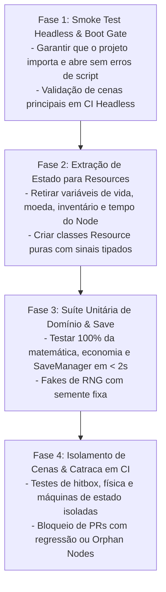

# 📈 Plano Estratégico de Modernização de Testes em Projetos de Jogos

> **Fonte Normativa:** `guides/testing/games/test-modernization-plan.md`  
> **Objetivo:** Roteiro progressivo em 4 fases para transformar jogos acoplados e sem testes (*God Nodes* / *Spaghetti Scripts*) em arquiteturas modulares testáveis em modo headless sem interromper a produção de novas mecânicas

---

## 1. O Desafio do Legado em Jogos Digitais ("O Monólito do `player.gd`")

Projetos de jogos frequentemente nascem de protótipos rápidos de *Game Jams* ou ciclos de descoberta onde um único arquivo (`player.gd`, `world_manager.gd`, `PlayerController.cs`) acumula mais de 2.500 linhas misturando:
- Leitura direta de hardware (`Input.is_key_pressed(KEY_SPACE)`);
- Regras econômicas, plantio, colheita, inventário e cálculo de dano;
- Manipulação direta de nós filhos (`$UI/Panel/GoldLabel.text = str(gold)`);
- Chamadas diretas de áudio, partículas e salvamento em disco.

Tentar testar esse nó diretamente exige carregar o mapa inteiro do jogo, todas as texturas, músicas e aguardar animações reais — tornando os testes lentos, frágeis e impossíveis de manter.



---

## 2. As 4 Fases de Modernização Passo a Passo

### Fase 1: Smoke Test Headless e Blindagem de Boot (Dia 1)
**Meta:** Garantir que nenhum commit quebre o carregamento de cenas (`.tscn`), referências de `preload()` ou tipagem estática, **sem alterar a lógica do jogo**.

1. Configure o runner headless no `Makefile` e no CI (`godot --headless --import && godot --headless --quit`).
2. Crie um único teste de fumaça (*Smoke Test*) que carrega as cenas principais do jogo (`MainMenu.tscn`, `FarmWorld.tscn`, `Player.tscn`), instancia cada uma por 2 quadros físicos e verifica que não ocorrem erros de script ou vazamento de nós.

---

### Fase 2: Extração Cirúrgica de `Resource` (Padrão *Humble Node*)
**Meta:** Transformar o `Node2D`/`Node3D` em um *Humble Object* (objeto humilde que apenas traduz sinais para a tela), movendo toda a inteligência para classes `Resource` ou `RefCounted`.

#### Antes (Monólito Intestável no Nó Visual):
```gdscript
# ❌ Difícil de testar: exige SceneTree, Sprite2D, AudioStreamPlayer e Label instanciados
extends Node2D

var seeds: int = 10
var gold: int = 100

func buy_seed(quantity: int) -> void:
	var cost: int = quantity * 15
	if gold >= cost:
		gold -= cost
		seeds += quantity
		$CanvasLayer/HBox/GoldLabel.text = str(gold)
		$BuySound.play()
```

#### Depois (Domínio Extraído e 100% Testável em Memória):
```gdscript
# ✅ res://domain/economy/farm_wallet.gd — Testável em 0.1ms sem qualquer nó visual!
class_name FarmWallet
extends Resource

signal balance_changed(new_gold: int, new_seeds: int)

@export var gold: int = 100
@export var seeds: int = 10

func buy_seeds(quantity: int, unit_price: int = 15) -> bool:
	if quantity <= 0 or unit_price < 0:
		return false
	var total_cost: int = quantity * unit_price
	if gold < total_cost:
		return false
	gold -= total_cost
	seeds += quantity
	balance_changed.emit(gold, seeds)
	return true
```

---

### Fase 3: Cobertura Unitária das Regras Críticas e Persistência
**Meta:** Cobrir as mecânicas que mais geram bugs graves para o jogador:
1. **Economia e Inventário:** Compra, venda, empilhamento (*stacking*), limites de mochila e prevenção de saldos negativos.
2. **Ciclo de Tempo e Crescimento:** Passagem de dias/estações, rega de plantações e apodrecimento.
3. **Combate e Status:** Mitigação de dano, aplicação de *buffs/debuffs* e morte.
4. **Save/Load e Migração:** Garantia de que saves da versão `v1` carregam perfeitamente na versão `v2` e que arquivos corrompidos acionam o `.bak`.

---

### Fase 4: Testes de Cena com Inputs Simulados e Catraca no CI
**Meta:** Automatizar os testes de colisão física, *Coyote Time*, *Input Buffering* e impedir regressões futuras.

1. Adicione a verificação estrita de **Zero Orphan Nodes** no runner de CI.
2. Aplique a **Regra do Escoteiro com Catraca (*Ratchet Gate*)**: toda nova mecânica de gameplay ou correção de bug exige no mínimo um teste unitário em `tests/unit/` ou um teste de cena em `tests/scenes/` antes do merge.
