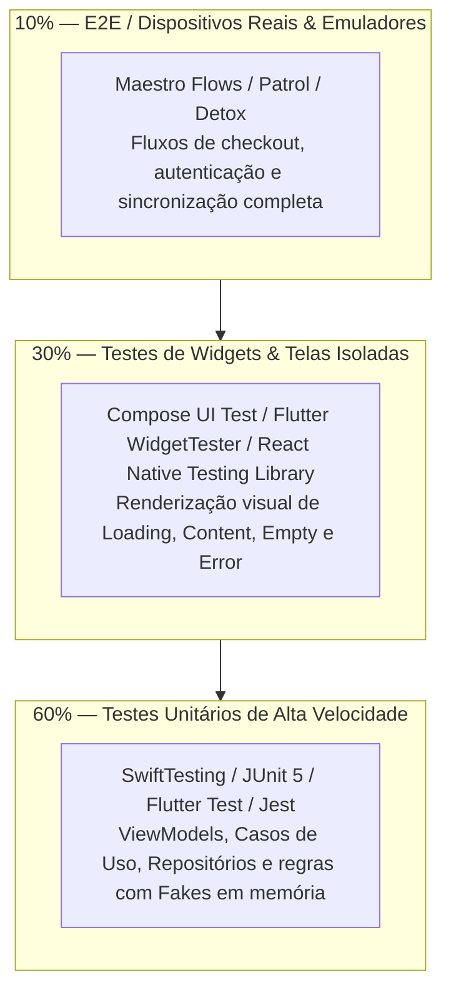

# 📱 Suíte de Guias de Testes Mobile

<div align="center">

[](../../../README.md)
[](test-writing-standards.md)
[](test-execution-guide.md)

<p align="center">
  <b>Padrões de engenharia para testes unitários, testes de componentes e widgets visuais, isolamento de estado e testes E2E em dispositivos para iOS e Android.</b>
</p>

</div>

---

## ⚙️ Heurísticas Executáveis

Bloco lido pelo `/setup` e por `skills/setup/scripts/verify_setup.py`. `when`/`verify` são shell (cwd = raiz do projeto mobile, `AI_GUIDES_RUNTIME` aponta para `.agents/ai-guides`). Heurísticas ativam quando arquivos de configuração mobile são detectados (`pubspec.yaml`, `android/build.gradle*`, `ios/*.xcodeproj`, ou `package.json` com `react-native`/`expo`). Os 4 guias abaixo compõem o conteúdo normativo referenciado.

```yaml heuristics
guide: testing-mobile
version: 1
requires: [desenvolvimento-mobile]
heuristics:
  - id: TMOB-01
    title: Script ou comando de teste mobile definido no projeto
    when: |
      sh "$AI_GUIDES_RUNTIME/templates/in_each.sh" --any mobile "test -f package.json && grep -qE '\"(react-native|expo)\"' package.json && ! python3 \"$AI_GUIDES_RUNTIME/templates/testing/npm_script.py\" test"
    do: |
      agent: Adicione o script "test" no package.json do(s) subprojeto(s) React Native/Expo apontando para o runner do projeto (ex.: "jest" ou "vitest").
    verify: |
      ! sh "$AI_GUIDES_RUNTIME/templates/detect_stack.sh" mobile || sh "$AI_GUIDES_RUNTIME/templates/in_each.sh" --all mobile "! test -f package.json || ! grep -qE '\"(react-native|expo)\"' package.json || python3 \"$AI_GUIDES_RUNTIME/templates/testing/npm_script.py\" test"

  - id: TMOB-02
    title: Estrutura de testes segregada (unitários e componentes/widgets)
    when: |
      sh "$AI_GUIDES_RUNTIME/templates/in_each.sh" --any mobile "! test -d test && ! test -d tests && ! test -d __tests__ && ! test -d Tests && ! test -d app/src/test && ! test -d android/app/src/test && ! ls -d *Tests 2>/dev/null | grep -q ."
    do: |
      agent: Crie a estrutura canônica de testes em cada subprojeto mobile (ex.: test/unit e test/widget no Flutter; __tests__ no React Native/Expo; app/src/test no Android/Kotlin; Tests/ ou <App>Tests/ no iOS/Swift).
    verify: |
      ! sh "$AI_GUIDES_RUNTIME/templates/detect_stack.sh" mobile || sh "$AI_GUIDES_RUNTIME/templates/in_each.sh" --all mobile "test -d test || test -d tests || test -d __tests__ || test -d Tests || test -d app/src/test || test -d android/app/src/test || ls -d *Tests 2>/dev/null | grep -q ."

  - id: TMOB-03
    title: Padrão AAA e ausência de chamadas reais de rede na suíte unitária
    when: |
      sh "$AI_GUIDES_RUNTIME/templates/detect_stack.sh" mobile && { git grep -h --untracked -iE -e 'http:[/]/|https:[/]/api\.' -- '*__tests__*' '*.test.*' '*.spec.*' '*_test.*' '*Test.*' '*Tests.*' '*test_*' ':(glob)**/test*/**' ':(glob)**/__tests__/**' ':(glob)**/*Tests/**' ':!.agents' ':!docs' ':!*.md' 2>/dev/null | grep -qvE 'https?://(localhost|127\.0\.0\.1|10\.0\.2\.2|0\.0\.0\.0)'; }
    do: "agent: Substitua chamadas diretas de URLs reais nos testes móveis por contratos mockados, fakes em memória ou MockWebServer."
    verify: |
      ! sh "$AI_GUIDES_RUNTIME/templates/detect_stack.sh" mobile || ! { git grep -h --untracked -iE -e 'http:[/]/|https:[/]/api\.' -- '*__tests__*' '*.test.*' '*.spec.*' '*_test.*' '*Test.*' '*Tests.*' '*test_*' ':(glob)**/test*/**' ':(glob)**/__tests__/**' ':(glob)**/*Tests/**' ':!.agents' ':!docs' ':!*.md' 2>/dev/null | grep -qvE 'https?://(localhost|127\.0\.0\.1|10\.0\.2\.2|0\.0\.0\.0)'; }
```

---

## 📚 Documentos Normativos da Suíte de Testes Mobile

A suíte divide-se em 4 guias canônicos de engenharia:

1. **[`test-writing-standards.md`](test-writing-standards.md):** Padrão AAA (*Arrange, Act, Assert*), escrita de testes unitários para ViewModels e Casos de Uso, testes de Widgets/Componentes isolados e testes E2E com Maestro e Patrol.
2. **[`test-execution-guide.md`](test-execution-guide.md):** Execução local em emuladores e simuladores, modo headless, otimização de velocidade de suíte e pipelines de CI/CD móvel.
3. **[`troubleshooting.md`](troubleshooting.md):** Resolução determinística de testes instáveis (*flaky tests*), dessincronização de animações, loops assíncronos e mocking de permissões de hardware.
4. **[`test-modernization-plan.md`](test-modernization-plan.md):** Roteiro estratégico de refatoração para transição de aplicativos legados sem testes para a pirâmide de testes corporativa.

---

## 🏛️ A Pirâmide de Testes Mobile Corporativa


