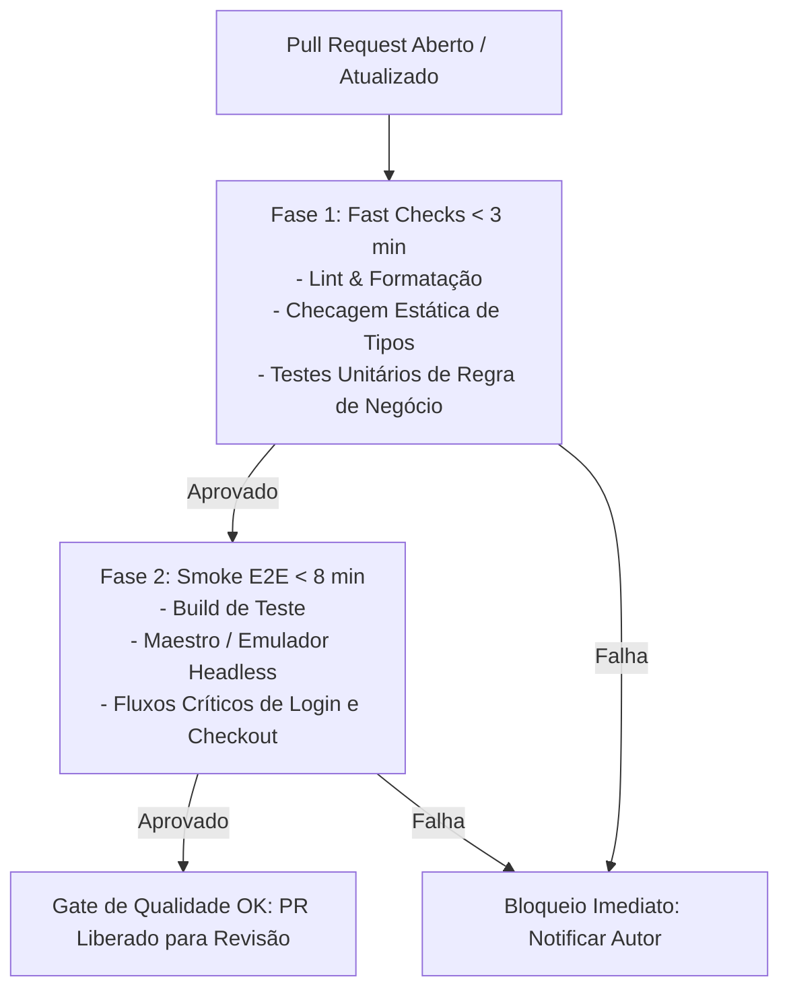

# 🚀 Guia de Execução e Automação de Testes Mobile (CI/CD)

> **Fonte Normativa:** `guides/testing/mobile/test-execution-guide.md`  
> **Escopo:** Execução local, emuladores headless, pipelines de CI/CD, matriz de device farms e políticas de SLA de feedback

---

## 1. Execução Local de Testes por Stack

Para manter alta velocidade de desenvolvimento (Inner Loop), a execução local deve oferecer opções para testes rápidos unitários e suítes completas com cobertura.

### 1.1. Flutter & Dart

```bash
# Execução rápida de testes unitários e de widgets (sem emulador)
flutter test

# Execução filtrando por arquivo ou tag específica
flutter test test/viewmodels/task_view_model_test.dart
flutter test --tags smoke

# Execução com geração de relatório de cobertura de código (LCOV)
flutter test --coverage
genhtml coverage/lcov.info -o coverage/html # Gera dashboard visual em HTML

# Testes de integração em dispositivo ou emulador ativo
flutter test integration_test/critical_checkout_flow_test.dart
```

### 1.2. React Native & Expo (Jest / Vitest)

```bash
# Execução da suíte de testes unitários com watch mode local
npm test -- --watch

# Execução única para esteira de CI com cobertura estrita
npm run test:ci -- --coverage --maxWorkers=2

# Verificação estática de tipos (TypeScript) sem emissão de arquivos
npm run typecheck

# Teste unitário de um único arquivo específico
npx jest src/stores/__tests__/taskStore.test.ts
```

### 1.3. Android (Kotlin / Gradle)

```bash
# Testes unitários rápidos executados na JVM local da máquina de desenvolvimento
./gradlew testDebugUnitTest

# Testes unitários com relatório unificado de cobertura JaCoCo
./gradlew testDebugUnitTestCoverage jacocoTestReport

# Teste filtrando por classe específica
./gradlew testDebugUnitTest --tests "com.cpb.enterprise.TaskViewModelTest"

# Testes instrumentados executados em emulador ou aparelho físico conectado
./gradlew connectedDebugAndroidTest
```

### 1.4. Apple (Swift / Xcode)

```bash
# Execução de testes de pacote Swift via CLI (SwiftPM)
swift test

# Execução de testes de aplicativo via xcodebuild no simulador iOS mais recente
xcodebuild test \
  -workspace AppEnterprise.xcworkspace \
  -scheme AppEnterprise \
  -destination 'platform=iOS Simulator,name=iPhone 16,OS=latest' \
  -resultBundlePath build/TestResults.xcresult \
  -quiet

# Execução filtrando apenas um teste específico
xcodebuild test \
  -workspace AppEnterprise.xcworkspace \
  -scheme AppEnterprise \
  -destination 'platform=iOS Simulator,name=iPhone 16,OS=latest' \
  -only-testing:AppEnterpriseTests/TaskListViewModelTests/loadTasksSuccess
```

---

## 2. Emuladores e Simuladores Headless em CI

Rodar testes em esteiras automatizadas (GitHub Actions, GitLab CI, Bitrise) exige inicialização de dispositivos virtuais sem interface gráfica (*headless*), com consumo mínimo de recursos de CPU e memória.

### 2.1. Android Emulator Headless (Linux / macOS Runners)

Para evitar que o emulador trave o runner por falta de GPU física:
1. Utilize GPU por software com shader indireto (`-gpu swiftshader_indirect`).
2. Desative áudio, animações de boot e janela gráfica (`-no-window -no-audio -no-boot-anim`).
3. Aguarde determinísticamente o término completo do boot do sistema operacional antes de disparar testes.

```bash
#!/usr/bin/env bash
set -euo pipefail

echo "==> Criando AVD (Android Virtual Device)..."
echo "no" | avdmanager create avd \
  -n test_avd \
  -k "system-images;android-34;google_apis;x86_64" \
  --force

echo "==> Inicializando emulador em background..."
$ANDROID_HOME/emulator/emulator -avd test_avd \
  -no-window \
  -no-audio \
  -no-boot-anim \
  -gpu swiftshader_indirect \
  -camera-back none \
  -camera-front none \
  -netdelay none \
  -netspeed full &

echo "==> Aguardando boot completo do dispositivo..."
adb wait-for-device
while [[ "$(adb shell getprop sys.boot_completed 2>/dev/null | tr -d '\r')" != "1" ]]; do
  echo "Aguardando inicialização do SO..."
  sleep 2
done

echo "==> Desativando animações do sistema para erradicar flakiness..."
adb shell settings put global window_animation_scale 0
adb shell settings put global transition_animation_scale 0
adb shell settings put global animator_duration_scale 0

echo "✅ Emulador Android operacional e otimizado para testes!"
```

### 2.2. iOS Simulator Headless (macOS Runners)

No ecossistema Apple, os simuladores são mais leves que emuladores Android por compartilharem o kernel do macOS hospedeiro:

```bash
#!/usr/bin/env bash
set -euo pipefail

DEVICE_TYPE="iPhone 16"
RUNTIME="iOS-18-0"
UDID=$(xcrun simctl create "CI_Runner_Device" "$DEVICE_TYPE" "$RUNTIME")

echo "==> Inicializando Simulador iOS UDID: $UDID..."
xcrun simctl boot "$UDID"
xcrun simctl bootstatus "$UDID" -b

echo "==> Desativando animações de teclado e janelas..."
xcrun simctl spawn "$UDID" defaults write com.apple.springboard HardwareKeyboardWindowLevel -int 1000

echo "✅ Simulador iOS pronto para execução de testes."
```

---

## 3. Matriz de CI/CD para Mobile (GitHub Actions)

A esteira de integração contínua deve ser dividida em **camadas de velocidade**, garantindo que verificações rápidas forneçam feedback imediato ao desenvolvedor:



### Exemplo de Pipeline Completo: `.github/workflows/mobile-ci.yml`

```yaml
name: Mobile Quality Pipeline

on:
  pull_request:
    branches: [main, develop]
    paths:
      - 'mobile/**'
      - '.github/workflows/mobile-ci.yml'

concurrency:
  group: ${{ github.workflow }}-${{ github.ref }}
  cancel-in-progress: true

jobs:
  unit-fast-checks:
    name: ⚡ Fast Checks (Unit & Types)
    runs-on: ubuntu-latest
    timeout-minutes: 5
    steps:
      - uses: actions/checkout@v4

      - name: Setup Node / Flutter / Java
        uses: actions/setup-node@v4
        with:
          node-version: 20
          cache: 'npm'

      - name: Instalar Dependências
        run: npm ci

      - name: Checagem de Tipos Estáticos
        run: npm run typecheck

      - name: Testes Unitários com Cobertura
        run: npm run test:ci -- --coverage --maxWorkers=2

      - name: Upload de Cobertura para Codecov
        uses: codecov/codecov-action@v4
        with:
          token: ${{ secrets.CODECOV_TOKEN }}
          fail_ci_if_error: true

  e2e-smoke-android:
    name: 📱 Maestro E2E Smoke (Android Headless)
    needs: unit-fast-checks
    runs-on: ubuntu-latest
    timeout-minutes: 15
    steps:
      - uses: actions/checkout@v4

      - name: Setup Java JDK
        uses: actions/setup-java@v4
        with:
          distribution: 'temurin'
          java-version: '17'

      - name: Setup Android SDK
        uses: android-actions/setup-android@v3

      - name: Instalar Maestro CLI
        run: curl -fsSL "https://get.maestro.mobile.dev" | bash

      - name: Executar Teste E2E no Emulador Headless
        uses: reactivecircus/android-emulator-runner@v2
        with:
          api-level: 34
          target: google_apis
          arch: x86_64
          profile: pixel_6
          script: |
            adb shell settings put global window_animation_scale 0
            adb shell settings put global transition_animation_scale 0
            adb shell settings put global animator_duration_scale 0
            ~/.maestro/bin/maestro test .maestro/smoke_flow.yaml
```

---

## 4. Estratégia de Testes em Dispositivos Físicos (Device Farms)

Emuladores são excelentes para verificar lógica de telas e fluxos E2E padronizados, mas **não substituem dispositivos físicos em homologação pré-release**. 

### 4.1. Quando Usar Emulador vs. Aparelho Real:

| Critério | Emulador / Simulador | Aparelho Físico Real (Device Farm) |
| :--- | :--- | :--- |
| **Execução em PR (Feedback Rápido)** | ⭐⭐⭐ Recomendado (barato e rápido) | ❌ Muito lento para cada commit |
| **Customizações de Fabricantes (OEM)** | ❌ Apenas Android puro (AOSP) | ⭐⭐⭐ Obrigatório (Samsung OneUI, Xiaomi MIUI, Motorola) |
| **Comportamento Biométrico Físico** | Mock de software | Sensores reais com latência física |
| **Câmera, Bluetooth e Sensores** | Simulações estáticas | Testes reais de pareamento e leitura ótica |
| **Consumo de Bateria e Térmico** | Impossível medir com precisão | ⭐⭐⭐ Medição real em tempo de execução |

### 4.2. Integração com Firebase Test Lab (Matriz de Fabricantes)

Para compilações noturnas (*nightly builds*) ou disparos pré-release, submeta o APK/AAB diretamente ao Firebase Test Lab:

```bash
gcloud firebase test android run \
  --type instrumentation \
  --app app-release-unsigned.apk \
  --test app-debug-androidTest.apk \
  --device model=oriole,version=34,locale=pt_BR,orientation=portrait \
  --device model=a52,version=33,locale=pt_BR,orientation=portrait \
  --timeout 10m \
  --results-bucket=gs://cpb-mobile-test-artifacts
```

---

## 5. Coleta de Métricas, Cobertura e Governança

1. **Threshold Mínimo de Cobertura:** Todo projeto mobile deve manter cobertura de testes $\ge 80\%$ na camada de domínio e ViewModels/Stores.
2. **Relatórios Unificados:**
   - Converta relatórios de cobertura para o formato LCOV ou XML (JaCoCo).
   - Publique os resultados no SonarQube ou Codecov para acompanhar a evolução histórica.
3. **Detecção de Regressão de Tempo de Execução:** Monitore o tempo total da suíte. Se a execução unitária ultrapassar 3 minutos, identifique gargalos como timeouts em testes assíncronos ou criação excessiva de contextos de banco de dados.

---

## 6. SLAs e Orçamentos de Tempo para Mobile CI

- **Feedback de PR (Fast Checks):** Máximo de **3 minutos**. Bloqueia o merge se quebrar.
- **Smoke E2E em PR:** Máximo de **8 minutos**. Executa apenas os fluxos de maior impacto no negócio.
- **Suíte E2E Completa (Regression Pack):** Execução noturna (*Nightly*) com tolerância de até **30 minutos**, cobrindo matriz de emuladores e aparelhos físicos reais.
