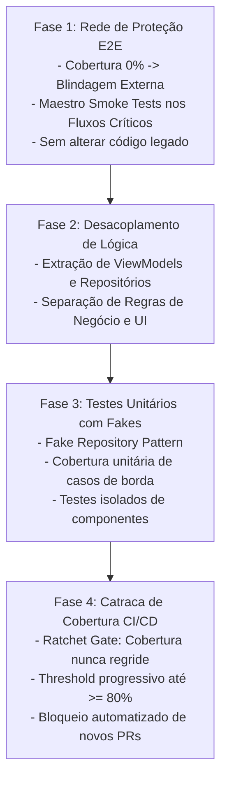

# 📈 Plano Estratégico de Modernização de Testes Mobile

> **Fonte Normativa:** `guides/testing/mobile/test-modernization-plan.md`  
> **Objetivo:** Roteiro prático, prescritivo e progressivo para elevar aplicativos legados sem testes para a pirâmide de testes corporativa (cobertura $\ge 80\%$) sem paralisar as entregas de negócio

---

## 1. O Desafio dos Aplicativos Móveis Legados

Muitos aplicativos móveis empresariais encontram-se no chamado **"Dilema do Legado Móvel"**:
- Telas monolíticas (*God Activities*, *Massive ViewControllers*, widgets com mais de 2.000 linhas) onde lógica de layout, parsing JSON, chamadas de rede e persistência SQLite residem juntas.
- Qualquer alteração pontual em uma regra de negócio introduz quebras em cascata ou travamentos (*crashes*) inesperados em produção.
- **Armadilha Frequente:** Tentar paralisar o produto por seis meses para uma "reescrita do zero". Esse plano quase sempre falha, atrasa o roadmap e reintroduz bugs já superados.

**A Solução Correta:** Modernização incremental em 4 fases baseada no princípio de *Strangler Fig Application* (Estrangulamento do Monólito).



---

## 2. As 4 Fases de Modernização Passo a Passo

### Fase 1: A Rede de Proteção E2E (Black-Box Protection)
**Meta:** Impedir que refatorações quebrem as funcionalidades vitais do negócio, **sem modificar uma única linha de código legado**.

1. Instale o **Maestro** na máquina e na esteira de CI.
2. Identifique os 2 fluxos mais críticos do produto (ex.: Login/Autenticação e Jornada de Checkout/Visualização Principal).
3. Crie fluxos declarativos em YAML que executam o binário do app como um usuário real:
   ```yaml
   appId: com.cpb.enterprise.app
   ---
   - launchApp:
       clearState: true
   - assertVisible: "Entrar"
   - tapOn: "E-mail"
   - inputText: "teste@cpb.com.br"
   - tapOn: "Senha"
   - inputText: "Senha123"
   - tapOn: "Entrar"
   - assertVisible: "Dashboard Principal"
   ```
4. Adicione esse fluxo ao pipeline de CI. A partir desse instante, nenhum desenvolvedor conseguirá aprovar um PR que impeça o cliente de logar ou navegar no app.

---

### Fase 2: Desacoplamento da Lógica de Apresentação (ViewModels & UDF)
**Meta:** Retirar regras de negócio de dentro de arquivos de tela (`Activity.kt`, `ViewController.swift`, `Widget.dart`, `Screen.tsx`).

1. **Localize o método que trata a ação do usuário:** (ex.: clique no botão "Salvar").
2. **Crie um ViewModel / Store apartado:** Mova o cálculo, a validação de campos e a decisão lógica para uma classe pura sem dependências do framework visual do SO.
3. **Mantenha a UI como mera casca burra (*Dumb UI*):** A tela apenas observa os estados do ViewModel (`StateFlow`, `@Observable`, `Cubit`) e renderiza os elementos correspondentes.
4. **Validação:** Rode o teste E2E do Maestro da Fase 1 para assegurar que a extração não introduziu nenhuma regressão visual.

---

### Fase 3: Introdução do Padrão Fake Repository
**Meta:** Escrever testes unitários ultrarrápidos sem recorrer a mocks frágeis ou chamadas de rede.

#### O Problema dos Mocks Tradicionais:
Mocks complexos (`Mockito.when(...)`, `jest.fn()`) exigem que o teste conheça detalhes internos de implementação da classe. Se a implementação interna mudar, o teste quebra mesmo que o comportamento do sistema continue correto.

#### A Solução Canônica: O Fake Repository em Memória:
Crie uma implementação em memória da interface do repositório:

```kotlin
// Interface de Contrato
interface TaskRepository {
    suspend fun getTasks(): List<Task>
    suspend fun saveTask(task: Task)
}

// Fake Puro para Testes (Rápido, determinístico e sem mocks)
class FakeTaskRepository : TaskRepository {
    private val tasks = mutableListOf<Task>()
    var shouldFail = false

    fun prepareTasks(items: List<Task>) {
        tasks.clear()
        tasks.addAll(items)
    }

    override suspend fun getTasks(): List<Task> {
        if (shouldFail) throw NetworkException("Erro simulado")
        return tasks.toList()
    }

    override suspend fun saveTask(task: Task) {
        tasks.add(task)
    }
}
```

Agora, os testes unitários do ViewModel executam em milissegundos sem depender de banco de dados ou internet:

```kotlin
@Test
fun `ao carregar tarefas, deve emitir lista quando o repositorio responder com sucesso`() = runTest {
    val fakeRepo = FakeTaskRepository().apply {
        prepareTasks(listOf(Task(id = "1", title = "Estudar Testes")))
    }
    val viewModel = TaskViewModel(fakeRepo)
    
    viewModel.load()
    
    assertEquals(1, (viewModel.uiState.value as UiState.Success).data.size)
}
```

---

### Fase 4: Estabelecimento da Catraca de Cobertura (Coverage Ratchet)
**Meta:** Garantir que a qualidade do código avance a cada sprint e nunca regrida.

1. **Meça a Cobertura Baseline:** Se o projeto hoje tem 12% de cobertura, documente esse valor como o ponto de partida oficial.
2. **Ative a Catraca no CI (Coverage Ratchet):**
   - Regra estrita: *Nenhum Pull Request pode diminuir o percentual global de cobertura em relação ao baseline da branch main.*
   - Regra de código novo: *Todo código novo adicionado no PR deve ter pelo menos 80% de cobertura.*
3. **Princípio do Escoteiro Obrigatório:** *Qualquer desenvolvedor que mexer em um arquivo legado para corrigir um bug deve adicionar testes cobrindo a função modificada antes de solicitar aprovação de PR.*
4. **Evolução Gradativa da Meta:**
   - Mês 1: 30%
   - Mês 3: 50%
   - Mês 6: 70%
   - Mês 9: $\ge 80\%$ (Estado de excelência corporativa).

---

## 3. Matriz de Priorização de Telas e Módulos

Não tente testar tudo de uma vez. Priorize os módulos aplicando a matriz de valor de negócio:

| Quadrante | Impacto no Negócio | Frequência de Mudança | Ação Imediata |
| :--- | :--- | :--- | :--- |
| **Q1 (Crítico)** | Alto (Pagamentos, Autenticação, Dados Cadastrais) | Alta (Novas features constantes) | **Prioridade Máxima:** Iniciar Fases 1, 2 e 3 imediatamente. |
| **Q2 (Estável)** | Alto (Termos de Uso, Telas Legais) | Baixa (Raramente alterado) | Criar apenas 1 teste E2E do Maestro como salvaguarda. |
| **Q3 (Experimental)** | Baixo (Telas de experimentação/A-B) | Alta | Testes unitários focados nas regras da experiência. |
| **Q4 (Trivial)** | Baixo (Tela "Sobre o App") | Baixa | Não priorizar no plano inicial de modernização. |

---

## 4. Métricas de Sucesso da Modernização

A evolução da suíte de testes deve refletir em indicadores de engenharia e produto:

1. **Sessões Livres de Falhas (*Crash-Free Sessions*):** Meta corporativa $\ge 99.5\%$.
2. **Tempo Médio de Feedback em PR (Fast Checks):** $\le 3$ minutos.
3. **Tempo Médio para Lançamento de Hotfix:** Redução de dias para menos de 2 horas graças à confiança na esteira automatizada.
4. **Taxa de Testes Flaky:** Menor que 1% de todas as execuções semanais.
