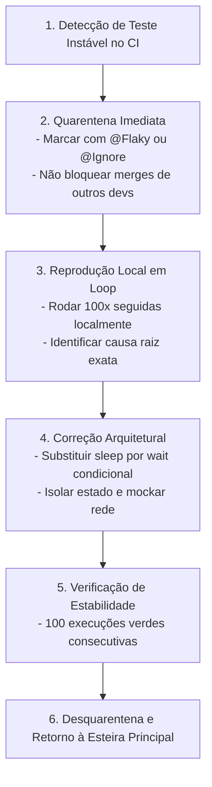

# 🩺 Troubleshooting de Testes Mobile & Erradicação de Flakiness

> **Fonte Normativa:** `guides/testing/mobile/troubleshooting.md`  
> **Objetivo:** Diagnóstico determinístico, resolução de falhas intermitentes (*flaky tests*) e protocolo de estabilização de suítes de testes mobile

---

## 1. As 8 Causas Raízes de Flakiness em Testes Mobile

Testes que passam localmente mas quebram aleatoriamente no CI geram perda de confiança na esteira e atrasam entregas. Todo teste instável decorre de uma das 8 causas fundamentais:

### 1.1. Animações e Transições de Tela Não Sincronizadas
- **Sintoma:** O runner tenta interagir com um botão ou asserir um texto enquanto a transição de navegação, fade de opacidade ou efeito de física ainda está em andamento, gerando `Node not found` ou `Element is not visible`.
- **Causa Técnica:** O framework de teste dispara eventos de toque na coordenada matemática calculada no instante $t_0$, mas o elemento ainda não atingiu sua posição final na tela.
- **Solução Definitiva:**
  1. No Android (CI), zere programaticamente as três escalas de animação do sistema:
     ```bash
     adb shell settings put global window_animation_scale 0
     adb shell settings put global transition_animation_scale 0
     adb shell settings put global animator_duration_scale 0
     ```
  2. No Flutter, utilize sempre `await tester.pumpAndSettle()` para aguardar o esvaziamento completo de microtasks e frames pendentes.
  3. No React Native, configure `jest.useFakeTimers()` ao testar componentes com transições animadas.

---

### 1.2. Coroutines, Tasks e Timers Assíncronos Descontrolados
- **Sintoma:** Erros como `A Timer is still pending even after the widget tree was disposed`, `Unfinished coroutine in testScope` ou asserções que checam o estado antes da resposta assíncrona ser processada.
- **Causa Técnica:** Criação de operações assíncronas em escopos globais (`GlobalScope`, `Task.detached`, callbacks de timer sem cancelamento no unmount).
- **Solução Definitiva:**
  - No Kotlin, utilize `StandardTestDispatcher` com `runTest` e controle manual do tempo virtual:
    ```kotlin
    testScheduler.advanceUntilIdle() // Drena todas as tarefas da fila de corrotinas
    ```
  - Em Swift, utilize `Task.yield()` ou isole a sincronização dentro de atores com confirmação de estado.
  - Sempre descarte *subscriptions*, *controllers* e *timers* nas rotinas de `dispose()` / `deinit` / `componentWillUnmount`.

---

### 1.3. Estado Compartilhado de Banco de Dados e Cache Local
- **Sintoma:** Um teste passa isoladamente mas quebra quando a suíte inteira é executada em lote, ou testes quebram dependendo da ordem alfabética de execução.
- **Causa Técnica:** O teste anterior gravou registros no banco SQLite, no Keychain ou em arquivos de preferências locais e não limpou a base no encerramento.
- **Solução Definitiva:**
  - Instancie bancos de dados puramente em memória (*in-memory database*) para cada teste unitário:
    ```kotlin
    Room.inMemoryDatabaseBuilder(context, AppDatabase::class.java)
        .allowMainThreadQueries()
        .build()
    ```
  - Em testes E2E, configure o Maestro com `clearState: true` no início do fluxo para garantir ambiente completamente zerado:
    ```yaml
    - launchApp:
        clearState: true
    ```

---

### 1.4. Teclado Virtual Bloqueando Coordenadas de Toque
- **Sintoma:** O teste falha com `View is not visible` ou `Tap coordinate is blocked by another element` (geralmente sobreposto pelo teclado do sistema).
- **Causa Técnica:** Ao focar em um campo de entrada (`EditText`, `TextField`, `TextInput`), o teclado do sistema sobe e empurra ou cobre os botões de ação na parte inferior da tela.
- **Solução Definitiva:**
  - Oculte explicitamente o teclado após preencher os dados:
    - Maestro: `- hideKeyboard`
    - Flutter: `FocusManager.instance.primaryFocus?.unfocus()`
    - Compose: `val keyboardController = LocalSoftwareKeyboardController.current; keyboardController?.hide()`
  - Envolva formulários sempre em contêineres roláveis (`ScrollView`) e utilize `scrollUntilVisible` antes de tentar clicar em botões inferiores.

---

### 1.5. Diálogos Nativos de Permissão e Popups do SO
- **Sintoma:** O teste congela até estourar o timeout global da esteira porque uma caixa de diálogo do sistema operacional ("Permitir que este app envie notificações?") bloqueia a janela do app.
- **Causa Técnica:** O runner de teste opera na camada de UI do aplicativo e não consegue interagir diretamente com janelas de permissão do sistema fora do processo.
- **Solução Definitiva:**
  - Conceda todas as permissões necessárias previamente via linha de comando no script de CI antes de abrir o app:
    ```bash
    # Android (ADB)
    adb shell pm grant com.cpb.enterprise.app android.permission.POST_NOTIFICATIONS
    adb shell pm grant com.cpb.enterprise.app android.permission.ACCESS_FINE_LOCATION

    # iOS (simctl)
    xcrun simctl privacy booted grant notifications com.cpb.enterprise.app
    xcrun simctl privacy booted grant location com.cpb.enterprise.app
    ```

---

### 1.6. Divergência de Timezone, Locale e Moeda entre Máquinas
- **Sintoma:** O teste passa na máquina do desenvolvedor (fuso de Brasília, `pt-BR`) mas quebra no runner Linux da nuvem (configurado em UTC, `en-US`), falhando em asserções de datas formatadas (`18/10/2026` vs `10/18/2026`) ou moedas (`R$ 10,00` vs `$10.00`).
- **Solução Definitiva:**
  - Force explicitamente o locale e a timezone na inicialização da JVM e nos argumentos do runner de teste:
    ```bash
    export TZ="America/Sao_Paulo"
    export LANG="pt_BR.UTF-8"
    ```
  - Em testes unitários, utilize formatadores com Locale fixado explicitamente no código de teste:
    ```kotlin
    val formatter = NumberFormat.getCurrencyInstance(Locale("pt", "BR"))
    ```

---

### 1.7. Renderização de Fontes e Densidade em Testes de Snapshot
- **Sintoma:** Testes de regressão visual (Snapshot / Screenshot Testing) falham com pequenas diferenças de 1% a 2% nos pixels de textos renderizados.
- **Causa Técnica:** Diferenças de antialiasing de fontes entre o macOS da máquina local e o Linux do servidor de CI.
- **Solução Definitiva:**
  - Execute testes de snapshot exclusivamente dentro de contêineres Docker padronizados que espelham o ambiente exato do CI.
  - Configure tolerância controlada de discrepância (ex.: `diffTolerance = 0.01` ou 1%).

---

### 1.8. Dependência Oculta de Conexão à Internet Real
- **Sintoma:** Testes quebram em momentos de lentidão de rede, instabilidade de DNS ou rate limit de APIs de terceiros.
- **Solução Definitiva:**
  - **Zero Requisições Reais na Suíte de Testes:** Utilize interceptores locais herméticos (**MockWebServer**, **MSW** ou **WireMock**) com tempos de resposta determinísticos.

---

## 2. Protocolo de Erradicação de Testes Flaky em 4 Passos



### Script para Reprodução de Teste Flaky em Loop:

```bash
#!/usr/bin/env bash
# Roda o teste suspeito 100 vezes consecutivas para forçar a quebra por concorrência
FAIL_COUNT=0
TOTAL_RUNS=100

echo "Iniciando estresse de estabilidade para o teste..."
for i in $(seq 1 $TOTAL_RUNS); do
  echo "==> Execução #$i de $TOTAL_RUNS"
  if ! ./gradlew testDebugUnitTest --tests "com.cpb.enterprise.TaskViewModelTest"; then
    echo "❌ Falha detectada na execução #$i!"
    FAIL_COUNT=$((FAIL_COUNT + 1))
    break
  fi
done

if [ $FAIL_COUNT -eq 0 ]; then
  echo "✅ Teste 100% estável ao longo de $TOTAL_RUNS execuções consecutivas!"
else
  echo "⚠️ Teste comprovadamente instável. Analise logs e concorrência."
fi
```

---

## 3. Checklist Rápido de Recuperação

- [ ] O emulador de CI está com animações desativadas (`scale 0`)?
- [ ] O teste depende de algum `sleep()` arbitrário? (Substitua por `waitFor` ou `advanceUntilIdle`).
- [ ] O banco de dados local é puramente em memória e recriado em cada teste?
- [ ] Todas as permissões de sistema foram pré-concedidas via ADB/simctl?
- [ ] O teclado virtual foi fechado antes de clicar em botões inferiores da tela?
- [ ] Os testes executam sem depender de conectividade com a internet real?
