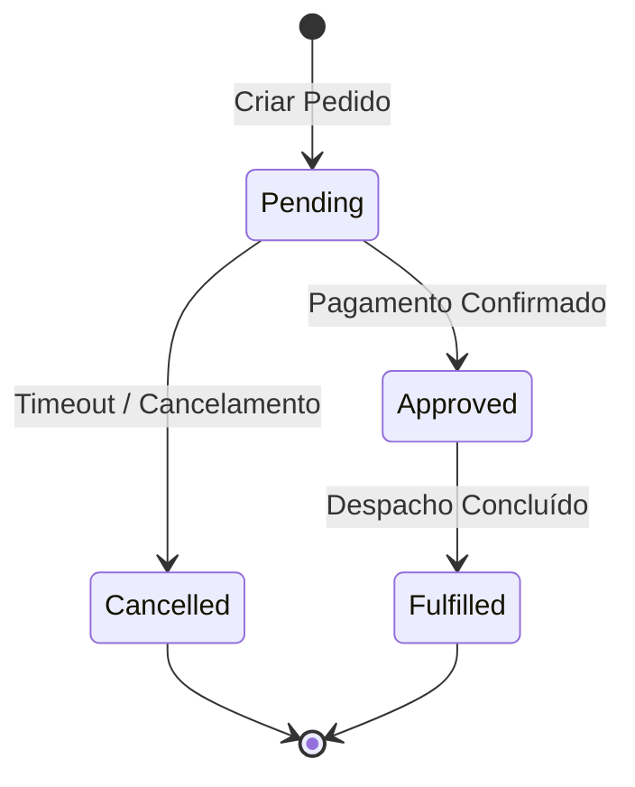

# Domínio de [Nome do Domínio]: Regras de Negócio (Business Rules)

---

## 1. Regras de Validação e Formatação
[Explique detalhadamente cada regra de validação de dados de entrada, restrições de formato, limites numéricos, regras temporais e obrigatoriedade de campos.]

### 1.1. Tabela de Validações
| Campo | Formato / Regra | Obrigatório | Mensagem de Erro |
| :--- | :--- | :--- | :--- |
| `email` | RFC 5322 / formato válido de e-mail | Sim | "E-mail em formato inválido" |
| `amount` | Valor decimal positivo > 0 | Sim | "O valor da transação deve ser superior a zero" |
| `sku` | Alfanumérico `[A-Z0-9-]{6,12}` | Sim | "Código SKU inválido" |

---

## 2. Máquina de Estados e Ciclo de Vida
[Descreva as transições de estado válidas para os agregados do domínio, incluindo condições de guarda e eventos disparados.]

---

## 3. Matriz de Permissões e Acessos (RBAC / ABAC)
[Explique os níveis de controle de acesso baseados em papéis (RBAC) ou atributos (ABAC): Usuário Leitor vs Operador vs Administrador vs Sistema / Service Account.]

| Papel / Perfil | Endpoint / Ação | Permissão | Regra de Escopo / Observação |
| :--- | :--- | :--- | :--- |
| **Cliente / Leitor** | `GET /api/v1/orders/` | Leitura | Restrito aos recursos pertencentes ao próprio `user_id` (Tenant/Ownership) |
| **Operador** | `POST /api/v1/orders/` | Criação | Permite submeter novos pedidos no contexto da organização |
| **Administrador** | `POST/PUT/DELETE /api/v1/*` | Escrita Total | Gestão irrestrita do módulo e parametrização |
| **Auditor / Compliance** | `GET /api/v1/audit-logs/` | Leitura | Acesso a trilhas de auditoria e relatórios de conformidade |

---

## 4. Auditoria, Rastreabilidade e Privacidade (LGPD / GDPR)
*   **Registro Obrigatório de Trilha de Auditoria:** Toda operação mutativa (Criação, Atualização, Exclusão de Estado) deve gerar log estruturado contendo `actor_id`, `action`, `resource_id`, `ip_address`, `timestamp_utc` e diff de dados anteriores vs novos (com dados sensíveis mascarados).
*   **Privacidade e Minimização de Dados (PII):** Atributos sensíveis (senhas, documentos pessoais, tokens de pagamento) devem ser cifrados em repouso e ofuscados em logs e respostas públicas.
*   **Políticas de Retenção e Exclusão:** Mecanismos de soft delete, anonimização e expiração programada conforme compliance do negócio.
