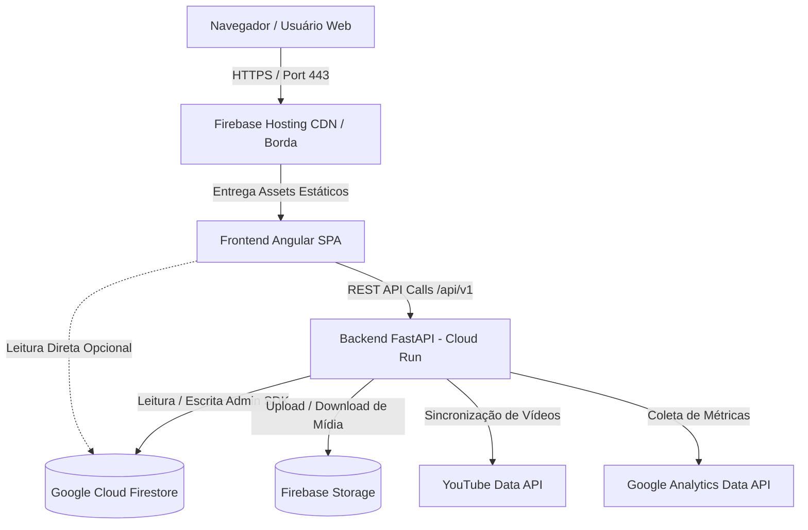

# System Design: Plataforma Lamed

<!-- Fonte canônica: templates/architecture/system-design.md (guia-system-design-sistemas-distribuidos.md §1, The 4-Step Blueprint) — instalado por SYSD-02 -->

> Documento vivo. As seções 1 e 2 registram o entendimento disponível no repositório; estimativas são hipóteses iniciais, não telemetria de produção. As demais evoluem com ADRs em `docs/adrs/`.

## 1. Escopo e Requisitos

### 1.1. Requisitos Funcionais Essenciais
- Servir uma aplicação web Angular para estudos bíblicos, artigos, bundles semanais e conteúdo em vídeo.
- Expor uma API FastAPI para consulta de conteúdo, administração, análise e tarefas de sincronização.
- Persistir conteúdo e dados operacionais no Firebase/Firestore.
- Permitir consulta de passagens bíblicas e apresentação no drawer de estudo do frontend.
- Executar tarefas protegidas de sincronização de vídeos e verificação de bundles pendentes.

### 1.2. Fora do Escopo (explicitamente descartado)
- Arquitetura de microsserviços ou particionamento horizontal do backend: o repositório descreve uma aplicação web e uma API como serviços separados, sem evidência de decomposição distribuída.
- Garantias de alta disponibilidade multi-região, replicação customizada ou sharding de Firestore: não há requisitos ou telemetria que justifiquem essas decisões.
- Estimativas de tráfego como metas de capacidade contratadas; os valores da seção 2 são apenas hipóteses para orientar medições.

### 1.3. Requisitos Não-Funcionais (QARs)
| Atributo | Meta inicial | Como medir |
| :--- | :--- | :--- |
| Disponibilidade | Definir SLO após obter baseline de produção; `/livez` verifica processo e `/readyz` dependências críticas | Métricas de uptime, probes e alertas do ambiente de deploy |
| Latência | Estabelecer p95/p99 por endpoint antes de definir limites | Instrumentação de requests e logs/monitoramento do deploy |
| Consistência | Firestore é a persistência compartilhada; respeitar as garantias documentadas pelo serviço, sem prometer consistência adicional | Testes de integração e comportamento observado nas operações de leitura/escrita |
| Durabilidade | Dependente das políticas e configuração do Firestore; confirmar backup e recuperação no ambiente | Exercícios de backup/restauração e revisão de configuração operacional |

## 2. Estimativas de Ordem de Grandeza (Back-of-the-Envelope)

Não há métricas de DAU, QPS, payload médio ou volume de dados versionadas neste repositório. Os números abaixo são um cenário de planejamento conservador, não dados observados; substituir por métricas de produção antes de decisões de capacidade.

| Métrica | Estimativa (hoje) | Estimativa (5 anos) | Base de cálculo |
| :--- | :--- | :--- | :--- |
| Usuários ativos diários (DAU) | 1.000 (hipótese) | 10.000 (hipótese) | Cenário de planejamento; validar com analytics |
| QPS de leitura / escrita | 0,12 / 0,01 médio (hipótese) | 1,16 / 0,12 médio (hipótese) | 10 ações de leitura e 1 escrita por DAU/dia, dividido por 86.400 s; pico a medir |
| Storage total | 10 GB (hipótese) | 100 GB (hipótese) | 10 MB de dados por DAU como aproximação inicial; medir Firestore e mídia separadamente |
| Largura de banda | 0,12 MB/s (hipótese) | 1,16 MB/s (hipótese) | 1 KB por leitura média; assets de mídia/CDN excluídos |
| Cache (RAM) | Não dimensionado | Não dimensionado | Não há perfil de hot keys ou cache dedicado demonstrado; coletar taxa de repetição e latência antes de dimensionar |

## 3. Arquitetura de Alto Nível (High-Level Design)

## 4. Deep Dive e Gargalos

### 4.1. Consistência de Dados (CAP / PACELC)
- **Classificação:** Firestore opera primariamente sob modelo CP (Consistência e Tolerância a Particionamento) na região de implantação (`southamerica-east1`).
- **Transações:** Operações de mutação crítica (como criação de artigos e bundles) utilizam transações atômicas ou batches no Firestore Admin SDK.
- **Leituras e Consultas:** Consultas paginadas (`only_active=true`, ordenadas por `published_at desc`) utilizam índices compostos com consistência forte garantida por documento.

### 4.2. Camada de Borda e Roteamento
- **DNS e CDN:** Gerenciados pelo Firebase Hosting com distribuição global Anycast e terminação TLS automática na borda.
- **Roteamento de API:** Tráfego para o backend é despachado para container Cloud Run com auto-scaling (0 a N instâncias) rodando Uvicorn com proxy headers habilitados (`--proxy-headers --forwarded-allow-ips *`).
- **Health Probes:** `/livez` monitora a liveness do processo e `/readyz` verifica a prontidão dos serviços e storage para o tráfego do container.

### 4.3. Persistência e Sharding
- **Modelo:** NoSQL baseado em documentos no Google Cloud Firestore.
- **Coleções Principais:** `articles`, `bundles`, `videos`, `users`.
- **Indexação:** Índices simples criados automaticamente; consultas ordenadas com filtros de igualdade (ex.: `is_active == true` + `published_at desc`) utilizam índices compostos declarados em `firestore.indexes.json`.
- **Particionamento:** Gerenciado nativamente pela infraestrutura do Google Cloud sem necessidade de sharding no nível da aplicação.

### 4.4. Caching
- **Frontend Assets:** Imutáveis com hash nos nomes de chunk (ex: `main-JIE7E3XO.js`) servidos com cache longo (`Cache-Control: public, max-age=31536000, immutable`).
- **Index HTML:** Servido com `Cache-Control: no-cache` para evitar stale clients em novas versões.
- **API Responses:** Cache HTTP curto e etags em endpoints públicos de leitura de artigos e bíblia.

### 4.5. Assincronismo e Integrações
- **YouTube Sync:** Execução controlada com batch queries e limites conservadores de paginação para evitar estouro de cotas da API do YouTube.
- **Download de Bundles:** Agregação ZIP de recursos em memória streaming (`io.BytesIO`) com controle de timeouts para mitigar riscos de exaustão de recursos.

### 4.6. Observabilidade
- **Logs:** Logs estruturados no padrão Uvicorn e FastAPI com identificação de requisições, status code e tempo de processamento.
- **Probes:** Endpoints canônicos `/livez` e `/readyz` disponíveis para balanceadores de carga e orquestradores.

## 5. Decisões Registradas
| ADR | Decisão |
| :--- | :--- |
| [ADR 0001](../adrs/0001-integracao-google-analytics-data-api.md) | Integração com Google Analytics Data API para métricas de engajamento |
| [ADR 0002](../adrs/0002-motor-biblico-e-drawer-de-estudo-interativo.md) | Motor bíblico reativo e drawer de estudo interativo no frontend |
| [ADR 0003](../adrs/0003-debito-contrato-camadas-js.md) | Adiar aplicação do contrato de dependências frontend até refatoração de camadas |
