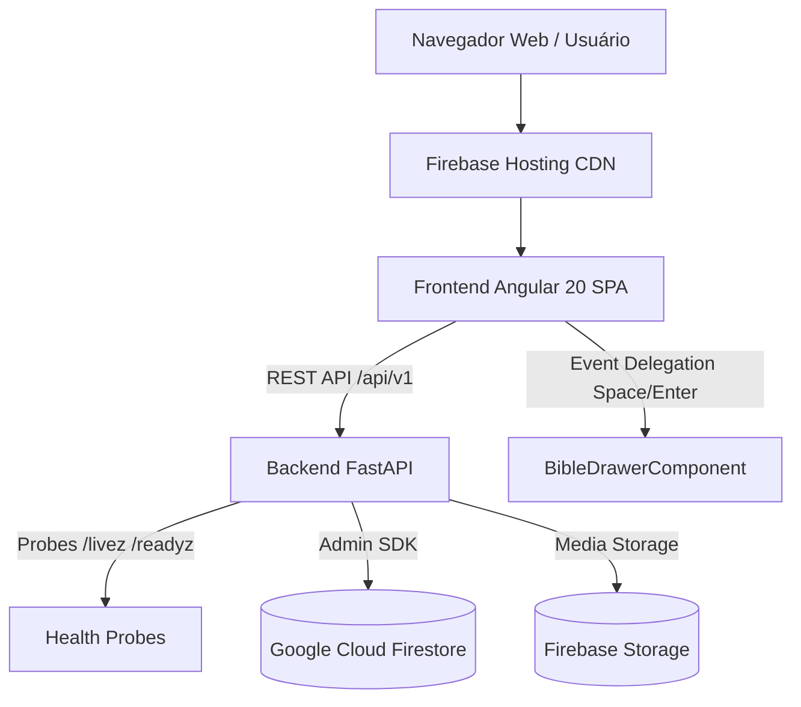

<!--
================================================================================
LOG DE MANUTENÇÃO DE DOCUMENTAÇÃO
--------------------------------------------------------------------------------
Data       | Autor          | Descrição
--------------------------------------------------------------------------------
2026-11-03 | OpenClaude     | Registro consolidado de desenvolvimento da sessão.
================================================================================
-->

# Registro de Desenvolvimento — 2026-11-03

| Metadado | Detalhe |
| :--- | :--- |
| **Escopo Principal** | Conclusão do Setup Canônico, Harness Nível 3, CI/CD, Acessibilidade e Auditorias Consolidadas |
| **Commits Gerados** | 5 micro-commits atômicos |
| **Arquivos Modificados** | 332 arquivos (harness, workflows, docs, ADRs, backend e frontend) |
| **ADRs Vinculadas / Geradas** | `docs/adrs/0001-integracao-google-analytics-data-api.md`, `docs/adrs/0002-motor-biblico-e-drawer-de-estudo-interativo.md`, `docs/adrs/0003-debito-contrato-camadas-js.md` |

---

## 1. Visão Geral das Alterações
> Conclusão integral do setup de governança e engenharia do monorepo Lamed (`0 ❌ · 1 ⚠️ · 142 ✅`), estruturação completa do harness de agentes Nível 3, esteiras isoladas de CI/CD para backend e frontend no GitHub Actions, governança de ADRs migradas para o padrão canônico `docs/adrs/`, formalização do System Design e documentação NoSQL Firestore. No frontend, foram sanadas pendências críticas de acessibilidade WCAG 2.2 AA (associação de inputs por label, atributos alt, semântica dialog e navegação por teclado para versículos bíblicos) e estabelecidos design tokens com suporte aos 4 temas da plataforma.

---

## 2. Arquitetura Afetada & Decisões (ADRs)
- **Decisões Registradas:**
  - `docs/adrs/0001-integracao-google-analytics-data-api.md`: Integração com Google Analytics Data API para métricas de engajamento.
  - `docs/adrs/0002-motor-biblico-e-drawer-de-estudo-interativo.md`: Motor bíblico reativo e drawer de estudo interativo no frontend.
  - `docs/adrs/0003-debito-contrato-camadas-js.md`: Formalização de débito técnico no acoplamento das camadas do frontend até refatoração de infraestrutura.
- **Diagrama de Relações e Fluxos:**

---

## 3. Mapa de Arquivos Modificados

| Arquivo | Camada Técnica | Resumo da Modificação |
| :--- | :--- | :--- |
| `.agents/**` | Harness / Governança | Regras, templates e scripts de conformidade Nível 3 |
| `.claude/**` & `.gemini/**` | Harness / Tooling | Configuração de agentes, memórias e hooks |
| `.github/workflows/**` | CI/CD | Workflows de testes backend/frontend, adr-lint, gitleaks e openapi-diff |
| `docs/adrs/**` | Governança | ADRs canônicas 0001, 0002 e 0003 com template e índice README |
| `docs/architecture/system-design.md` | Arquitetura | Especificação canônica com modelo C4 e garantias CAP/PACELC |
| `docs/database/database-schema.md` | Dados | Documentação reversa de coleções Firestore e índices |
| `backend/main.py` & `Dockerfile` | Backend / Infra | Implementação de endpoints `/livez` e `/readyz` com healthcheck |
| `backend/.importlinter-preflight.toml` | Backend / Lint | Regra proibindo importação de frameworks web na camada de domínio |
| `frontend/src/tokens.css` | Frontend / Design | Tokens CSS com suporte a Claro, Escuro, Capycro e Alto Contraste |
| `frontend/src/app/pages/article-detail/*` | Frontend / UI | Delegação de teclado (Enter/Space) para links de referências bíblicas |
| `frontend/eslint.config.cjs` | Frontend / Tooling | Flat config com plugin templateAccessibility ativo |

---

## 4. Detalhamento por Commit

### `chore(harness): configurar arquitetura do harness Nivel 3 e governanca de agentes` (3228875)
- **Razão da alteração:** Estabelecer a infraestrutura unificada de desenvolvimento autônomo e regras de governança.
- **Comportamento atual:** Validações de stack, sandboxing via `.ai-jail`, scripts de detecção e suite de mods disponíveis.
- **Decisões técnicas & ADRs:** Conformidade estrita com as heurísticas de IA do repositório.

### `ci(workflows): adicionar esteiras de validacao de adrs, seguranca, openapi e testes` (dacc83d)
- **Razão da alteração:** Garantir validação contínua e automatizada das regras de qualidade e conformidade no GitHub Actions.
- **Comportamento atual:** Pipelines isolados para backend (`uv run pytest`) e frontend (`npm run test:ci`), além de checagens de segredos e diff OpenAPI.
- **Decisões técnicas & ADRs:** Isolamento de diretórios de execução via `defaults.run.working-directory`.

### `docs(architecture): documentar adrs canonicas, system design e modelagem firestore` (4baa1a0)
- **Razão da alteração:** Atender às heurísticas canônicas de documentação de arquitetura, decisões e dados.
- **Comportamento atual:** ADRs 0001, 0002 e 0003 registradas, System Design completo e schema de coleções NoSQL formalizado.
- **Decisões técnicas & ADRs:** `docs/adrs/0003-debito-contrato-camadas-js.md`.

### `feat(backend): implementar health probes livez e readyz e configurar import-linter` (814b7f0)
- **Razão da alteração:** Melhorar a observabilidade de orquestração do container e garantir separação de camadas.
- **Comportamento atual:** `/livez` valida processo e `/readyz` valida storage; `import-linter` fiscaliza contratos limpos.
- **Decisões técnicas & ADRs:** Conformidade com o guia de arquitetura Clean Code e resiliência defensiva.

### `feat(frontend): aprimorar acessibilidade wcag, suporte a temas e configuracao de testes` (99092b6)
- **Razão da alteração:** Sanar violações de acessibilidade em formulários e templates, adicionar suporte a temas e testes E2E.
- **Comportamento atual:** Navegação acessível por teclado, 4 temas suportados via tokens CSS e ESLint templateAccessibility ativo.
- **Decisões técnicas & ADRs:** Heurísticas WCAG 2.2 AA atendidas.

---

## 5. Dívida Técnica & Próximos Passos

- [ ] Elevar a cobertura do backend dos atuais 67,37% para a meta institucional de 80% (mantendo a catraca em 67%).
- [ ] Adicionar focus trap estrito com `@angular/cdk/a11y` no componente `BibleDrawerComponent`.
- [ ] Implementar validação de scheme e timeout seguro contra SSRF no download ZIP em `backend/routes/bundles.py`.
