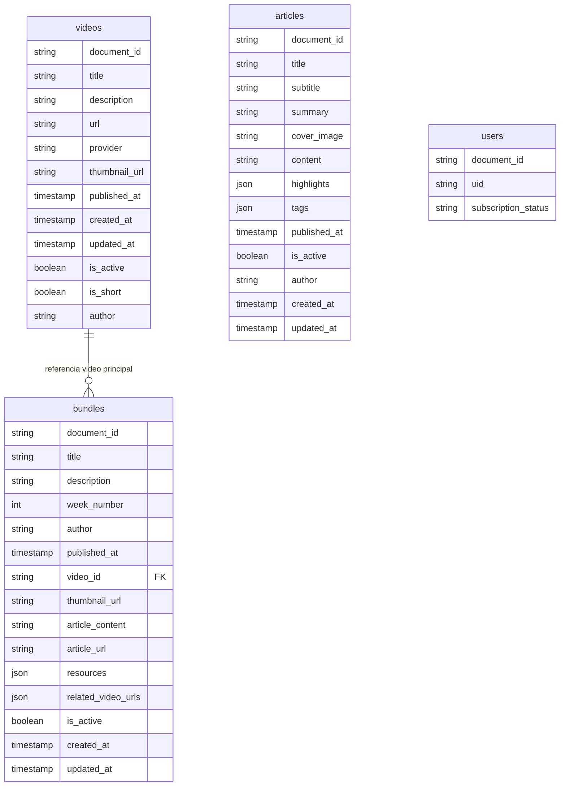

<!--
=================================================================================
LOG DE MANUTENÇÃO E ALTERAÇÕES DO DOCUMENTO
=================================================================================
Data       | Autor          | Descrição da Alteração
-----------|----------------|--------------------------------------------------
2026-11-03 | db-documentar  | Engenharia reversa estática de collections Firestore e contratos do backend.
=================================================================================
-->

# Documentação do Schema Firestore

## 1. Visão Geral e Arquitetura de Dados

- **Mecanismo:** Google Cloud Firestore (document store; não relacional).
- **Fontes:** `backend/models.py`, rotas FastAPI (`backend/routes/`), `firestore.rules`, configuração de índices disponível no repositório e documentação preexistente `FIRESTORE_SCHEMA.md`.
- **Collections identificadas:** `articles`, `bundles`, `videos` e `users` (a última consta das regras e da documentação preexistente; não foi identificado fluxo backend de leitura/escrita nos trechos auditados).
- **Limitação de evidência:** análise estática local. Não foram consultados projeto Firebase, documentos reais, IAM, índices implantados ou volumes. Tipos opcionais e defaults Pydantic descrevem o contrato da aplicação, não garantem que todo documento armazenado os contenha.
- As referências entre documentos são lógicas; não há foreign keys físicas. `bundles.video_id` referencia conceitualmente `videos`.

## 2. Diagrama de Coleções e Relações Lógicas

**Leitura do ERD:** IDs são IDs de documento Firestore, não campos obrigatórios gravados no documento. `bundles.video_id` é uma referência lógica opcional; a cardinalidade real/unicidade não é garantida pelo Firestore.

## 3. Dicionário de Dados

### 3.1 Collection `videos`

Contrato observado em `backend/models.py` e `backend/routes/videos.py`.

| Campo | Tipo da aplicação | Nulo/ausente | Confiança | Descrição |
|---|---|---:|---|---|
| document ID | string | Não | 🟢 Confirmado | ID do documento, retornado como `id`; pode ser ID YouTube ou gerado. |
| `title` | string | Não no modelo | 🟢 Confirmado | Título. |
| `description` | string | Sim | 🟢 Confirmado | Descrição opcional. |
| `url` | string | Não no modelo | 🟢 Confirmado | URL do conteúdo. |
| `provider` | `youtube` ou `storage` | Não no modelo; default `youtube` | 🟢 Confirmado | Provedor declarado pelo modelo. |
| `thumbnail_url` | string | Sim | 🟢 Confirmado | URL de miniatura. |
| `published_at` | datetime | Sim | 🟢 Confirmado | Ordenação e paginação da listagem. |
| `created_at` | datetime | Saída requer valor; pode ser inferido no mapeamento | 🟢 Confirmado | Data de criação ou derivada de `published_at` na resposta. |
| `updated_at` | datetime | Saída requer valor; pode ser inferido no mapeamento | 🟢 Confirmado | Atualização ou derivada de `published_at` na resposta. |
| `is_active` | boolean | Não no modelo; default `true` | 🟢 Confirmado | Listagem pública filtra ativos por padrão. |
| `is_short` | boolean | Não no modelo; default `false` | 🟢 Confirmado | Classificação de short; também há inferência pelo URL/título/descrição. |
| `author` | string | Não no modelo; default `Lamed` | 🟢 Confirmado | Autor. |

### 3.2 Collection `bundles`

Contrato observado em `backend/models.py` e `backend/routes/bundles.py`.

| Campo | Tipo da aplicação | Nulo/ausente | Confiança | Descrição |
|---|---|---:|---|---|
| document ID | string | Não | 🟢 Confirmado | ID Firestore devolvido como `id`; criação usa ID gerado. |
| `title` | string | Não no modelo | 🟢 Confirmado | Título do pacote. |
| `description` | string | Não no modelo | 🟢 Confirmado | Descrição. |
| `week_number` | integer | Não no modelo | 🟢 Confirmado | Número da semana; ordenação secundária. |
| `author` | string | Sim; default `Lamed` | 🟢 Confirmado | Autor. |
| `published_at` | datetime | Sim; criação atribui data atual se ausente | 🟢 Confirmado | Publicação e ordenação. |
| `video_id` | string | Sim | 🟡 Inferido | Referência lógica a `videos`; a verificação de duplicidade na aplicação não é atômica. |
| `thumbnail_url` | string | Sim; criação aplica placeholder | 🟢 Confirmado | Capa. |
| `article_content` | string | Sim | 🟢 Confirmado | Conteúdo de artigo incorporado. |
| `article_url` | string | Sim | 🟢 Confirmado | URL associada ao artigo. |
| `resources` | array de `Resource` | Sim no modelo; default vazio | 🟢 Confirmado | Cada item contém `title`, `type` e `url`. |
| `related_video_urls` | array de strings | Sim no modelo; default vazio | 🟢 Confirmado | URLs relacionadas. |
| `is_active` | boolean | Não no modelo; default `false` | 🟢 Confirmado | Listagem pública filtra ativos por padrão. |
| `created_at` | datetime | Não documentado como campo obrigatório no modelo de entrada | 🟢 Confirmado | Criado pela rota. |
| `updated_at` | datetime | Não documentado como campo obrigatório no modelo de entrada | 🟢 Confirmado | Criado/atualizado pela rota. |

`Resource.type` permite `pdf`, `pptx`, `infographic`, `doc`, `csv`, `audio`, `image`, `mapa_mental`, `slides`, `guia`, `infografico` e `video`. Isso difere da lista menor descrita em `FIRESTORE_SCHEMA.md`.

### 3.3 Collection `articles`

Contrato observado em `backend/models.py` e `backend/routes/articles.py`.

| Campo | Tipo da aplicação | Nulo/ausente | Confiança | Descrição |
|---|---|---:|---|---|
| document ID | string | Não | 🟢 Confirmado | A rota de criação usa ID Firestore gerado; a documentação antiga descreve slug, divergindo do código. |
| `title` | string | Não no modelo | 🟢 Confirmado | Título. |
| `subtitle` | string | Sim | 🟢 Confirmado | Subtítulo. |
| `summary` | string | Não no modelo | 🟢 Confirmado | Resumo; aceita legado `description` no mapeamento de entrada. |
| `cover_image` | string | Não no modelo; default de asset local | 🟢 Confirmado | Imagem de capa; aceita legado `banner_image_url`. |
| `content` | string | Não no modelo | 🟢 Confirmado | Conteúdo HTML do editor. |
| `highlights` | array de strings | Sim no modelo; default vazio | 🟢 Confirmado | Destaques. |
| `tags` | array de strings | Sim no modelo; default vazio | 🟢 Confirmado | Tags. |
| `published_at` | datetime | Sim; criação define se ativo e sem data | 🟢 Confirmado | Data de publicação e ordenação. |
| `is_active` | boolean | Não no modelo; default `true` | 🟢 Confirmado | Listagem filtra ativos por padrão. |
| `author` | string | Não no modelo; default `Lamed` | 🟢 Confirmado | Autor. |
| `created_at` | datetime | Ausente no modelo de entrada | 🟢 Confirmado | Criado pela rota. |
| `updated_at` | datetime | Ausente no modelo de entrada | 🟢 Confirmado | Criado/atualizado pela rota. |

### 3.4 Collection `users`

| Campo | Tipo | Confiança | Descrição |
|---|---|---|---|
| document ID / `userId` | string | 🟡 Inferido | Caminho `users/{userId}` protegido por UID nas regras. |
| `uid` | string | 🟡 Inferido | Documentado em `FIRESTORE_SCHEMA.md`; não confirmado em modelo/fluxo backend examinado. |
| `subscription_status` | string | 🟡 Inferido | Valores documentados `active`, `inactive`, `past_due`; sem validação local observada. |
| demais campos | desconhecido | 🔴 Lacuna | Não há contrato verificável a partir das fontes examinadas. |

## 4. Matriz de Integridade Referencial

| Origem | Campo | Destino | Cardinalidade | Tipo | Regra/limitação |
|---|---|---|---|---|---|
| `bundles` | `video_id` | `videos` | N:1 lógica, opcional | 🟡 Implícita | Sem FK física; backend tenta evitar duplicidade com consulta e gravação separadas. |
| caminho `users/{userId}` | `userId` | Firebase Auth UID | 1:1 por convenção | 🟡 Implícita | Regras comparam UID autenticado; documentos e ciclo de vida não foram verificados. |

## 5. Segurança e Privacidade

| Collection/campo | Classificação | Proteção observada | Observação |
|---|---|---|---|
| `bundles`, `videos`, `articles` | Conteúdo público | Regras permitem leitura pública; gravação exige claim `admin == true`. | Backend usa Firebase Admin SDK, que ignora regras Firestore; autorização/filtros da API continuam essenciais. |
| `users/{userId}` | Dado de usuário potencialmente pessoal | Leitura/escrita por proprietário ou admin nas regras. | Campos efetivos e classificação LGPD não confirmados; não expor conteúdo sem revisar o contrato real. |
| `articles.content` | Conteúdo HTML | Não é dado pessoal por definição | Sanitização/uso seguro no frontend deve ser avaliado no fluxo de renderização, não inferido do schema. |
| claims `admin` | Dado de autorização | Regra Firestore exige booleano `true`; backend foi observado usando truthiness do claim. | Divergência de tipo: token privilegiado com valor truthy não booleano pode autorizar API e falhar nas regras. Sem evidência de token assim emitido, não é bypass confirmado. |

## 6. Índices, Consultas e Lacunas

- As listagens ordenam por `published_at`; bundles ordenam também por `week_number` e filtram por `is_active`. As combinações podem exigir índices compostos.
- Foram encontrados dois arquivos de índices (`firestore.indexes.json` na raiz e `backend/firestore.indexes.json`) com conteúdos diferentes durante a auditoria. **Lacuna:** não foi verificado qual deles é implantado; confirmar a configuração Firebase/deploy antes de declarar índice ausente.
- A paginação usa `start_after_id` com documento carregado separadamente. Vídeos com `is_short` filtram em Python após streaming, podendo ler mais documentos que o limite de resposta.
- A listagem pode omitir `is_active` ao passar `only_active=false`; endpoints de detalhe e o ZIP de bundle também não verificam `is_active`. Se tais documentos forem privados/drafts, o backend público permite sua recuperação; validar a regra de publicação esperada.
- `FIRESTORE_SCHEMA.md` não corresponde integralmente aos modelos atuais (campos omitidos, `Resource.type` defasado e estratégia de ID de artigo divergente). Atualizar esse documento após confirmar os documentos reais e a política operacional.

## 7. Ciclo de Vida de Dados Observável

| Collection | Produtores/mutadores observados | Exclusão | Limitação |
|---|---|---|---|
| `videos` | Sincronização YouTube e rotas administrativas; modelos em `backend/models.py`. | Estado ativo pode ser alterado; rota administrativa de delete não confirmada nesta varredura. | Fonte externa e documentos reais não consultados. |
| `bundles` | `POST /bundles`, `PUT /bundles/{id}`; listagem/detalhe/download ZIP. | `DELETE /bundles/{id}` remove o documento. | Consistência da unicidade de `video_id` não garantida sob concorrência. |
| `articles` | `POST /articles`, `PUT /articles/{id}`; listagem/detalhe. | `DELETE /articles/{id}` remove o documento. | Criação gera ID aleatório, diferente da documentação de slug. |
| `users` | Não identificado no backend examinado. | Desconhecida. | Contrato e retenção não verificados. |

## 8. Deltas e Próxima Validação

Este artefato é a primeira documentação canônica Firestore em `docs/database/`, construída por análise estática. Não implica migração nem mudança de dados. Antes de declarar o schema como fonte da verdade, comparar com documentos reais (amostras anonimizadas), confirmar projeto/índices implantados e rastrear os produtores de `users` e `videos`.
